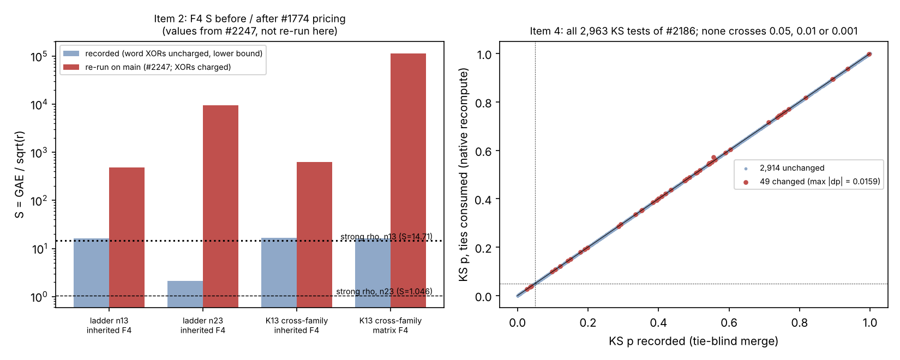

# Validation sweep D: known-issue re-checks (2026-10-19)

Scope: seven results already known or suspected to be wrong, and what each contaminates. This is an audit: it records verdicts and impacts and changes no research state. Machine-readable twin: [`verdicts.jsonl`](verdicts.jsonl) (one record per item: root_cause, affected_results[], severity, recommended_action). Graph: [`validation_D.svg`](validation_D.svg) / [`.png`](validation_D.png). No performance measurement, no leaderboard change, no `benchmarks/` entry.

## Summary

| # | item | verdict | severity |
|--:|:--|:--|:--|
| 1 | 48/168 replay mismatches | cause **not isolated**; narrowed (not #1774/#1862, not x86 micro-architecture, not F4 source drift); cross-ISA experiment not run | medium |
| 2 | F4 S before #1774 | no win claim found; two invalid readings (near-rho, F4-as-incumbent ranking); ranking vs rootfind reverses once priced | medium |
| 3 | `quartic_ic.rs` | 5 result/record groups built on it; 90/90 recoveries plausibly intact, `lin-equiv PASS`, S values and `resolved` status unverified; NG #2 owns the re-solve | medium |
| 4 | KS tie bug | 2,963 tests recomputed natively; 49 change (max \|dp\| 0.0159); no threshold crossing; #2206 not affected | low |
| 5 | #2236 synthetic study | labelled invented, not cited by anything | low |
| 6 | two N83 baselines | different quantities (different pipeline, K, charged phases, host, rho, draws) | low |
| 7 | verified=true, scalar=0 | no recorded result affected; bug only in unmerged review heads | low |

## 1. Root-finder replay mismatches

What the receipt shows (`research/ecbench_frontier_20261013/audits/rootfind-n13-replay-all-failed.json`): 120/168 identical, all 48 failures are inherited-F4 arms (`ic-f4-m2`, `ic-f4-m3`), reason "differs in phase counts"; session `ECBS1hfd5bf1885227`, archived on Apple M4 Pro (aarch64, macOS, rustc 1.93.1, commit `2245b75`); replayed on x86-64 Linux (rustc 1.97, binary `53654ef1…` built at `759978250`, dirty). Only `relations.solver_ops` differs (seq 58: 300,531 Apple vs 301,961 x86). The same-host audit is 168/168.

Established in this slice, in order of strength:

1. **Not #2247's change points.** `759978250` is not a descendant of `c8b1594f6` (#1774) nor `d1d034d94` (#1862) (`git merge-base --is-ancestor`), and `inherited_f4.rs`, `koblitz_groebner*.rs`, `pq_groebner_f2.rs` are identical between `2245b75` and `759978250`; the `ic_framework` diff adds a large-prime seam whose default wraps `decompose`. #2247 compares x86 against x86; this mismatch is Apple against x86. The m2 arm is also unchanged by #1862, and 24 of the 48 rows would be m2.
2. **Not x86 micro-architecture.** The F4/F5/F6 K13 session `ECBS1h2b56c13eeaec` was recorded on an Intel Xeon and replays 48/48 identical on the AMD EPYC auditor, inherited F4 included.
3. **Not within-host nondeterminism** (prior study `research/inherited_f4_replay_determinism_20261018`: threads, hash order/salt, BMI2 and scatter rewrite paths).

Open: an aarch64-only engine path, rustc 1.93.1 vs 1.97 std behaviour, macOS vs Linux, or an unrecorded dirty state of the Apple binary. I tried to separate toolchain from ISA with three builds (x86 on 1.97, aarch64 on 1.97 under qemu-user, x86 on 1.93.1). The session's disk allowance filled during the builds, so **no counter was measured**. Next step: those three builds on a host with room, one `ic-f4-m2` target-0 row each, compared with the archived 300,531 / 211,626 / 268,815.

Relation to #2247: independent causes, but they compound. Any replay-all of the archived F4 sessions on current `main` fails twice over, even on the recording host: m3 rows change (+7%, #1862) and priced F4 rows change charge (#1774). The F4 method identity is not versioned by ISA, toolchain or pricing rule.

Results using the affected counter (`solver_ops` of `ic-f4-*`): see `verdicts.jsonl` item 1. Not affected: root-finder and rho rows, recovered scalars, trial counts, charged GAE.

## 2. F4 S recorded before #1774

#1774 (2026-10-13) changed a full-name match to a prefix match, so the pinned 0.002304 GAE per word XOR is charged; earlier F4 `S` is a lower bound (`lower_bound: true`). Values from #2247, which re-ran the committed specs on `main` (not re-run here): ladder n13 F4 16.27 → 488.89, n23 2.134 → 9,479.7, K13 inherited F4 16.49 → 634.12, matrix F4 16.44 → 113,830.

Claim scan (own greps over `crypto`; the delegated citation sweep did not return, see Limits):

- **No sentence calls a pre-#1774 F4 S a win against rho.** Every table says "lower bound" and reads "IC loses", which is a valid use of a lower bound.
- **Invalid near-rho reading.** The ladder table and `docs/ic/LEADERBOARD.md` list F4 S/rho 1.105, 1.582, 2.091 (per-target minimum 0.720 at n13); `research/ecbench_frontier_20261013/README.md:26` calls inherited F4 the best Boolean arm at "1.136x setup-heavy strong rho at K13". Priced, n13 is about 22× (the ladder's own sensitivity row, 326.8 / 14.71) to 33× (#2247, 488.89 / 14.71) rho.
- **Invalid ranking.** The rootfind improve/parity loops and the PDP root-finder study took F4's lower bound (S 16.3, "best IC row") as the incumbent: "vs inherited-F4 in S: still higher", "1.744 (bounded; not a speedup)", pre-registered P2. With F4 priced (about 489–634 at K13) the complete-S pair-table root finder (28.4 at m=2) is roughly 17–22× cheaper than F4, so that ranking reverses. This is an inference from #2247's re-run values and the recorded root-finder S, not a new measurement.
- Generators and mirrors of the same wording: `docs/ic/progress-timeline.json` and `scripts/build_ic_leaderboard.py` (found by the late citation sweep, which hit its 300-entry cap and is not exhaustive). Fix them together with the leaderboard rows by regeneration.
- Already corrected in the paper: `frontier.tex:92` and `rootfinding.tex:207`.

Adjacent, not item 2: the parity loop's "rootfind S 15.552, 1.08× rho" is itself a lower bound (factor-base construction natives and inversions unpriced) and needs the §5a 0 / 0.1 / 1 GAE band before any near-rho wording.

## 3. Plane-quartic results

PR #2227 (open, not re-run here) reports that the degree-3 reduction in `research/ghs_cubic_quartic_ic_20261012/quartic_ic.rs` merges distinct classes (1, 7, 20 pairs on the three split GHS instances). Built on that file: the study's 90/90 recoveries and `--check-lin-equiv` PASS (its "cubic reduction smoke" ran with the faulty reduction), the three S values (650,896 / 2,751,663 / 37,920,188), the problem record `plane-quartic-jacobian-class-arithmetic-missing.md` marked `resolved (toy smokes)`, and four documents that cite 90/90. Recoveries are checked against the planted scalar through degree-6 orbit-pair keys, so correctness is plausibly intact; relation counts, S and the PASS are unverified. `src/bin/quartic_ic.rs` is a different file with the same name (bielliptic diagnostic) and is not affected. NG #2 is re-running the solves, so none were repeated here.

## 4. KS tie bug

The historical `ks()` advanced one sample per step, so ties were not consumed as one ECDF step. #2174's head already contains the repair and a test. Native recompute ([`ks_recompute/`](ks_recompute/): `ks_recompute.rs`, `run.sh`, `ks_recompute.tsv`) over the 16 `results.json` of `research/isogeny-class-rho/runs/run-20261018T0857Z` (#2186):

| quantity | value |
|:--|--:|
| KS tests | 2,963 |
| tie-blind replica vs recorded D and p | 0 mismatches (confirms the cause) |
| tests that change with ties consumed | 49 (generators 33, shift 13, class 3) |
| max \|ΔD\| / max \|Δp\| | 0.0010 / 0.0159 |
| crossings of p < 0.05, 0.01, 0.001 | 0, 0, 0 |

No decision or flag changes. #2242 carries the same 16 files and values. **#2206 is not affected**: its `volcano_tall_analyze.rs` has its own `ks()` that consumes ties (`a[i] <= x`) with a 4,000-permutation p-value, and the branch has no `isoclass_rho`. The asymptotic p-value stays an approximation for discrete counts, and the rank-test and covariance concerns of #2187 are untouched.

## 5. #2236 synthetic volcano study

Open (`needs-human`). Every artifact is labelled "Invented data"; no curve, isogeny or log is constructed; no ledger changes. Nothing cites it: its directory does not exist on `main`, and no hit in the three repositories or in other PRs. The delegated sweep's 124 hits concerned the real study `volcano_ecdlp_census_20261017` and bare "130410" digits. Residual risk is provenance (130,410 invented observations under `research/`, and a shared-renderer change `synthetic: true`).

## 6. Two N83 baselines

| | crypto 120 s | cryptanalysis 195.7 s |
|:--|:--|:--|
| what | mean cold process wall at K1104 (setup 48.7 + rank 71.3 + target 0.18 s); K1120 119.8 | `e2e_cold_mean` 195,694.6 ms of the **superseded** rank-cut row (rank stage 173,151 + cold 22,544 ms); current top row 166,005 ms |
| pipeline, K | dense-root/Gauss recipe, K1104–K1152, 183,264 usable points | S3 root index, K600, 99,600 points |
| charged phases | base and index construction included | base construction not charged (loaded from file) |
| host | GitHub-hosted AMD EPYC 7763, ≥4 CPUs | `runnervm8k3b6`, one pinned CPU, AMD EPYC 9V74 (replay: Xeon 8573C) |
| rho | same-point, online mean 2.164 s; implementation not named in RESULT/PROTOCOL | rT770 (tuned StrongRhoG fold, 64 lanes, DP 6): online 2.707 s, cold 2.980 s |
| draws | 5 sealed points (+K1152 A/A) | 20 points; 4 rank blocks × 600 attempts |
| IC / rho | 55.4–56.6 | 65.67 [55.38, 80.20] |

Neither number is a rho time and they are not comparable. A canonical row is IC #2's job.

## 7. verified=true with scalar=0

Per the #2250 description the bug lived in review heads of an unmerged PR and is repaired there with a monotonic session deadline and two regressions. The solver, `icx solve` and `gpu/certicom` are absent from all three `main` branches; the PR contains no recorded solve ("neither published challenge was solved"). No recorded result is affected. Not checked: the #968 commit history for a head with recorded runs.

## Method, delegation and limits

- Conductor: `conductor check` returned "Clear"; `coord_start_work` failed with an internal 500, so no task card was held. Edits are confined to `research/validation_sweep_20261019/D-known-issues/`.
- Haiku subagents ran four frozen grep cards. Two reports arrived (quartic dependents, synthetic/deadline citations) and were reviewed: their broad concept hits were narrowed by my own `rg` before use (the quartic scan listed 20 directories, only 5 groups depend on the file). The F4-citation and KS-user sweeps never delivered (lost to disk exhaustion). Items 2 and 4 therefore rest on my own greps and PR-branch inspection, and **KS and F4 users in `cryptanalysis` and `crypto-autoresearcher` were not completed**.
- Not independently checked: #2247's S values and bisect, #2227's 1/7/20 merged-pair counts, #2250's test results. Item 1's cross-ISA experiment was not run.
- Python is used only to lay out the graph and to build this PDF (`plot.py`, `build_pdf.py`); the KS recompute is native Rust.
- Fixes: none proposed as code. Item 1's cause is not certain; #2174 already holds the KS repair.
