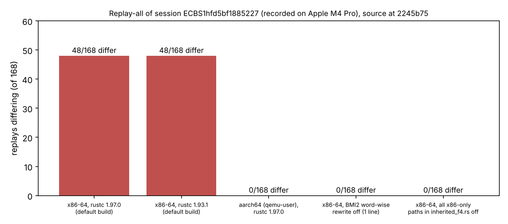

# Item 1 cross-ISA experiment: the 48 replay mismatches (2026-10-20)

Follow-up to `../REPORT.md` item 1. The question: why do 48 of 168 replays of session `ECBS1hfd5bf1885227` (recorded on Apple M4 Pro, aarch64) differ on an x86-64 Linux auditor, all of them `ic-f4-m2` / `ic-f4-m3` rows whose `relations.solver_ops` (word XORs) changed.

## Result

**Cause isolated: the x86-64-only BMI2 word-wise ("eager") rewrite in `inherited_f4.rs` charges a different word-XOR count than the portable bit-scatter path, and the method identity does not record which path ran.** Everything else tested is exonerated.

| build (all source at recorded commit `2245b75`) | host | replays differing | receipt |
|:--|:--|--:|:--|
| default, rustc 1.97.0 | x86-64 native | **48** (same 48 seqs as the original audit receipt) | `receipts/audit_x86_197.json` |
| default, rustc 1.93.1 (the recording toolchain) | x86-64 native | **48** (same set) | `receipts/audit_x86_193.json` |
| default, rustc 1.97.0, `--target aarch64-unknown-linux-gnu` | qemu-user 8.2.2 | **0** (168/168 reproduced) | `receipts/audit_a64_197.json` |
| x86-only `cfg` paths disabled in 5 files (`inherited_f4`, `koblitz_groebner`, `pq_groebner_f2`, `gf2_elim`, `semaev_decomp`) | x86-64 native | **0** | `receipts/audit_x86_off.json` |
| x86-only `cfg` paths disabled in `inherited_f4.rs` only | x86-64 native | **0** | `receipts/audit_bis1.json` |
| **one line**: `wordwise_rewrite()` returns `false` instead of `is_x86_feature_detected!("bmi2")` ([`bisect_bmi2_off.patch`](bisect_bmi2_off.patch)) | x86-64 native | **0** | `receipts/audit_bis2.json` |

What this rules out, by measurement: the compiler version (1.93.1 and 1.97.0 agree on x86), source drift since the archive (the archived commit itself reproduces the 48 on x86), #1774 and #1862 (neither is in this tree), and the other x86 `cfg` paths (popcnt, in the other four files). What it rules in: with the BMI2 branch off, x86 reproduces the Apple-recorded counts exactly, on all 168 replays.

Consistency check: the F4/F5/F6 K13 session recorded on an Intel Xeon replays 48/48 on an x86 auditor. Both sides used the BMI2 path, so there was no difference to see.

## Implication

The counted F4 word XORs depend on whether the CPU has BMI2 (`pext`/`pdep`), not on the method. A session recorded on aarch64 or on an x86 CPU without BMI2 will not replay on a BMI2 x86 host, and the reverse; the audit reports it as a failed replay even though both counts are valid for their path. Nothing here says which count is "right"; the two paths implement the same rewrite and differ in what they charge (the code charges "words read" and the span from the first nonzero word). The recorded S values are unaffected in kind but F4 `S` cannot be compared across ISAs without stating the path.

Recommended, not applied (code change, separate PR and owner): make the charge path-independent, or add the rewrite path (`wordwise`/`scatter`) to the F4 method identity and the host class, or let the audit compare F4 `solver_ops` only within one path. Do not use `KIC_F4_REWRITE=scatter` for replay: the harness refuses it (below).

## Method and caveats

- Source: `git archive 2245b75` of `Cargo.toml`, `Cargo.lock`, `src`, `benches`, the two `experiments/` bin directories and `docs` into a RAM disk (the container's disk allowance was full). Commands: `ecbench verify --dir research/ecbench_rootfind_engine_20261012/sessions/claim-n13 --replay-all --out ...`, release builds, one at a time.
- The session directory was read, never modified. Builds and receipts live outside it; receipts are in `receipts/`, build and audit logs in `logs/`.
- The aarch64 binary is built with `--no-default-features` (the default `redis-native-tls` feature needs OpenSSL for aarch64 and is unrelated to F4). It runs under qemu-user emulation, not on aarch64 hardware. That it reproduces the Apple M4 Pro counts is the evidence the emulated path matches real aarch64.
- Bisect variants 4 and 5 were made by `sed` of `target_arch = "x86_64"` to a never-true name (variant 4 in the five files, variant 5 in `inherited_f4.rs`), not saved as patches; variant 6 is the one-line patch above. All were in a scratch copy; no repository source changed.
- `receipts/audit_x86_197_scatter.json` (96 failures) is **invalid as an experiment**: the harness refuses to replay with `KIC_F4_REWRITE` set ("it would change the search without changing the method's identity"), so every F4 arm failed to run. The 96 are 48 real mismatches plus 48 refusals.
- One x86 host (this container) and one recorded session; the Intel-recorded check above is the only other. Timing was not measured: this is a counted-work reproducibility result, not a speed claim, so no `benchmarks/` entry and no leaderboard change.
- Binary hashes: default x86 1.97 `460de8e4…`, x86 1.93.1 `1c37b266…`, aarch64 `95af1fff…`, BMI2-off `36c3b87c…`.
