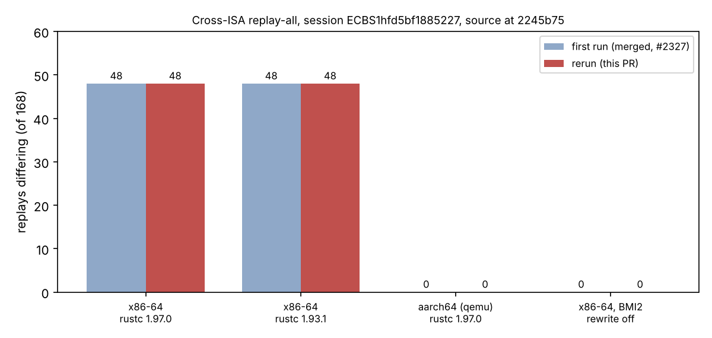

# Item 1 cross-ISA experiment: independent rerun (2026-10-20)

Replication of [`../item1_cross_isa_20261020/RESULT.md`](../item1_cross_isa_20261020/RESULT.md), requested by the owner. Same method, fresh container, fresh toolchains and fresh builds of the recorded commit `2245b75`; nothing reused from the first run except the committed receipts it is compared to.

## Result

**The first run reproduces exactly.** For all four builds the rerun's failing set is identical to the committed receipt, compared per sequence number over all 168 replays and per problem string.

| build | first run | rerun | per-seq outcome identical |
|:--|--:|--:|:--|
| x86-64, rustc 1.97.0 | 48 differ | 48 differ | yes (168/168 positions) |
| x86-64, rustc 1.93.1 | 48 differ | 48 differ | yes |
| aarch64 under qemu-user, rustc 1.97.0 | 0 | 0 | yes |
| x86-64, one-line patch: BMI2 word-wise rewrite off | 0 | 0 | yes |

So the conclusion of the first run stands: the 48 mismatches are produced by the x86-64-only BMI2 word-wise rewrite in `inherited_f4.rs`; with it off, an x86 build reproduces the Apple M4 Pro counts on all 168 replays, as the aarch64 build does.

## What is and is not independent

- Independent: container, rustup toolchains (re-downloaded), qemu-user and cross gcc (re-installed), builds, audits. The rerun was made by the same agent that ran the first, so it is a replication, not a second author's check.
- Not independent: the same recorded session, the same x86 host class (a cloud VM; the receipts' env-class ids show it), and the same method of switching the BMI2 branch off (one line, [patch](../item1_cross_isa_20261020/bisect_bmi2_off.patch)). The aarch64 build still runs under emulation, not on hardware.
- Binary hashes differ from the first run (`logs/binary_sha256.txt` against the first run's) because the build directory is embedded in the binaries (`/dev/shm/y` against `/dev/shm/x`); the audit outcomes do not.
- Not repeated: the "five files off" and "only `inherited_f4.rs` x86 paths off" builds (the one-line patch subsumes them) and the invalid scatter-env run.
- Counted-work reproducibility, not a speed claim: no `benchmarks/` entry, no leaderboard change. The session directory was only read.

Receipts: `receipts/audit_*.json`; logs: `logs/`.
