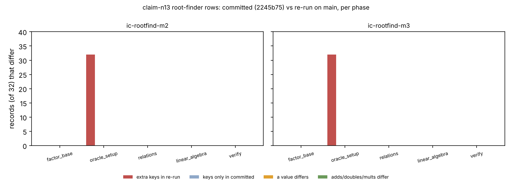

# claim-n13 root-finder replay drift: two counters added after the recording (2026-10-26)

Follow-up to item 1 of [`../REPORT.md`](../REPORT.md) and to the second drift
recorded in `problems/ecbench-claim-n13-replay-accounting-version-drift.md`.
Counted work only: no wall-time claim, no method comparison, no leaderboard or
`benchmarks/` change.

## Result

**The 48 root-finder failures are two added counters, nothing else.** The
committed session `claim-n13` (recorded 2026-10-13 03:42 UTC at `2245b75`) and
a re-run of the same spec on current code agree on every counted quantity of
every root-finder record. The re-run's `oracle_setup` phase carries two native
counters the committed records do not have, `pair_table_kind` and
`pair_table_points`, and the audit compares the native-count map exactly, so
it reports `differs in phase counts`.

| quantity, over the 64 `ic-rootfind-m2/m3` records (32 per arm) | records that differ |
|:--|--:|
| extra native keys in the re-run, `oracle_setup` phase | **64** (`pair_table_kind`, `pair_table_points`) |
| native keys only in the committed record | 0 |
| native keys present on both sides with a different value | 0 |
| `adds`, `doubles` or `scalar_mults` of any phase | 0 |

The other four phases (`factor_base`, `relations`, `linear_algebra`, `verify`)
are identical in every record ([`compare_native.out`](compare_native.out): ten
patterns of 32 record-phase pairs, one of them the `oracle_setup` addition).

**Cause.** Commit `c8bd952c4` (2026-10-13 17:52 PDT, "ecbench rootfind parity
cycle-1: negation-folded PairTable engines") makes `pdp3_koblitz.rs` insert
`pair_table_kind` (0 = full `PairSumTable`, 1 = negation-folded `PairTable`)
and `pair_table_points`. It landed about 21 hours after the session was
recorded. `full_price.rs` classes both under "counts of outcomes or of work
already charged as additions", so they add no cost of their own; the
re-run's `adds`, `doubles` and `scalar_mults` equal the recording's in every
phase, which is the measured form of the same fact.

**What this is not.** It is not the inherited-F4 accounting drift (a different
mechanism, version 1 against 2 of the specialisation accounting) and not the
pricing change that moves the F4 and K13 `total_gae`.

## Method

1. Build `ecbench` from the working tree (main plus the merged accounting-
   version change); binary SHA-256 `40106995f3520ed4…`.
2. `ecbench run --spec docs/ecbench/specs/claim-koblitz-rootfind-n13.json --out
   <scratch> --cpus none --allow-busy`: session `ECBS1h5f4e1659d690`, 224/224
   records verified, same `spec_sha256` and `plan_sha256` as the committed
   session, so all 224 sequence numbers pair with the same arm, workload and
   round.
3. [`compare_native.sh`](compare_native.sh) (jq) compares every `ic-rootfind`
   record phase by phase.

Run after a resume checkpoint was pushed (`checkpoint.sh gate` passing). Host:
x86-64 Intel Xeon @ 2.10 GHz, Linux, isolation L0 (operation counts only).

## Limits

- The comparison is a re-run paired by sequence number, not the audit's own
  replay. It matches the audit's reported cause by reading `audit.rs` (its
  `ints` closure compares `(name, adds, doubles, scalar_mults, native)` exactly);
  I did not instrument the audit.
- One session, one host. The re-run session (1.5 MB) is not committed: it adds
  nothing the `jq` output and the spec do not reproduce, and ecbench CI would
  re-audit it.
- The F4 rows of the same re-run were not analysed here.
- **Other sessions are not enumerated.** Any committed session recorded before
  `c8bd952c4` with a PairTable-based root-finder arm should fail the same way
  on `main`; a first scan over-matched (it also catches engines that never emit
  these counters), so no count is claimed.

## What would fix it (not applied)

The audit already has a rule for a block that older records lack: `field_ops`
is compared "only when both the record and the replay carry it". Applying the
same rule to native counters present on one side only would stop an additive
counter from invalidating older records, at the price of a weaker meaning of
"identical" for native maps. That changes what an audit certifies, so it is an
owner decision and not made here. The alternative is a convention that a new
native counter on a recorded phase needs a replay-compatibility plan.
