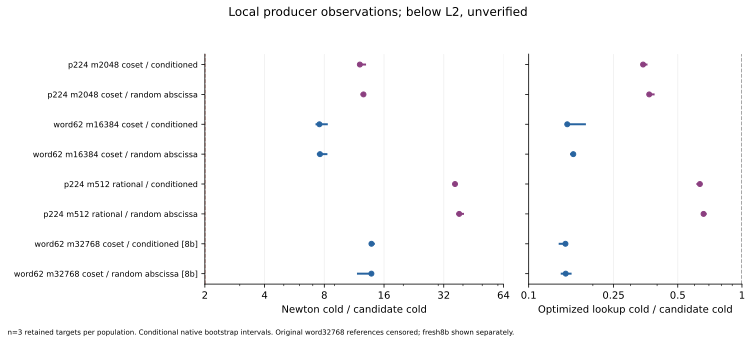

# Vieta Rust native NTT and quadratic-fiber results

Producer observations, **unverified**: PCC-20261117-b4ee50. Full cold means fresh
native field setup, certified descriptor, complete point factor base, required
lookup index, and one relation query. Query clocks/counters remain separate.
No process launch, target fixture/oracle preparation, canonical output encoding,
or independent scalar replay is charged to these worker clocks.

The explicit fast arm combines native Montgomery fields, single-field NTT128,
the unchanged half-GCD algorithm, and closed linear/quadratic roots. Schoolbook,
Euclid/Newton and field-only/NTT-only references are preserved. The optimized
lookup reference uses exactly the candidate's construction flags; setup
primitive counters match in all40 input comparisons including warmups.

## Frozen observations

[pcc:unverified] These are paired medians and conditional native bootstrap
intervals from the frozen Rust analyzer, with three retained targets per
population/configuration. Populations/cohorts are separate. The original
192-call cohort is **inconclusive as a whole**:176 calls replayed and16 reference
calls at word32768 exceeded the fixed4b multiplication cap. All failures remain.
A separately preregistered fresh8b word32768 cohort completed/replayed all48
calls. The old calls were not replaced. Both cohorts pass their A/A and positive
control groups; the fresh cohort meets its frozen local engineering criterion.

| Workload / population | Cohort | n | Newton cold s | Candidate cold s | Paired ratio | Conditional95% | Lookup cold s |
|---|---|---:|---:|---:|---:|---|---:|
| p224 m2048 coset / conditioned | Original4b | 3 | 9.7343 | 0.8055 | 12.09x | [12.08, 12.84] | 0.2770 |
| p224 m2048 coset / random abscissa | Original4b | 3 | 9.7582 | 0.7741 | 12.61x | [12.32, 12.70] | 0.2845 |
| word62 m16384 coset / conditioned | Original4b | 3 | 5.3044 | 0.6830 | 7.56x | [7.31, 8.24] | 0.1099 |
| word62 m16384 coset / random abscissa | Original4b | 3 | 5.3917 | 0.6941 | 7.61x | [7.42, 8.20] | 0.1126 |
| word62 m32768 coset / conditioned | Original4b | 3 | censored | 1.4371 | censored | unavailable | 0.2232 |
| word62 m32768 coset / random abscissa | Original4b | 3 | censored | 1.5034 | censored | unavailable | 0.2370 |
| p224 m512 rational / conditioned | Original4b | 3 | 11.2796 | 0.3109 | 36.47x | [36.03, 36.66] | 0.1954 |
| p224 m512 rational / random abscissa | Original4b | 3 | 11.5918 | 0.3006 | 38.28x | [37.50, 40.00] | 0.1983 |
| word62 m32768 coset / conditioned | Fresh8b | 3 | 20.4201 | 1.4677 | 13.83x | [13.78, 14.21] | 0.2159 |
| word62 m32768 coset / random abscissa | Fresh8b | 3 | 20.2707 | 1.5344 | 13.82x | [11.82, 13.99] | 0.2193 |



Optimized lookup has lower full cold cost in every reported subgroup. These
relative gains are over the Euclid/Newton reference. The clocks remain below L2;
there is no signed independent standing or fastest-external-tool claim.

## What changed and why

Field-only calibration missed the word goal (about1.15–1.25x) while substantially
improving P224 cosets. NTT polynomial products made recursive half-GCD effective
on the word workload. Rational construction still used generic polynomial
factoring for every quadratic fiber; exact discriminant roots remove that
cost while retaining coprimality, poles, every sibling, and exact full-splitting
checks. Repeated roots are deduplicated and therefore fail a required separable
fiber-size certificate. Higher-degree fibers retain the generic finder.

NTT acceleration requires the tested primes' large power-of-two roots. Root
order is checked, twiddle/root setup is counted per Arithmetic stage, and no
global cache amortizes construction. Native field constructor internals are
inside cold clocks but unpriced in evaluator counters: fast **full cold counted
cost is incomplete**, so it is never asserted. Query counters describe evaluator
primitive operations, including NTT setup. Failed transform-prefix counts may
be incomplete when a local limit interrupts the hook; failures are never wins.

## Validation and scope

- Independent algorithmic oracle: original BigUint scalar complete-set replay;
  its implementation/execution are producer-owned and unsigned.
- Native scale core15 tests; adapter/NTT7 and worker2 groups; strict Clippy.
  Exhaustive quadratics over5,7,17,19 include repeated/nonsplit/zero cases.
- Original and repaired primary exports retained. Original metadata mislabeled
  terminal failed processes; canonical completed includes failed. The repaired
  export passes file checks, with every raw status/metric/seed/hash unchanged.
- Every cohort has a canonical file-checked export, including exploratory
  profiling. Profiling warned about timer undercoverage and supports no precise
  CPU attribution or throughput comparison.
- Root library attempt reached its180s cap and emitted unchanged-main
  hashed-ecdl-tensor::metrics errors; no full-root-suite pass is claimed.
- Word62 is a synthetic prime-field curve workload without a prime-order
  subgroup assertion. P224 is the standard-curve fixture. Rational benchmarks
  use fully certified Mobius conjugates of squaring; this is not the cost of
  finding auxiliary isogenies.
- The general last-fall-degree argument and arbitrary-depth formal normal-form
  instantiation remain unverified. These measurements do not establish them.
- Local/Git-only evidence, zero paid/cloud experiments, no local S3 operation,
  no protected benchmark-index/leaderboard promotion or availability assertion.

## Reproduce/check

Source for the first cohort:149fd91f33844390511f6310a21ffa50ad607542;
source for the new8b cohort:2595478e2ac478055c7526f19af6dfc1fe604f8f.
`evidence/budget-source-equivalence.json` shows the only worker change is the
operation cap; core, adapter and frozen analyzer are unchanged.

```sh
cargo test --release --locked --manifest-path research/vieta_coset_rust_20261115/speedup-20261117/fiber-budget/Cargo.toml
cargo build --release --locked --manifest-path research/vieta_coset_rust_20261115/speedup-20261117/fiber-budget/Cargo.toml
research/vieta_coset_rust_20261115/speedup-20261117/fiber-budget/target/release/vieta-fiber-budget-lab replay research/vieta_coset_rust_20261115/speedup-20261117/runs/primary-budget8b/0-word62-coset-m32768
```

These commands test/replay saved evidence. Any new measurement needs its own
frozen protocol and new output directory. See [FIBER_PLAN.md](FIBER_PLAN.md),
[TRANSFORM_PLAN.md](TRANSFORM_PLAN.md), [protocol-primary-v2.json](protocol-primary-v2.json),
[protocol-budget8b.json](protocol-budget8b.json), the registration addenda and
[evidence/control-audit.json](evidence/control-audit.json). The control auditor
was authored after data solely to check stored frozen statistics; it is not an
independent validator or a replacement analysis.
