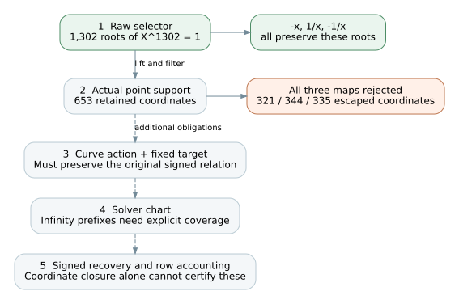
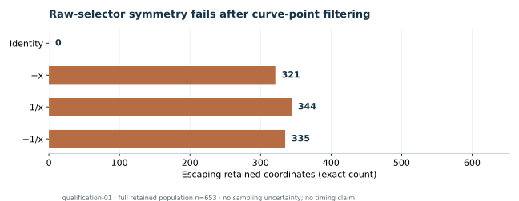

# Vitse techniques and the ordinary Prime31 target

**Compatibility audit and reusable Rust checker — 23 November 2026**

[PR #5016](https://github.com/isogeny-labs/crypto/pull/5016) · [Native protocol](PROTOCOL.md) · [Mathematical review](MATHEMATICAL_REVIEW.md) · [Formalization map](FORMALIZATION.md)

## 1. Result and decision

The new Rust audit connects an exact finite-domain checker to the existing production Kummer selector, curve operations and S3 evaluator. On the fixed ordinary Prime31 curve, the complete selector X^1302=1 contains 1,302 field roots. Exactly 653 coordinates lift to rational points and pass the recorded subgroup filter. Coordinate negation, reciprocal and negative reciprocal preserve the raw selector, but each fails to preserve this actual point support. A separate valid fixed-target relation also fails S3 after each of those three coordinate transformations. These are source-bound native development observations. [pcc:unverified]

The existing extension-field Vitse machinery is substantial: the one-2-torsion, characteristic-two, full-2-torsion and Edwards reductions have implementations and complete small pipeline paths. The Prime31 decision is therefore an applicability issue. Neither a symmetric scalar selector nor an auxiliary isogeny construction supplies a compatible torsion action on this particular target curve. The coverage table below preserves the difference between existing implementation and new execution. [pcc:unverified]

The immediately supported reductions are ordinary point-negation column handling and exchange of equivalent leaves at the correct stage. For the present finite prefix chart, swapping the first two leaves is safe when their domains match. A full leaf-permutation quotient needs explicit handling of infinity partial sums; equal selectors alone do not provide that guarantee. No candidate coordinate map is promoted to a solver symmetry by this checker. [pcc:unverified]

Native observations: [PCC-20261123-5d6948](../../pcc/claims/PCC-20261123-5d6948.json), standing **unverified**, with no signed verdict. Same-team code review and native checks do not supply independent scientific verification. The source inventory has separate statement [PCC-20261123-8342e3](../../pcc/claims/PCC-20261123-8342e3.json), and identity evaluation has [PCC-20261123-894c19](../../pcc/claims/PCC-20261123-894c19.json). [pcc:unverified]



## 2. Fixed instance and exhaustive selector audit

The audit uses the inherited ordinary curve and its recorded generator. It introduces no replacement curve or alternate ECDLP task.

| Quantity | Fixed value |
|---|---|
| Field modulus p | 2,147,483,647 |
| Curve equation | y^2 = x^3 + 847,514,846 x + 2,087,444,724 |
| Recorded order n | 2,147,446,831 |
| Generator G | (625,037,715; 2,100,627,251) |
| Selector | X^1302 - 1; Kummer degrees [2,3,7,31], g=1 |
| Construction seed | 20,261,123 |
| Source baseline | 7d61e3b45de6e93d235345a0061dae08db1f8b44 |

The driver checks p and n with the existing bounded-u64 primality routine, curve nonsingularity, G on the curve, G nonidentity and nG=O. It also checks 46341^2>p and p+1+2*46341<2n. Together with the standard Hasse bound, these conditions admit group order n: a nonidentity point killed by prime n has order n, the curve order is a positive multiple of n, and the upper bound is below 2n. This is an arithmetic admission check using the reused implementation, with no independently signed point-count certificate. [pcc:unverified]

The production constructor supplies 1,302 distinct roots; every root is checked against X^1302=1 and the original tower verifier. A degree-1,302 polynomial cannot have more distinct roots, so the supplied root list is complete. Each coordinate is then lifted with the production square-root routine and tested on the original curve and subgroup. The output retains all 1,302 roots, all 653 retained coordinates and point representatives, all 649 nonresidue coordinates, and zero subgroup rejections. Both signs of every retained point are checked. [pcc:unverified]

| Map in ordinary x | Raw selector closed? | Retained support closed? | Retained escaping coordinates | First escape |
|---|---|---|---:|---|
| Identity | Yes | Yes | 0 | None |
| -x | Yes | No | 321 | 1 -> 2,147,483,646 |
| 1/x | Yes | No | 344 | 2 -> 1,073,741,824 |
| -1/x | Yes | No | 335 | 1 -> 2,147,483,646 |

All four maps have zero poles on this nonzero selector. The counts are directly recorded native outputs, not statistical estimates. The population is the entire fixed 653-coordinate retained support. Every escaping image is retained in the [raw JSONL](evidence/qualification-01/prime31-audit/stdout.txt), not just the first witness. [pcc:unverified]



This rejects these maps as actions on the full retained factor-base support. It does not assert that no smaller invariant subset exists, that a different coordinate model is impossible, or that an accidentally small relation set cannot have additional symmetry. Those are different questions.

## 3. Fixed target and finite-chart controls

The fixed public relation control is R=G, P=2G, Q=-G. Production arithmetic gives P=(1,923,055,775; 307,731,458), Q=(625,037,715; 46,856,396), and P+Q=R. The original and leaf-swapped S3 residuals are zero. The target coordinate remains fixed throughout the map comparison. This control is not presented as a decomposition over the audited selector. [pcc:unverified]

| Coordinate map applied to both leaves | S3 residual modulo p |
|---|---:|
| Identity | 0 |
| -x | 1,117,560,836 |
| 1/x | 1,070,912,494 |
| -1/x | 32,387,107 |

The three nonzero residuals reject the transformed tuples as S3 solutions for this same public target. Ordinary point negation behaves differently: it keeps x(P) unchanged and changes the signed total R to -R. The coordinate solver's x(R)=x(-R) ambiguity must still be resolved by exact signed point replay. [pcc:unverified]

The chart control compares (G,G,-G,G) with (G,-G,G,G). Their totals are both 2G. The first ordering has represented intermediate prefixes 2G and G; the second has O and G. Thus the second ordering leaves the existing affine intermediate chart even though the abstract sum is unchanged. The first-two-leaf swap preserves both prefixes. The separate P=2G, Q=-G control exercises a nontrivial two-leaf S3 swap. These are explicit group/chart fixtures, not extracted selector-constrained four-summand solutions. [pcc:unverified]

The [mathematical review](MATHEMATICAL_REVIEW.md) separates selector closure, point action, fixed-target stabilization, chart preservation and final signed-row handling. For the restricted action P'_i = epsilon P_pi(i) + T_i with a common sign epsilon, the target condition is sum T_i=(1-epsilon)R. This is a sufficient contract for that class of actions, not a classification of all possible symmetries. Its present formalization status is recorded separately. [pcc:unverified]

## 4. Technique coverage from the supplied talk

The reference is Vanessa Vitse's DLP 2014 talk, supplied as a 110-page PDF with overlays and 37 printed slides. The [author's copy](https://www-fourier.univ-grenoble-alpes.fr/~viva/research/talks/Vitse_talk_DLP14.pdf) and [FHJRV 2014 paper](https://www.iacr.org/archive/eurocrypt2014/84410158/84410158.pdf) are the primary references. Coverage below is a bounded source audit, not a new execution of every implementation. [pcc:unverified]

| Technique | Existing implementation and exact scope | Prime31 applicability |
|---|---|---|
| General summation polynomials, symmetric coordinates and Weil restriction | Existing Semaev modules, symmetric builders and extension-field pipelines. | Ordinary S3 and equal-leaf symmetry apply; the extension-field subfield factor base is not a nontrivial restriction at extension degree one. |
| Arbitrary coordinate map phi and generic P_phi,m construction | Bounded coordinate search, quotient/descent work and particular constructions exist. No complete arbitrary-phi compiler was located in the inspected scope. | Partial infrastructure; requires its own action, inverse and exceptional-chart evidence. |
| One rational 2-torsion point, odd characteristic | gaudry_quartic_d4.rs implements the adapted coordinate, even-sign/permutation invariants, Weil system, lifting and decomposition path. | The torsion prerequisite fails on the admitted odd-prime-cardinality curve. |
| Characteristic-two additive-coordinate reduction | gaudry_quartic_bin.rs implements t -> t+1, invariant construction and complete small pipeline paths. | Different characteristic; does not transfer to this odd-prime target. |
| Full rational E[2] and the Klein action | klein_v4.rs and quartic_folds.rs implement adapted z -> -z, 1/z, -1/z invariants and relation-pipeline components. | Needs actual full rational 2-torsion and the specified coordinate model. Raw x-selector closure is insufficient. |
| Edwards / Joux-Vitse symmetry and lifting | jv_quintic_edwards.rs and joux_vitse_edwards.rs include extension-field decomposition, trace replay and signed-row recovery. | These are curve/model-specific extension-field implementations, not an automatic Prime31 reduction. |
| Exact high-arity P_phi,8 | Lower-arity and specialized higher-Semaev support exists; a general exact P_phi,8 implementation was not located. | Open implementation item, with no claimed Prime31 benefit established here. |
| Cartier and general higher-torsion routes | A concrete order-three equivariant-coordinate study exists; no complete generic Cartier/higher-torsion relation pipeline was located. | Higher rational torsion still requires compatible target-group structure; bounded source absence is not a theorem of impossibility. |

The implementation names above refer to the pinned [crypto source directory](https://github.com/isogeny-labs/crypto/tree/7d61e3b45de6e93d235345a0061dae08db1f8b44/src/cryptanalysis). Source audit evidence spans crypto, ml-cryptanalysis, cryptanalysis and crypto-autoresearcher; the separate [coverage inventory](COVERAGE.md) gives exact revisions, files and search limits. [pcc:unverified]

The full-E[2] mechanism must not be confused with a single cyclic order-four point. The ordinary Prime31 group is admitted here as odd prime cardinality, excluding nontrivial small rational torsion. A same-field isogenous curve has the same rational point count; an auxiliary curve used only to generate coordinate values is a different group and does not provide an induced target-curve action. [pcc:unverified]

## 5. New component and how to use it

[compatibility.rs](compatibility.rs) implements a reusable, standard-library-only finite-domain checker for the fixed Prime31 field. Its public Mobius constructor requires canonical coefficients and nonzero determinant. It reports genuine poles, every escaped image, set closure and nonvacuous bijection. Retained coordinates must belong to the supplied raw selector. Duplicate or noncanonical coordinates and malformed permutations are rejected. Empty domains are explicitly vacuous. [pcc:unverified]

The intended call site is immediately after an existing implementation has produced the full selector roots and the distinct coordinates remaining after its point and subgroup filters. Use the same coordinate chart for both lists and the proposed map. For example:

```rust
let report = audit_selector_support(
    &selector_roots,
    &retained_abscissae,
    Mobius::coordinate_negation(),
)?;
```

For leaf domains, the permutation convention is explicit: output slot j receives the old value from source_for_destination[j]. Equality is checked as sets, not by cardinality or enumeration order.

```rust
let report = audit_leaf_permutation(
    &[&leaf0, &leaf1, &leaf2, &leaf3],
    &[1, 0, 2, 3],
)?;
```

Every result carries EvidenceScope::FiniteCoordinateSetsOnly. In particular, both_nonvacuously_closed does not authorize quotienting the solver equations. It does not certify root-list completeness, an upstream filter, a curve action, nonradical ideal invariance, fixed-target preservation, chain reconstruction, or a cost advantage. The source-bound driver separately supplies completeness and lifting evidence for the one fixed selector audited here.

The new component and native bridge live in this study directory. This PR adds no production solver rewrite or automatic quotient selection. The appropriate next integration is to invoke the guard in a candidate-action admission path, preserving the original signed replay and treating geometric/chart obligations as separate requirements.

## 6. Validation, evidence and reproducibility

The 17 contract tests passed and the fixed native audit completed with exit code zero. After supplying the exact baseline cfg(test) fixture, a separate offline standalone run also passed all 22 existing identity-certificate and SHA tests; the original production modules and earlier evidence were unchanged. Each qualification records unchanged source and executable hashes before and after its own execution. The tests cover real public B8 inputs, singular maps, noncanonical values, duplicate coordinates, poles, raw-versus-retained closure, unequal leaf sets, permutation validity, and empty-domain behavior. B8 is explicitly not asserted to be a complete production factor base. [pcc:unverified]

Qualification reuses the exact production pkm_smooth_tower.rs prefix ending at byte 41,436. The full source Git blob is 9a801f27ae779cd35a6ee21a80252922324a9089. Full-file SHA-256 is 7578526c9900abbea37c040b5459b2e72331c65c9b81621d7a897cb0860d3d5f; selected-prefix SHA-256 is 9fd8351cb748331dfbb09592c1ce36fe3d72fbefd2bb21440c1110ba71705e33. No field formula, curve law, Kummer constructor or S3 evaluator was rewritten. [pcc:unverified]

The toolchain was official rustc 1.100.0, commit 0ef1bc386059596dada8fb65b50425aab2ea637a, on x86_64 Linux. Official component archives were checked against their manifest digests and installed only in task scratch. The shared development container provides correctness observations, not controlled performance measurements. Native test duration text is retained verbatim and is not used as a benchmark. [pcc:unverified]

The [qualification receipt](evidence/qualification-receipt.json) links protocol, source inventory, build requests/results, immutable pre-call manifests, raw outputs and post-call manifests. Frozen executables were retained locally with their hashes; binary bytes are not committed. The [identity evidence addendum](IDENTITY_EVIDENCE.md) binds the S3 sign-difference derivation to certificate IDC1h095fa9aa1df01499: 32 issuer evaluations and a separate process with 32 extra evaluations accepted; wrong-sign, underdeclared-degree and digest-mutation controls were rejected. Its field is F_(2^61-1), its proof field is null, and it is same-team finite-evaluation evidence rather than a formal Prime31 or integer-polynomial proof. [pcc:unverified] Formal source inheritance and the still-missing concrete Lean bridges are documented in FORMALIZATION.md.

```sh
python3 research/vitse_prime31_compatibility_20261123/qualify.py \
  --source src/cryptanalysis/pkm_smooth_tower.rs \
  --rustc /absolute/path/to/rustc \
  --attempt fresh-replay
```

Run from the pinned repository snapshot. The runner refuses a different production blob, an existing attempt directory, an ambiguous extraction marker, or a changed source/executable. Python performs source/file metadata and process orchestration only; all field, curve, selector and compatibility calculations run in Rust.

The full root-library gate failed at compilation. Earlier attempts retained a cold timeout, a repaired sparse-checkout omission and an EFD parser failure. After main repaired the EFD source, attempt 04 ran the original locked/default-feature command at exact revision 71408278. It exited 101 with Rust E0428: src/cryptanalysis/prime_radical_root.rs defines the test module round73_mersenne_single_fold twice. No root tests executed. The unchanged-source receipts and unsigned statement PCC-20261123-fb8892 are linked in [ROOT_GATE.md](ROOT_GATE.md). This existing production test-module defect is separate from the passing isolated checks. [pcc:unverified]

Integration preserves main 71408278's concurrent work and complete PCC ledger prefix, with the original local registrations archived and mapped to new append-only envelopes. Selected production PKM, identity, SHA and selector source blobs match the frozen audit baseline. Other library source changed; the source inventory keeps its stated audit revisions, and the current-main gate has its own outcome. [pcc:unverified] PR checks, review and merge status remain on PR #5016; merging does not confer independent scientific standing.

## 7. Remaining work and acceptance conditions

| Obligation | Current scope/status | Concrete next condition |
|---|---|---|
| Finite selector and support compatibility | Implemented and natively exercised at fixed Prime31 | Reuse it at a candidate-action boundary with the actual chart and retained lists. |
| Fixed-target and infinity-chart discipline | Explicit public rejection controls and source derivations | Any broader quotient must supply target stabilization, complete chart transport and signed replay. |
| All techniques from the talk | Central specialized implementations present; general compiler and selected higher-arity/torsion routes partial or missing in the audited scope | Implement a separately justified route with its complete prerequisites and extraction contract. |
| Full-library gate | Current checked main fails on a duplicate root-finding test module; see ROOT_GATE.md | Repair the duplicate through its owner, then complete the original locked/default-feature gate on the review head. |
| Lean and independent scientific standing | Inheritance mapped; no new task-local Lean build or signed verdict | Materialize pinned shared dependencies and bind actual Rust/field/point/chart semantics before claiming formal coverage. |
| Performance | Not measured in this audit | A new, admitted matched experiment with complete setup, extraction and recovery accounting. |

No new performance value is supplied to the scoreboard, leaderboard or progress timeline. Their numeric views remain outside this change. The report adds a compatibility diagram and a graph of exhaustive fixed-set observations; it makes no asymptotic or total-cost claim. [pcc:unverified]

Coordination fallback: Conductor and the research-KB executable were unavailable. The session used live AGENTS.md, ACTIVE.md, the newest session log, immutable source reads, the supplied talk and primary paper. The draft PR was opened before implementation. The root gate used a separate exact-revision checkout; the stale preexisting checkout was not treated as current or modified.
