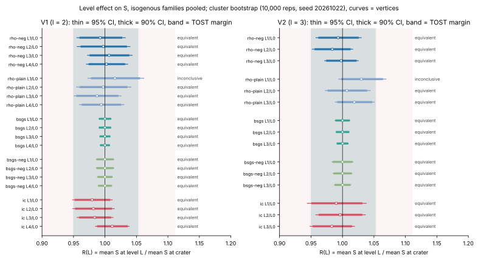
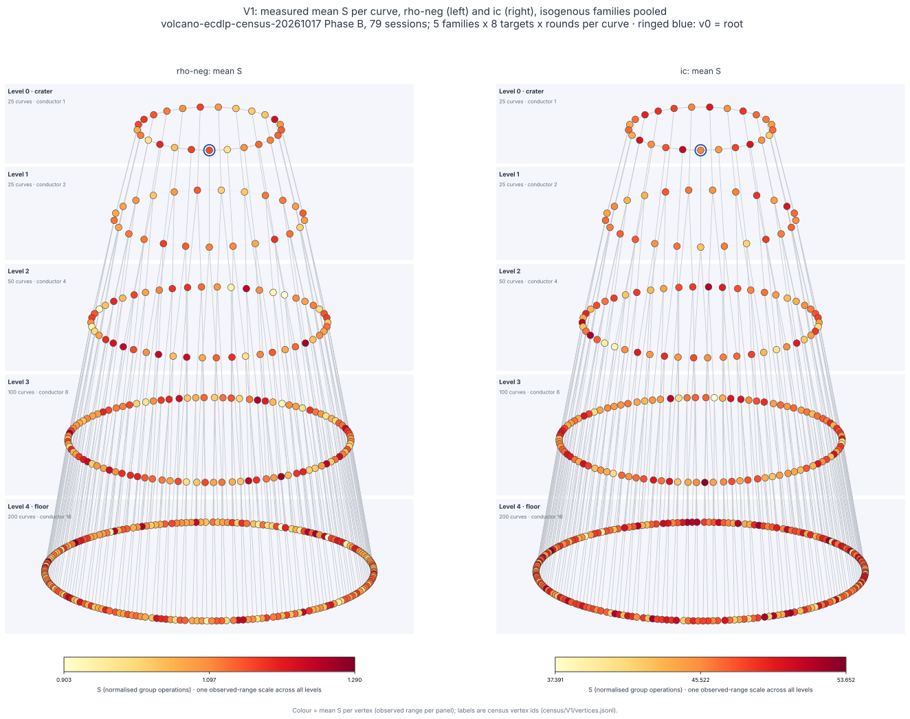
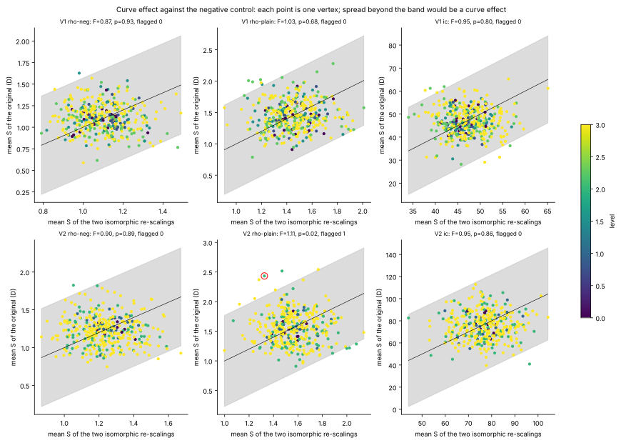
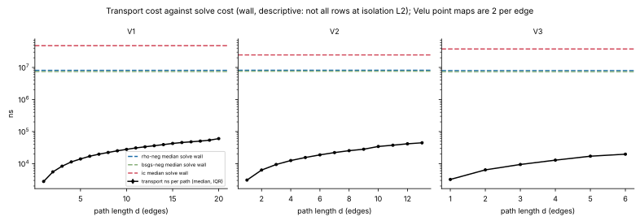
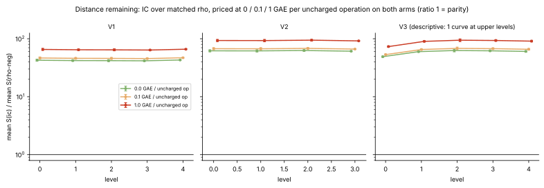
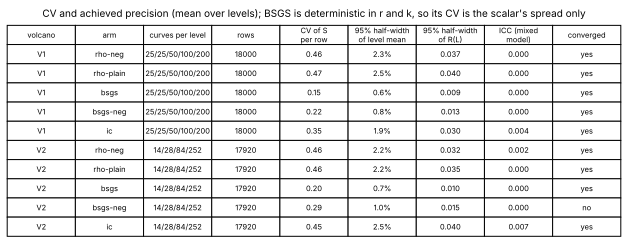

# Volcano ECDLP census, Phase C: analysis and report

Study `research/volcano_ecdlp_census_20261017/`; plan `PLAN.md`, analysis plan `ANALYSIS_PLAN.md` (frozen after data collection and before inspection), amendments `AMENDMENTS.md` (A1, A2). Every number below is read from `analysis/results.json` (written by `analysis/analyze.py`, 10,000 bootstrap or permutation replicates, seeds 20261022 and 20261023). **Status: observed, not established.** No speedup is claimed. Independent validation (`VALIDATION.json`) has not happened yet; this report is the analysis, not its validation.

## 1. Verdicts

1. **Positive control first (gates everything): PASS.** On the V3 (j = 0) crater, mean S(`rho-cubic`) / mean S(`rho-neg`) = **0.5733**, 95% CI [0.5619, 0.5850] over 4000 paired runs (theory 1/sqrt(3) = 0.5774; pass needs the CI upper bound below 0.85). The detector sees a 42% cost reduction, so the 'equivalent' verdicts below are informative, not relabelled 'uninformative'.
2. **Level effect (V1, V2; 5 arms; 35 level ratios): 33 equivalent, 0 different, 2 inconclusive.** TOST margins are +-5% for rho and BSGS and +-10% for IC. The two inconclusive ratios are both `rho-plain` at level 1 (CI not inside the margin; neither differs from 1 after Holm). No method shows a level effect on either volcano. With one volcano per l, this is an observed absence of an effect at these margins, not an established one (PLAN §5: replication on a second volcano of the same l is missing).
3. **Curve effect against the isomorphic negative control:** no variance-ratio test survives Holm (smallest adjusted p = 0.130); BSGS is degenerate (identical S for a curve and its re-scalings). 1 curve is flagged in total (V2, `rho-plain`, vertex 69), and it is not flagged for the other arms.
4. **Transfer:** every one of the 403168 measured runs recovered k (95% lower bound 0.9963 for the smallest cell). BSGS counts are identical across D, Ua, Ub and S in 100% of triples. Paired source ratios for rho-neg, rho-plain and ic: 23 of 24 equivalent, 1 inconclusive, 0 different. Transport is cheap against solving (section 6) and no 'transport, then solve' ratio is a speedup signal (0 signals).
5. **IC against matched `rho-neg` (distance remaining, not pass/fail):** IC costs 42.4x (V1) and 61.5x (V2) the rho cost in S with nothing priced, 65.1x and 92.7x with every uncharged operation priced at 1 GAE on both arms. The order (rho ahead) holds across the whole 0 / 0.1 / 1 band at every level of V1, V2 and V3. No level improves IC's position.
6. **Wall time: not admitted for any (V, arm).** The A/A ratio is within [0.95, 1.05] on all three volcanoes, but only 87% to 94% of rows reached isolation L2, so condition 1 fails everywhere. Wall tables are descriptive.

## 2. What was measured

- 79 audited ecbench sessions (V3, V1, V2; V4 is censused, not measured, A1.1), each `audit OK` with exact replays; 403,168 measured runs after dropping 265,952 warm-up runs. Unverified measured runs: 0.
- Arms: `rho-neg` (matched reference), `rho-plain`, `bsgs`, `bsgs-neg`, `ic` (`ic-fb64-mitm`, frozen in `FROZEN.json`), `rho-neg-aa` (A/A), `rho-cubic` (V3 crater). Families D, Ua, Ub, S, N are isogenous; `ctl` (two isomorphic re-scalings per vertex) is the negative control and never pooled.
- Population: V1 (l = 2, depth 4, 400 curves per family), V2 (l = 3, depth 3, 378), V3 (j = 0, depth 4, 16; descriptive). Curves per level V1 25/25/50/100/200, V2 14/28/84/252, V3 1/1/2/4/8.
- Unit: S (ecbench normalised group operations). Host: shared 4-vCPU cloud VM; binary `ac4bc5b2...` from a clean commit (`runs/progress.jsonl` header); campaign wall about 12.2 h of sessions plus a 5-day pause.
- Statistics: cluster bootstrap over **vertices**, then rows, stratified by level (A2.3). Rows per curve are many; levels are compared on their curves, not their solves.

## 3. Positive control

V3 crater (census vertex 0), D, N and ctl rows pooled (3 generators; `rho-cubic` was run on one of the two re-scalings), 4000 paired runs. Ratio 0.5733, 95% CI [0.5619, 0.5850] (pair bootstrap); slug-cluster sensitivity [0.5588, 0.5851]. Result: **pass**.

## 4. Level effect: R(L) = mean S at level L / mean S at the crater

Cells: ratio [95% CI], verdict (E equivalent, D different, I inconclusive). Margins [0.95, 1.053] for rho and BSGS, [0.90, 1.111] for IC. Holm family (a) has 35 tests.

**V1** (l = 2)

| arm | L1/L0 | L2/L0 | L3/L0 | L4/L0 | CV of S per row | achieved 95% half-width of R |
|:--|:--|:--|:--|:--|--:|--:|
| rho-neg | 0.992 [0.955, 1.032] E | 0.997 [0.956, 1.040] E | 1.006 [0.972, 1.043] E | 1.002 [0.970, 1.036] E | 0.46 | 0.037 |
| rho-plain | 1.016 [0.973, 1.062] I | 0.997 [0.955, 1.042] E | 0.987 [0.951, 1.026] E | 0.994 [0.960, 1.030] E | 0.47 | 0.040 |
| bsgs | 1.000 [0.991, 1.010] E | 1.000 [0.991, 1.010] E | 1.000 [0.992, 1.008] E | 1.000 [0.993, 1.007] E | 0.15 | 0.009 |
| bsgs-neg | 1.000 [0.986, 1.014] E | 1.000 [0.986, 1.014] E | 1.000 [0.988, 1.012] E | 1.000 [0.989, 1.011] E | 0.22 | 0.013 |
| ic | 0.980 [0.949, 1.012] E | 0.981 [0.949, 1.015] E | 0.984 [0.956, 1.013] E | 1.011 [0.985, 1.038] E | 0.35 | 0.030 |

**V2** (l = 3)

| arm | L1/L0 | L2/L0 | L3/L0 | CV of S per row | achieved 95% half-width of R |
|:--|:--|:--|:--|--:|--:|
| rho-neg | 0.993 [0.958, 1.030] E | 0.984 [0.952, 1.016] E | 0.998 [0.972, 1.025] E | 0.46 | 0.032 |
| rho-plain | 1.030 [0.994, 1.069] I | 1.007 [0.973, 1.044] E | 1.019 [0.989, 1.051] E | 0.46 | 0.035 |
| bsgs | 1.000 [0.989, 1.012] E | 1.000 [0.990, 1.010] E | 1.000 [0.991, 1.009] E | 0.20 | 0.010 |
| bsgs-neg | 1.000 [0.983, 1.017] E | 1.000 [0.985, 1.015] E | 1.000 [0.987, 1.013] E | 0.29 | 0.015 |
| ic | 0.990 [0.944, 1.038] E | 0.996 [0.958, 1.036] E | 0.983 [0.948, 1.019] E | 0.45 | 0.040 |

BSGS ratios equal 1 exactly: BSGS cost depends on r and k only, and r is the same on every curve of a volcano. Their bootstrap interval reflects only the spread of the scalars k_i. Secondary mixed model (`log S ~ C(level) + C(family) + (1 | curve)`, REML) agrees: level ratios between 0.977 and 1.038; ICC between 0.0000 and 0.0074 (no curve-level variance beyond the solve noise); non-converged fits: V2|bsgs-neg (reported; the bootstrap is the result). Per-family R(L) (descriptive) are in `results.json` under `R_by_family_descriptive`.

*Figure 1. Level ratios with TOST bands. Source: `analysis/results.json` `level_effect`; session ids in `runs/progress.jsonl`.*

*Figure 2a. V1 per-curve mean S for `rho-neg` and `ic` (standard `volcano-diagram/v2`). V2 and V3 are `fig2_volcano_V2/V3`. Colour scales are per panel; the spread within a level is the same size as between levels.*

## 5. Curve effect against the negative control

| volcano | arm | vertices | F (between / within) | permutation p | Holm p (across 10) | flagged curves (Holm p < 0.01) |
|:--|:--|--:|--:|--:|--:|:--|
| V1 | rho-neg | 400 | 0.867 | 0.926 | 1.000 | none |
| V1 | rho-plain | 400 | 1.032 | 0.676 | 1.000 | none |
| V1 | bsgs | 400 | degenerate | n/a | n/a | none (D and both re-scalings give identical S) |
| V1 | bsgs-neg | 400 | degenerate | n/a | n/a | none (D and both re-scalings give identical S) |
| V1 | ic | 400 | 0.949 | 0.800 | 1.000 | none |
| V2 | rho-neg | 378 | 0.900 | 0.888 | 1.000 | none |
| V2 | rho-plain | 378 | 1.113 | 0.022 | 0.130 | vertex 69 (level 2, z 4.55, adjusted p 1.0e-04) |
| V2 | bsgs | 378 | degenerate | n/a | n/a | none (D and both re-scalings give identical S) |
| V2 | bsgs-neg | 378 | degenerate | n/a | n/a | none (D and both re-scalings give identical S) |
| V2 | ic | 378 | 0.945 | 0.862 | 1.000 | none |

F below 1 means the original curves spread no more than their own isomorphic re-scalings. The flagged V2 curve (vertex 69) has z by arm: rho-neg z = -0.24, rho-plain z = 4.55, ic z = 2.91. One curve of the 2,334 tested by the plan's rule (3 non-degenerate arms x 778 vertices), in one arm only, and the corresponding variance-ratio test is not significant after Holm; it is listed, not interpreted.

*Figure 4. Mean S of each original curve (D) against the mean of its two re-scalings. The grey band is the normal-approximation 99% band of the control, for display only; flags come from the permutation test.*

## 6. Transfer

**Recovery.** 403,168 of 403,168 measured runs verified (every (V, family, arm) cell 100%; the Clopper-Pearson 95% lower bound is 0.9963 for the 1,000-run cells and higher for larger ones). `matches_transported` is true for all 3,158 transport-benchmark paths.

**Paired source ratios** (mean S of the source family over D, on shared k_i; 95% CI; TOST margin as in section 4). Nothing is 'different'.

| volcano | arm | Ua/D | Ub/D | S/D | N/D |
|:--|:--|:--|:--|:--|:--|
| V1 | rho-neg | 0.996 [0.969, 1.024] E | 0.997 [0.969, 1.027] E | 0.997 [0.969, 1.026] E | 0.989 [0.962, 1.017] E |
| V1 | rho-plain | 1.018 [0.989, 1.049] E | 0.992 [0.963, 1.022] E | 1.028 [0.998, 1.059] I | 1.021 [0.990, 1.052] E |
| V1 | ic | 1.010 [0.988, 1.033] E | 1.002 [0.979, 1.026] E | 0.991 [0.968, 1.015] E | 0.997 [0.975, 1.019] E |
| V2 | rho-neg | 1.007 [0.978, 1.036] E | 1.003 [0.976, 1.032] E | 1.008 [0.979, 1.037] E | 1.014 [0.985, 1.043] E |
| V2 | rho-plain | 0.995 [0.965, 1.025] E | 1.004 [0.974, 1.034] E | 1.003 [0.973, 1.034] E | 1.001 [0.972, 1.031] E |
| V2 | ic | 0.999 [0.968, 1.030] E | 1.015 [0.985, 1.047] E | 1.001 [0.971, 1.031] E | 1.017 [0.990, 1.046] E |

N uses another scalar sequence (A1.3), so its pairing is nominal. BSGS identity check (fraction of (vertex, target, round) triples with equal `ops_gae` across the families present): V1 bsgs 1.000 over 3600; V1 bsgs-neg 1.000 over 3600; V2 bsgs 1.000 over 3584; V2 bsgs-neg 1.000 over 3584; V3 bsgs 1.000 over 2040; V3 bsgs-neg 1.000 over 2040.

**Transport cost** (`runs/transfer_cost.jsonl`, 200 repetitions per path, `ca volcano --transport-bench`; field-operation counts are a model, not instrumented). Per path length d, median ns per path (IQR) and Velu point maps (2 per edge):

| volcano | d = 1 | d = 4 | d = 8 | d = max |
|:--|:--|:--|:--|:--|
| V1 | 2.8 us (2.7 to 2.8), d = 1, 2 maps | 11.3 us (11.0 to 12.2), d = 4, 8 maps | 22.3 us (22.1 to 22.7), d = 8, 16 maps | 60.3 us (56.6 to 62.9), d = 20, 40 maps |
| V2 | 3.1 us (3.0 to 3.1), d = 1, 2 maps | 12.5 us (12.3 to 12.7), d = 4, 8 maps | 25.3 us (24.7 to 27.6), d = 8, 16 maps | 44.7 us (40.4 to 45.3), d = 13, 26 maps |
| V3 | 3.2 us (3.2 to 3.3), d = 1, 2 maps | 12.8 us (12.3 to 13.1), d = 4, 8 maps | n/a | 19.7 us (19.0 to 20.3), d = 6, 12 maps |

Transport as a fraction of the destination solve (median `solve_wall_ns` of the arm at that level; wall is descriptive, section 8):

| volcano | arm | median fraction over levels (max over paths) | Velu maps / mean ops_gae at 0.1 / 1 GAE per map |
|:--|:--|:--|:--|
| V1 | rho-neg | 0.35% (1.03%) | 0.055% / 0.55% |
| V1 | bsgs-neg | 0.38% (1.12%) | 0.058% / 0.58% |
| V1 | ic | 0.06% (0.18%) | 0.001% / 0.01% |
| V2 | rho-neg | 0.27% (1.21%) | 0.092% / 0.92% |
| V2 | bsgs-neg | 0.29% (1.29%) | 0.102% / 1.02% |
| V2 | ic | 0.09% (0.39%) | 0.001% / 0.01% |

**Transport, then solve, against solve where born** (A2.3; per source family, arm and destination level, priced at 0 / 0.1 / 1 GAE per Velu map): 240 cells; the CI excludes 1 at all three prices in 14 of them, and **0 meet the plan's speedup condition** (excludes 1 on the lower side at all three prices and disjoint from the native-instance control). The cells that exclude 1 are V1 `ic` from S (ratio about 1.2, above 1), V3 `ic` from D and Ua (about 1.2, above 1; the crater is cheaper for IC, section 9) and V2 `rho-plain` from Ua (about 0.6, **below 1**). The V2 `rho-plain` Ua cell is the same at every level including level 0 (no transport at all), and the paired Ua/D ratio for it is equivalent to 1, so it reflects a high mean at the single source vertex (one floor curve, few rows), not a transport benefit; its CI overlaps the native-instance control CI (about 0.75 to 1.34), so it is not a signal under the plan's condition. The price band moves any ratio by at most 1.5%. Transport is at most about 1.3% of a solve in wall time for any path (medians below 0.5%) and at most about 1.3% in GAE at 1 GAE per Velu map (V2, `bsgs-neg`), far less for IC.

*Figure 5. Transport ns per path against median solve wall by path length (descriptive wall).*

## 7. IC against matched rho (distance remaining)

Mean S(ic) / mean S(rho-neg), isogenous families pooled, 95% CI, with every uncharged native operation (`ic`: lookups, target-guard probes, row operations, Legendre symbols, square roots; `rho-neg`: canonicalisations) priced at 0 / 0.1 / 1 GAE on **both** arms. Counts come from the run records (A2.1). Both arms still omit native work ecbench does not name, so both are lower bounds.

**V1**

| level | curves | price 0 | price 0.1 | price 1 | order across the band |
|--:|--:|:--|:--|:--|:--|
| 0 | 25 | 42.6 [41.0, 44.4] | 46.6 [44.8, 48.5] | 65.4 [62.8, 68.3] | rho-neg ahead of ic at all three prices (95% CI above 1 at each) |
| 1 | 25 | 42.1 [40.8, 43.4] | 46.0 [44.6, 47.4] | 64.6 [62.5, 66.7] | rho-neg ahead of ic at all three prices (95% CI above 1 at each) |
| 2 | 50 | 41.9 [40.3, 43.6] | 45.8 [44.1, 47.6] | 64.4 [61.8, 67.0] | rho-neg ahead of ic at all three prices (95% CI above 1 at each) |
| 3 | 100 | 41.6 [40.6, 42.6] | 45.5 [44.4, 46.6] | 63.9 [62.3, 65.5] | rho-neg ahead of ic at all three prices (95% CI above 1 at each) |
| 4 | 200 | 43.0 [42.2, 43.8] | 47.0 [46.2, 47.8] | 66.0 [64.8, 67.2] | rho-neg ahead of ic at all three prices (95% CI above 1 at each) |
| all | | 42.4 [41.9, 42.9] | 46.4 [45.8, 46.9] | 65.1 [64.3, 65.9] | |

**V2**

| level | curves | price 0 | price 0.1 | price 1 | order across the band |
|--:|--:|:--|:--|:--|:--|
| 0 | 14 | 61.9 [59.4, 64.5] | 67.3 [64.6, 70.2] | 93.3 [89.3, 97.3] | rho-neg ahead of ic at all three prices (95% CI above 1 at each) |
| 1 | 28 | 61.7 [59.1, 64.5] | 67.1 [64.3, 70.2] | 93.0 [88.9, 97.4] | rho-neg ahead of ic at all three prices (95% CI above 1 at each) |
| 2 | 84 | 62.7 [60.7, 64.7] | 68.2 [66.0, 70.4] | 94.5 [91.4, 97.7] | rho-neg ahead of ic at all three prices (95% CI above 1 at each) |
| 3 | 252 | 61.0 [59.9, 62.2] | 66.3 [65.1, 67.6] | 91.9 [90.1, 93.7] | rho-neg ahead of ic at all three prices (95% CI above 1 at each) |
| all | | 61.5 [60.6, 62.4] | 66.9 [65.9, 67.9] | 92.7 [91.3, 94.1] | |

**V3** (descriptive: one curve at levels 0 and 1, 2 / 4 / 8 above)

| level | curves | price 0 | price 0.1 | price 1 | order across the band |
|--:|--:|:--|:--|:--|:--|
| 0 | 1 | 49.0 [47.7, 50.3] | 53.3 [51.9, 54.7] | 73.3 [71.3, 75.3] | rho-neg ahead of ic at all three prices (95% CI above 1 at each) |
| 1 | 1 | 59.9 [58.3, 61.5] | 65.2 [63.4, 67.0] | 90.1 [87.6, 92.7] | rho-neg ahead of ic at all three prices (95% CI above 1 at each) |
| 2 | 2 | 62.6 [59.4, 66.0] | 68.2 [64.6, 71.9] | 94.4 [89.3, 99.6] | rho-neg ahead of ic at all three prices (95% CI above 1 at each) |
| 3 | 4 | 62.0 [60.0, 64.0] | 67.5 [65.3, 69.6] | 93.3 [90.3, 96.4] | rho-neg ahead of ic at all three prices (95% CI above 1 at each) |
| 4 | 8 | 60.5 [58.6, 62.4] | 65.8 [63.8, 68.0] | 91.0 [88.1, 94.0] | rho-neg ahead of ic at all three prices (95% CI above 1 at each) |
| all | | 58.8 [57.8, 59.8] | 64.0 [62.9, 65.1] | 88.4 [86.9, 89.9] | |

Uncharged operations per run (V1): `ic` 292,972 (about 1.9 per charged GAE), `rho-neg` 3,239 (about 0.90 per charged GAE). The gap to rho is therefore about 43x unpriced and 65x at 1 GAE (V1), a distance of more than an order of magnitude at this size and no level of any volcano changes it. This is the measured baseline gap, not a result for or against IC's potential.

*Figure 3. IC / rho-neg by level, three prices, 95% CI (log scale).*

## 8. Wall time

| volcano | A/A ratio (rho-neg-aa / rho-neg) [95% CI] | within [0.95, 1.05] | rows at L2 (rho-neg / ic) | admitted |
|:--|:--|:--|:--|:--|
| V1 | 0.9994 [0.9944, 1.0044] | yes | 92.0% / 86.8% | no (isolation L1 rows present) |
| V2 | 1.0005 [0.9959, 1.0051] | yes | 93.4% / 91.6% | no (isolation L1 rows present) |
| V3 | 0.9978 [0.9924, 1.0032] | yes | 92.4% / 89.4% | no (isolation L1 rows present) |

So wall numbers (`solve_wall_ns` ratios in `results.json`, `R.<level>.wall`) are **descriptive (not admitted)**. For orientation they also show no level trend. The A/A result says the instrument's own noise floor is within 1% pooled.

## 9. V3 (j = 0), descriptive

One curve at levels 0 and 1, so no between-curve inference. Mean S relative to the crater:

| arm | L1 | L2 | L3 | L4 |
|:--|--:|--:|--:|--:|
| rho-neg | 1.003 | 0.969 | 0.992 | 1.003 |
| rho-plain | 0.991 | 0.980 | 0.997 | 0.994 |
| bsgs | 1.014 | 1.014 | 1.014 | 1.014 |
| bsgs-neg | 1.022 | 1.022 | 1.022 | 1.022 |
| ic | 1.226 | 1.238 | 1.254 | 1.237 |

**Observed, not tested:** `ic` is about 22 to 25% more expensive at every non-crater V3 level than at the j = 0 crater, while the rho and BSGS arms show nothing. This fits IC using the 6 automorphisms of j = 0 on the crater, as the negation-folded oracle does for 2; it is one curve, one volcano and descriptive here, and it makes IC's gap to rho smaller on that curve (49x against about 60x at 0 GAE), not close to parity.

## 10. CV and achieved precision

*Figure 6. Per (volcano, arm): curves per level, rows, per-row CV of S, achieved 95% half-width of the level mean and of R(L), and ICC.* Rho CV about 0.46 (calibration 0.40, plan 0.52), IC 0.35 to 0.45, BSGS 0.15 to 0.29. The achieved 95% half-width of R(L) is 3 to 4% for rho and IC and about 1% for BSGS, so the +-5% rho margin and the +-10% IC margin were within reach, as the `rho-plain` level-1 results show (they sit just outside).

## 11. Limits

- Shared 4-vCPU cloud VM; wall time is descriptive, 8 to 13% of rows were at isolation L1.
- One volcano per l (V1 l = 2, V2 l = 3): no replication on a second volcano of the same l, so nothing can be 'established', only observed.
- V3 is descriptive (one curve per upper level, A1.2); its positive control uses one of the two ctl re-scalings for `rho-cubic`.
- V4 (twist of V1) is censused, not measured (A1.1).
- 5-day pause in Phase B (driver died after V2-S-L3-c0, resumed 2026-10-22); the gap is excluded from wall; no result depends on it.
- A1 amendments (V4, V3 shape, target seeds, rho CV, Drive, storage, clean binary) and A2 amendments (this phase, post hoc) shape the analysis; each interpretation is listed in `AMENDMENTS.md`. `ANALYSIS_PLAN.md` was frozen after data collection but before anyone inspected a Phase B cost summary. A 100-replicate smoke run of the code was inspected before the final run. `results.json` records the SHA-256 of `AMENDMENTS.md` as it stood at the final run, before A2.3 and A2.4 were appended.
- Curves are census vertices; the five isogenous families share a vertex and are pooled. A different clustering would change widths, not point estimates.
- IC and rho both leave unnamed native work unpriced; the 0 / 0.1 / 1 GAE band covers only counters ecbench names. Field-operation counts for Velu maps are a model.
- Small sizes only (26-bit group orders); no statement about cryptographic sizes, no speedup, no `claim`.
- The analysis is Python (the plan names it); AGENTS.md prefers native code for results. The validator should re-derive the headline numbers independently.

## 12. Files

- Code: `analysis/analyze.py`, `analysis/extract_uncharged.py`, `analysis/figures.py`, `analysis/build_report.py`; output `analysis/results.json` (all statistics, n, seeds, SHA-256 of every input), `analysis/figures/*.svg|png`, `analysis/analyze.log`.
- Inputs: `runs/extract/*.csv.xz`, `runs/uncharged/*.csv.xz`, `runs/slugmap/*.json`, `census/V*/`, `runs/transfer_cost.jsonl`, `runs/progress.jsonl`, sessions archives `sessions/*.tar.xz`.
- Copies for browsing: `benchmarks/20261017-volcano-ecdlp-census/` (no `benchmarks/README.md` row until the validation gate is passed).
