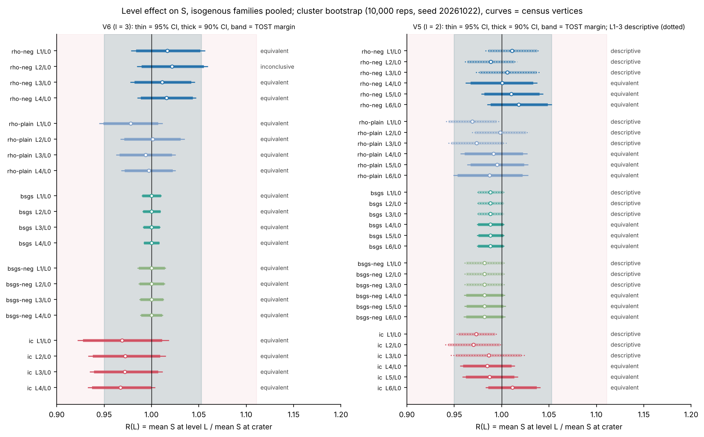
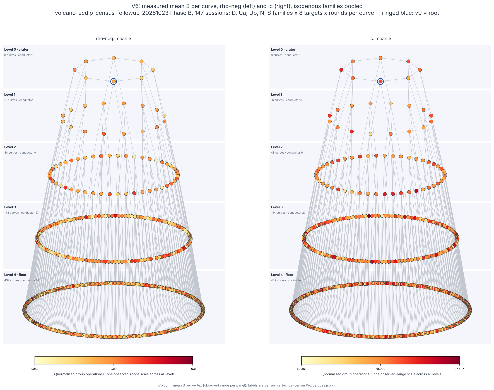
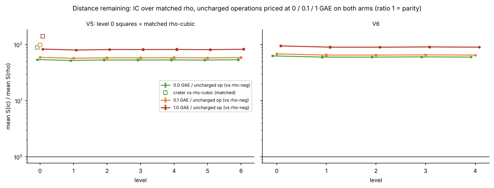
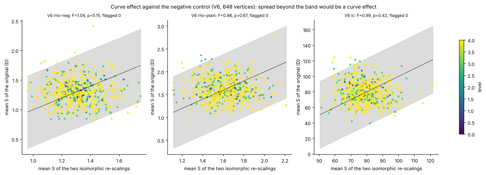
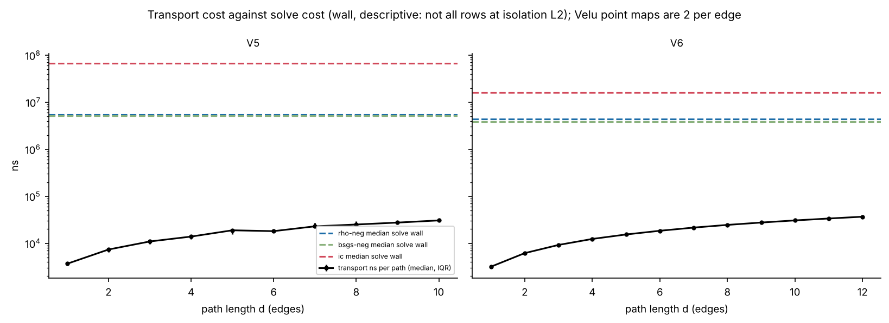
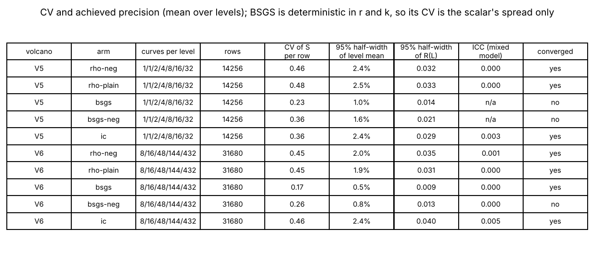
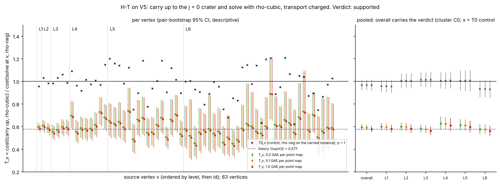
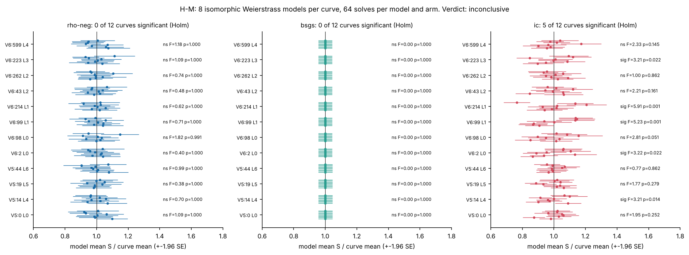

# Volcano ECDLP census follow-up, Phase C: analysis and report

Study `research/volcano_ecdlp_census_followup_20261023/`; plan `PLAN.md`, analysis plan `ANALYSIS_PLAN.md` (frozen before the first Phase B session), amendments `AMENDMENTS.md` (A1, A2, and **A3, post hoc**, written after the data and before the final run). Every number below is read from `analysis/results.json` (written by `analysis/analyze.py`; 10,000 bootstrap or permutation replicates; seeds 20261022, 20261023, 20261024). **Status: observed, not established.** No speedup is claimed beyond H-T's measured ratio. Independent validation (`VALIDATION.json`) has not happened; this is the analysis, not its validation. It extends the validated census `research/volcano_ecdlp_census_20261017/`.

## 1. Verdicts

1. **Q2a, positive control (V5 j = 0 crater): PASS.** mean S(`rho-cubic`) / mean S(`rho-neg`) = **0.6113**, 95% CI [0.5995, 0.6237] over 4000 paired runs on 3 Weierstrass models (theory 1/sqrt(3) = 0.5774; pass needs the upper bound below 0.85; slug-cluster sensitivity [0.5967, 0.6288]). The detector sees a cost reduction, so the 'equivalent' verdicts below are informative.
2. **Q1, V6 (l = 3, depth 4, 648 curves) level effect: no method depends on level.** Of the 20 V6 level ratios, 19 are equivalent (TOST, +-5% rho and BSGS, +-10% IC), 1 inconclusive (V6 `rho-neg` level 2: ratio 1.022, 90% CI not inside the margin; not different after Holm), none different. The census finding (no level effect) replicates on a deeper l = 3 volcano.
3. **Q2b, V5 (j = 0 crater, depth 6, 64 curves) level effect:** levels 4-6 (8, 16, 32 curves), 15 ratios: all 15 equivalent. Levels 1-3 (1, 2, 4 curves) are **descriptive** (ratios within -0.031 to +0.011 of 1). `rho-cubic` is excluded from the level analysis.
4. **H-T (carry up to the crater, solve with `rho-cubic`): SUPPORTED.** Pooled over 63 source vertices (vertex-weighted, A3.2), T = 0.5946 [0.5684, 0.6220] at 0.0 GAE, 0.5917 [0.5655, 0.6193] at 0.1 GAE, 0.5781 [0.5512, 0.6063] at 1.0 GAE per Velu point map. The control T0 (same transport, same crater curve, `rho-neg`) = 0.9672 [0.9227, 1.0145], 0.9672 [0.9223, 1.0149], 0.9670 [0.9204, 1.0164], whose CI includes 1 at all three prices. Theory 1/sqrt(3) = 0.5774; the transport term is 0.21% of the numerator at 1 GAE. Measured same-curve automorphism gain in S (`rho-cubic` / `rho-neg` on the carried instances): 0.6148 [0.5895, 0.6420]. This is a measured end-to-end ratio of a known composition, about 0.58x in ops_gae, not a new speedup; and it is relative to `rho-neg` on the same instance, not to the strongest rho at the source.
5. **H-M (does IC cost depend on the Weierstrass model?): INCONCLUSIVE.** `ic` is significant (Holm, alpha 0.05) on 5 of 12 chosen curves; `rho-neg` on 0 and `bsgs` on 0. Supported would need 6 of 12 for `ic` and at most 1 for each of the others; refuted would need at most 1 for `ic`. IC's model dependence is therefore present on some curves and absent on others: it is neither a general property nor noise. The census's V3 crater values (IC 57 / 67 / 73) are quoted only as the motivating observation.
6. **IC against matched rho (distance remaining, not pass/fail).** V6: IC costs 60.4x `rho-neg` in S with nothing priced and 90.8x with every uncharged operation priced at 1 GAE. V5 levels 1-6: 53.3x and 81.8x. **On the V5 j = 0 crater the matched rho is `rho-cubic`: 89.3x / 98.2x / 141.2x at 0 / 0.1 / 1 GAE** (not the `rho-neg` ratio). The order (rho ahead) holds across the whole band at every level. No level improves IC's position.
7. **Wall time: not admitted** on either volcano. The A/A ratio is within [0.95, 1.05] (V5 1.042, V6 1.001), but only 87% (V5) and 84% (V6) of rows reached isolation L2, so condition 1 fails. Wall tables are descriptive.

## 2. What was measured

- 147 audited ecbench sessions (V5: 7 D, 6 Ua, 6 Ub, 7 N, 7 ctl, 63 Tcr, 4 M; V6: 8 M and D, Ua, Ub, S, N, ctl), each `audit OK` with exact replays; 428,976 measured runs after dropping 241,712 warm-up runs. Unverified measured runs: 0.
- Arms: `rho-neg` (matched reference), `rho-plain`, `bsgs`, `bsgs-neg`, `ic` (`ic.pipeline`, `prime-abscissa:size=64`), `rho-neg-aa` (A/A), `rho-cubic` (V5 crater D, N, ctl and every Tcr spec). Tcr specs carry `rho-cubic` and `rho-neg`; M specs `rho-neg`, `bsgs`, `ic`.
- Populations: V5 (l = 2, p = 66678169, 26-bit, depth 6; 1/1/2/4/8/16/32 curves); V6 (l = 3, p = 38002051, depth 4; 8/16/48/144/432 curves). Curve = census vertex for every resample (A2.3 in force from the start).
- Unit S (normalised group operations); uncharged counters (`canonicalisations_uncharged` etc.) priced at 0, 0.1 and 1 GAE per operation from each session's `records.jsonl` (A2.1 in force). Totals agree with the CSV extracts row by row (max |dS| = 0.0, max |d ops_gae| = 0.0).
- Host: shared 4-vCPU cloud VM; frozen binary `ac4bc5b2...`; session wall 8.94 h, 7 recorded pauses (driver and container restarts) excluded from the wall budget.

## 3. Q2a positive control

V5 crater (vertex 0, j = 0; D, N and ctl rows, 3 models): ratio 0.6113, CI [0.5995, 0.6237]; theory 0.5774; census V3 value for comparison (not pooled) in the census report. **Pass.** `rho-cubic` is valid only at j = 0, which on V5 is the crater alone.

## 4. Q1 and Q2b: level effect

R(L) = mean S at level L / mean S at the crater, isogenous families pooled (D, Ua, Ub, N; plus S on V6), cluster bootstrap over census vertices stratified by level. Verdicts in the plan's vocabulary; Holm over 35 tests (A3.5).

| V | arm | L | curves | R(L) on S | 95% CI | 90% CI | half-width | margin | Holm p | verdict |
|---|---|--:|--:|--:|---|---|--:|---|--:|---|
| V6 | rho-neg | 1 | 16 | 1.016 | [0.979, 1.056] | [0.985, 1.050] | 0.039 | 0.95-1.05 | 1.000 | equivalent |
| V6 | rho-neg | 2 | 48 | 1.022 | [0.985, 1.059] | [0.991, 1.054] | 0.037 | 0.95-1.05 | 1.000 | inconclusive |
| V6 | rho-neg | 3 | 144 | 1.011 | [0.978, 1.045] | [0.983, 1.040] | 0.034 | 0.95-1.05 | 1.000 | equivalent |
| V6 | rho-neg | 4 | 432 | 1.016 | [0.986, 1.047] | [0.990, 1.042] | 0.031 | 0.95-1.05 | 1.000 | equivalent |
| V6 | rho-plain | 1 | 16 | 0.978 | [0.945, 1.011] | [0.951, 1.005] | 0.033 | 0.95-1.05 | 1.000 | equivalent |
| V6 | rho-plain | 2 | 48 | 1.001 | [0.968, 1.034] | [0.973, 1.029] | 0.033 | 0.95-1.05 | 1.000 | equivalent |
| V6 | rho-plain | 3 | 144 | 0.994 | [0.963, 1.025] | [0.968, 1.020] | 0.031 | 0.95-1.05 | 1.000 | equivalent |
| V6 | rho-plain | 4 | 432 | 0.997 | [0.968, 1.025] | [0.973, 1.021] | 0.028 | 0.95-1.05 | 1.000 | equivalent |
| V6 | bsgs | 1 | 16 | 1.000 | [0.990, 1.010] | [0.992, 1.008] | 0.010 | 0.95-1.05 | 1.000 | equivalent |
| V6 | bsgs | 2 | 48 | 1.000 | [0.991, 1.009] | [0.992, 1.008] | 0.009 | 0.95-1.05 | 1.000 | equivalent |
| V6 | bsgs | 3 | 144 | 1.000 | [0.991, 1.009] | [0.993, 1.007] | 0.009 | 0.95-1.05 | 1.000 | equivalent |
| V6 | bsgs | 4 | 432 | 1.000 | [0.992, 1.008] | [0.994, 1.007] | 0.008 | 0.95-1.05 | 1.000 | equivalent |
| V6 | bsgs-neg | 1 | 16 | 1.000 | [0.986, 1.015] | [0.988, 1.012] | 0.015 | 0.95-1.05 | 1.000 | equivalent |
| V6 | bsgs-neg | 2 | 48 | 1.000 | [0.987, 1.014] | [0.989, 1.012] | 0.014 | 0.95-1.05 | 1.000 | equivalent |
| V6 | bsgs-neg | 3 | 144 | 1.000 | [0.987, 1.013] | [0.990, 1.011] | 0.013 | 0.95-1.05 | 1.000 | equivalent |
| V6 | bsgs-neg | 4 | 432 | 1.000 | [0.989, 1.012] | [0.991, 1.010] | 0.012 | 0.95-1.05 | 1.000 | equivalent |
| V6 | ic | 1 | 16 | 0.969 | [0.923, 1.018] | [0.929, 1.010] | 0.048 | 0.90-1.11 | 1.000 | equivalent |
| V6 | ic | 2 | 48 | 0.972 | [0.934, 1.015] | [0.939, 1.008] | 0.041 | 0.90-1.11 | 1.000 | equivalent |
| V6 | ic | 3 | 144 | 0.972 | [0.935, 1.011] | [0.941, 1.005] | 0.038 | 0.90-1.11 | 1.000 | equivalent |
| V6 | ic | 4 | 432 | 0.967 | [0.933, 1.004] | [0.939, 0.998] | 0.035 | 0.90-1.11 | 1.000 | equivalent |
| V5 | rho-neg | 1 | 1 | 1.011 | [0.983, 1.041] | [0.987, 1.036] | 0.029 | 0.95-1.05 | - | descriptive |
| V5 | rho-neg | 2 | 2 | 0.988 | [0.961, 1.016] | [0.965, 1.012] | 0.027 | 0.95-1.05 | - | descriptive |
| V5 | rho-neg | 3 | 4 | 1.006 | [0.973, 1.041] | [0.978, 1.035] | 0.034 | 0.95-1.05 | - | descriptive |
| V5 | rho-neg | 4 | 8 | 1.001 | [0.962, 1.037] | [0.969, 1.032] | 0.037 | 0.95-1.05 | 1.000 | equivalent |
| V5 | rho-neg | 5 | 16 | 1.010 | [0.979, 1.043] | [0.983, 1.038] | 0.032 | 0.95-1.05 | 1.000 | equivalent |
| V5 | rho-neg | 6 | 32 | 1.018 | [0.985, 1.053] | [0.990, 1.047] | 0.034 | 0.95-1.05 | 1.000 | equivalent |
| V5 | rho-plain | 1 | 1 | 0.969 | [0.941, 0.998] | [0.945, 0.993] | 0.028 | 0.95-1.05 | - | descriptive |
| V5 | rho-plain | 2 | 2 | 0.998 | [0.969, 1.029] | [0.973, 1.024] | 0.030 | 0.95-1.05 | - | descriptive |
| V5 | rho-plain | 3 | 4 | 0.973 | [0.944, 1.005] | [0.948, 1.000] | 0.031 | 0.95-1.05 | - | descriptive |
| V5 | rho-plain | 4 | 8 | 0.991 | [0.957, 1.027] | [0.962, 1.021] | 0.035 | 0.95-1.05 | 1.000 | equivalent |
| V5 | rho-plain | 5 | 16 | 0.995 | [0.964, 1.027] | [0.969, 1.022] | 0.032 | 0.95-1.05 | 1.000 | equivalent |
| V5 | rho-plain | 6 | 32 | 0.987 | [0.949, 1.027] | [0.955, 1.020] | 0.039 | 0.95-1.05 | 1.000 | equivalent |
| V5 | bsgs | 1 | 1 | 0.988 | [0.974, 1.002] | [0.976, 1.000] | 0.014 | 0.95-1.05 | - | descriptive |
| V5 | bsgs | 2 | 2 | 0.988 | [0.974, 1.002] | [0.976, 1.000] | 0.014 | 0.95-1.05 | - | descriptive |
| V5 | bsgs | 3 | 4 | 0.988 | [0.974, 1.002] | [0.976, 1.000] | 0.014 | 0.95-1.05 | - | descriptive |
| V5 | bsgs | 4 | 8 | 0.988 | [0.974, 1.002] | [0.976, 1.000] | 0.014 | 0.95-1.05 | 1.000 | equivalent |
| V5 | bsgs | 5 | 16 | 0.988 | [0.975, 1.002] | [0.977, 1.000] | 0.014 | 0.95-1.05 | 1.000 | equivalent |
| V5 | bsgs | 6 | 32 | 0.988 | [0.974, 1.002] | [0.976, 1.000] | 0.014 | 0.95-1.05 | 1.000 | equivalent |
| V5 | bsgs-neg | 1 | 1 | 0.982 | [0.961, 1.004] | [0.964, 1.000] | 0.022 | 0.95-1.05 | - | descriptive |
| V5 | bsgs-neg | 2 | 2 | 0.982 | [0.961, 1.003] | [0.964, 1.000] | 0.021 | 0.95-1.05 | - | descriptive |
| V5 | bsgs-neg | 3 | 4 | 0.982 | [0.961, 1.003] | [0.964, 1.000] | 0.021 | 0.95-1.05 | - | descriptive |
| V5 | bsgs-neg | 4 | 8 | 0.982 | [0.960, 1.003] | [0.964, 1.000] | 0.021 | 0.95-1.05 | 1.000 | equivalent |
| V5 | bsgs-neg | 5 | 16 | 0.982 | [0.961, 1.004] | [0.964, 1.000] | 0.021 | 0.95-1.05 | 1.000 | equivalent |
| V5 | bsgs-neg | 6 | 32 | 0.982 | [0.960, 1.003] | [0.964, 1.000] | 0.022 | 0.95-1.05 | 1.000 | equivalent |
| V5 | ic | 1 | 1 | 0.973 | [0.952, 0.995] | [0.955, 0.991] | 0.021 | 0.90-1.11 | - | descriptive |
| V5 | ic | 2 | 2 | 0.970 | [0.940, 1.001] | [0.945, 0.996] | 0.030 | 0.90-1.11 | - | descriptive |
| V5 | ic | 3 | 4 | 0.986 | [0.946, 1.025] | [0.953, 1.019] | 0.039 | 0.90-1.11 | - | descriptive |
| V5 | ic | 4 | 8 | 0.985 | [0.956, 1.013] | [0.960, 1.009] | 0.029 | 0.90-1.11 | 1.000 | equivalent |
| V5 | ic | 5 | 16 | 0.987 | [0.959, 1.017] | [0.963, 1.012] | 0.029 | 0.90-1.11 | 1.000 | equivalent |
| V5 | ic | 6 | 32 | 1.011 | [0.983, 1.040] | [0.987, 1.035] | 0.029 | 0.90-1.11 | 1.000 | equivalent |

Secondary mixed models (`log S ~ C(level) + C(family) + (1 | vertex)`, REML) converge for `rho-neg`, `rho-plain` and `ic` on both volcanoes and for V6 `bsgs`; they do not converge for V5 `bsgs`, V5 `bsgs-neg` and V6 `bsgs-neg` (BSGS cost is a deterministic function of r and k, so the curve variance is degenerate; reported as not converged in `results.json`). ICC V6 `ic` 0.0050, V5 `ic` 0.0035: curves differ very little beyond their rows. They never override the bootstrap. Per-family R(L) (D, Ua, Ub, N, S) is in `results.json` (descriptive; Ua and Ub have no V5 level-0 rows, A3.6). See figures 1, 2 and 6.

## 5. Curve effect against the isomorphic negative control (V6)

| arm | F | permutation p | Holm p | curves flagged (adj. p < 0.01) |
|---|--:|--:|--:|--:|
| rho-neg | 1.04 | 0.149 | 0.448 | 0 |
| rho-plain | 0.98 | 0.674 | 0.849 | 0 |
| bsgs | n/a (zero within-vertex variance) | - | - | 0 |
| bsgs-neg | n/a (zero within-vertex variance) | - | - | 0 |
| ic | 0.99 | 0.425 | 0.849 | 0 |

No variance-ratio test is significant and no curve is flagged: no V6 curve differs from its own isomorphic re-scalings beyond the control spread (figure 4).

## 6. Transfer (V6)

- **Recovery:** every one of the 428,976 measured runs on both volcanoes was verified (smallest Clopper-Pearson 95% lower bound 0.9963, for the smallest cell).
- BSGS counts are identical across D, Ua, Ub and S in 100% of triples on both volcanoes.
- **Paired source ratios** (Ua, Ub, S, N over D; `rho-neg`, `rho-plain`, `ic`; Holm family of 12): 12 of 12 equivalent, 0 inconclusive, 0 different.
- **Transport cost:** about 3172 ns per edge on V6 and 3669 ns on V5, 2 Velu point maps per edge; the largest transport/solve wall fraction is 1.2% (V5) and 2.6% (V6) of a solve (figure 5; wall is descriptive).
- **Transport, then solve (V6):** 2 of 100 (family, arm, destination level) cells meet the plan's literal 'signal' rule: `V6|S|ic` destination level 1, `V6|S|ic` destination level 3. Both are `ic` on the family S, whose source is one vertex (the crater-b vertex); the same family and arm have the same point ratio (0.85-0.89) at the other three levels, whose CIs reach 1 or overlap the control's, and the family D and Ua `ic` rows are at 0.88-0.92 and 0.76-0.81 without meeting the rule. The source mean comes from a single curve (the plan warns it is noisy and shared by all destination levels), the native control ratio is itself above 1, and no `rho-neg` or `rho-plain` cell meets the rule. It is labelled a signal under the rule and **is not a speedup claim**: IC remains 50x or more behind `rho-neg` at every level, so a 10 to 15% shift in IC's own cost moves nothing about the distance to rho.

## 7. H-T: carry up, then solve with the automorphism (V5)

For each of the 63 non-crater vertices v the instance born at v is carried to the crater (verified isogenies; the last edge outside `ca` by the study's helper, checked), and solved there with `rho-cubic`. T_v(p) = [mean priced ops_gae(`rho-cubic`, Tcr_v) + p * M_v] / mean priced ops_gae(`rho-neg`, N_v); T0 is the same with `rho-neg` on Tcr_v. M_v = Velu point maps of the path + 2 for the last edge (2 to 12). Checks: unpaired rows 0, path-length check failures 0.

| stratum | vertices | T at 0 GAE | T at 0.1 | T at 1 | T0 at 0 | T0 at 1 |
|---|--:|---|---|---|---|---|
| **overall (verdict)** | 63 | 0.5946 [0.5684, 0.6220] | 0.5917 [0.5655, 0.6193] | 0.5781 [0.5512, 0.6063] | 0.9672 [0.9227, 1.0145] | 0.9670 [0.9204, 1.0164] |
| level 1 (descriptive) | 1 | 0.599 [0.567, 0.633] | 0.596 [0.564, 0.630] | 0.582 [0.549, 0.617] | 0.958 [0.905, 1.013] | 0.956 [0.902, 1.014] |
| level 2 (descriptive) | 2 | 0.600 [0.565, 0.637] | 0.597 [0.562, 0.634] | 0.583 [0.546, 0.621] | 1.005 [0.945, 1.069] | 1.005 [0.943, 1.073] |
| level 3 (descriptive) | 4 | 0.581 [0.547, 0.618] | 0.578 [0.543, 0.615] | 0.563 [0.528, 0.601] | 1.013 [0.952, 1.080] | 1.015 [0.951, 1.085] |
| level 4 (descriptive) | 8 | 0.628 [0.577, 0.688] | 0.625 [0.574, 0.685] | 0.612 [0.559, 0.674] | 1.006 [0.938, 1.081] | 1.007 [0.936, 1.086] |
| level 5 (descriptive) | 16 | 0.615 [0.567, 0.667] | 0.612 [0.564, 0.664] | 0.599 [0.550, 0.653] | 1.006 [0.917, 1.098] | 1.007 [0.915, 1.104] |
| level 6 (descriptive) | 32 | 0.578 [0.536, 0.623] | 0.575 [0.533, 0.621] | 0.562 [0.518, 0.608] | 0.932 [0.859, 1.008] | 0.931 [0.855, 1.010] |

Verdict rule (plan s4, applied at each price): supported if the overall CI of T is below 1 at all three prices and the CI of T0 includes 1 at all three; refuted if T's CI includes 1 or lies above it at any price. Inputs: T below 1 at all prices = True, T0 includes 1 at all prices = True, T includes or exceeds 1 at some price = False. **Verdict: supported.** Per-vertex T_v at 1 GAE ranges 0.43 to 0.89 (pair-bootstrap CIs, figure 7); per-level values are descriptive. Level 6 has T0 = 0.931 (the control itself sits below 1 there, descriptive), and level 1 0.956; the pooled T0 interval includes 1. Per the census lesson F2, a per-curve difference is read against isomorphic controls: T0 is that control, and it shows the spread the carried instance alone has.

## 8. H-M: does IC cost depend on the Weierstrass model?

Eight isomorphic models (u not +-1) per chosen curve, native generator carried by the isomorphism, 16 targets x 4 rounds = 64 solves per model and arm. F = between-model / within-model mean square; permutation p (10,000 shuffles of rows across models, seed 20261024); Holm over the 12 curves of each arm. BSGS must be model independent; it is (F = 0 on every curve; identical ops_gae across models for each (target, round) in 100% of cases), so the models carry the same instances.

| curve | level | `ic` F | `ic` Holm p | `ic` max/min model mean (95% CI) | `rho-neg` F | `rho-neg` Holm p | `rho-neg` max/min (95% CI) |
|---|--:|--:|--:|---|--:|--:|---|
| V5:0 | 0 | 1.95 | 0.2516 | 1.21 [1.15, 1.38] | 1.09 | 1.000 | 1.19 [1.14, 1.42] |
| V5:14 | 4 | 3.21 | 0.0140 * | 1.22 [1.17, 1.41] | 0.70 | 1.000 | 1.14 [1.12, 1.39] |
| V5:19 | 5 | 1.77 | 0.2787 | 1.20 [1.14, 1.37] | 0.38 | 1.000 | 1.12 [1.10, 1.36] |
| V5:44 | 6 | 0.77 | 0.8623 | 1.12 [1.09, 1.30] | 0.99 | 1.000 | 1.19 [1.13, 1.44] |
| V6:2 | 0 | 3.22 | 0.0225 * | 1.31 [1.24, 1.55] | 0.40 | 1.000 | 1.10 [1.11, 1.38] |
| V6:214 | 1 | 5.91 | 0.0012 * | 1.58 [1.39, 1.84] | 0.62 | 1.000 | 1.15 [1.11, 1.37] |
| V6:223 | 3 | 3.21 | 0.0225 * | 1.32 [1.23, 1.55] | 1.09 | 1.000 | 1.20 [1.14, 1.44] |
| V6:262 | 2 | 1.00 | 0.8623 | 1.17 [1.13, 1.40] | 0.74 | 1.000 | 1.15 [1.12, 1.39] |
| V6:43 | 2 | 2.21 | 0.1610 | 1.32 [1.20, 1.55] | 0.48 | 1.000 | 1.13 [1.11, 1.37] |
| V6:599 | 4 | 2.33 | 0.1452 | 1.30 [1.17, 1.53] | 1.18 | 1.000 | 1.15 [1.13, 1.41] |
| V6:98 | 0 | 2.81 | 0.0511 | 1.36 [1.23, 1.62] | 1.82 | 0.991 | 1.26 [1.17, 1.50] |
| V6:99 | 1 | 5.23 | 0.0012 * | 1.32 [1.28, 1.59] | 0.71 | 1.000 | 1.14 [1.11, 1.37] |

`*` = significant after Holm. Counts: `ic` 5 of 12, `rho-neg` 0, `bsgs` 0. **Verdict: inconclusive.** The max/min of eight model means of a quantity with sampling noise is above 1 by chance (rho-neg shows 1.10-1.26 with no significant curve); IC's values reach 1.58 on one curve. Two related observations from this study, descriptive only: the V5 crater's own D/N model and its two ctl re-scalings give IC mean S 59.3, 59.2, 58.1 (no model gap on that curve, unlike the census V3 crater), and the V6 curve-effect test (section 5) finds no curve differing from its re-scalings. The test permutes rows across models and ignores the shared (target, round) pairing, which makes it conservative (A3.7). With 5 of 12 the verdict is inconclusive by the plan's rule, which needed 6.

## 9. IC against matched rho (distance remaining)

Mean S(`ic`) / mean S(`rho-neg`), pairs of the same (workload, target, round), uncharged counts priced at 0 / 0.1 / 1 GAE on both arms (an arm with an unemitted count is a lower bound). Ranked only if the order holds at all three prices. V5 level 0 uses `rho-cubic` (the strongest rho at j = 0).

| V | level | matched rho | IC/rho at 0 GAE | at 0.1 | at 1 | order across the band |
|---|--:|---|---|---|---|---|
| V5 | 0 | **rho-cubic** | 89.3 [87.1, 91.6] | 98.2 [95.8, 100.7] | 141.2 [137.6, 144.9] | rho-cubic ahead of ic at all three prices |
| V5 | 1 | rho-neg | 52.3 [51.1, 53.7] | 57.2 [55.8, 58.7] | 80.3 [78.2, 82.4] | rho-neg ahead of ic at all three prices (95% CI above 1 at each) |
| V5 | 2 | rho-neg | 53.4 [51.7, 55.1] | 58.4 [56.5, 60.3] | 81.9 [79.3, 84.7] | rho-neg ahead of ic at all three prices (95% CI above 1 at each) |
| V5 | 3 | rho-neg | 53.3 [51.3, 55.3] | 58.3 [56.1, 60.5] | 81.8 [78.7, 84.9] | rho-neg ahead of ic at all three prices (95% CI above 1 at each) |
| V5 | 4 | rho-neg | 53.5 [51.2, 56.0] | 58.5 [56.0, 61.3] | 82.1 [78.5, 86.1] | rho-neg ahead of ic at all three prices (95% CI above 1 at each) |
| V5 | 5 | rho-neg | 53.1 [51.5, 54.8] | 58.1 [56.3, 60.0] | 81.5 [79.0, 84.2] | rho-neg ahead of ic at all three prices (95% CI above 1 at each) |
| V5 | 6 | rho-neg | 54.0 [52.2, 55.9] | 59.1 [57.1, 61.2] | 82.9 [80.0, 85.9] | rho-neg ahead of ic at all three prices (95% CI above 1 at each) |
| V6 | 0 | rho-neg | 63.1 [60.9, 65.3] | 68.6 [66.2, 71.0] | 95.1 [91.6, 98.5] | rho-neg ahead of ic at all three prices (95% CI above 1 at each) |
| V6 | 1 | rho-neg | 60.1 [57.3, 62.8] | 65.3 [62.2, 68.2] | 90.4 [85.9, 94.6] | rho-neg ahead of ic at all three prices (95% CI above 1 at each) |
| V6 | 2 | rho-neg | 60.1 [58.2, 62.0] | 65.2 [63.2, 67.3] | 90.2 [87.3, 93.3] | rho-neg ahead of ic at all three prices (95% CI above 1 at each) |
| V6 | 3 | rho-neg | 60.6 [59.2, 62.1] | 65.9 [64.3, 67.5] | 91.2 [88.9, 93.5] | rho-neg ahead of ic at all three prices (95% CI above 1 at each) |
| V6 | 4 | rho-neg | 60.1 [59.3, 60.9] | 65.3 [64.4, 66.2] | 90.3 [89.0, 91.7] | rho-neg ahead of ic at all three prices (95% CI above 1 at each) |

| pooled | at 0 GAE | at 0.1 | at 1 |
|---|---|---|---|
| V5 (levels 1-6, rho-neg) | 53.3 [52.5, 54.0] | 58.3 [57.5, 59.1] | 81.8 [80.6, 83.0] |
| V6 (levels 0-4, rho-neg) | 60.4 [59.8, 61.1] | 65.6 [64.9, 66.3] | 90.8 [89.8, 91.8] |

The 12 M curves give per-curve IC/`rho-neg` of 51.8 to 65.2 at 0 GAE and 79.5 to 98.4 at 1 GAE (descriptive; on the V5 crater curve that is not the matched rho). Pricing the uncharged counters raises IC's cost more than rho's, so the gap widens with the price; it never closes at any of the three prices, and no level of either volcano moves it. Figure 3.

## 10. Wall time

| V | A/A ratio | 95% CI | A/A within 5% | rows at L2 per arm | admitted |
|---|--:|---|---|---|---|
| V5 | 1.0424 | [1.0376, 1.0472] | True | bsgs 86%, bsgs-neg 87%, ic 88%, rho-neg 86%, rho-plain 86% | False |
| V6 | 1.0005 | [0.9969, 1.0040] | True | bsgs 77%, bsgs-neg 83%, ic 88%, rho-neg 79%, rho-plain 79% | False |

M and Tcr specs have no A/A arm: their wall times are descriptive.

## 11. Figures

*fig1_forest_level_effect: R(L) per volcano and arm with 90% and 95% CIs against the TOST band (V5 levels 1-3 dotted: descriptive). Source `analysis/results.json`; SVG beside the PNG.*

*fig2_volcano_V5: V5 volcano, mean S per curve, rho-neg and ic (standard `tools/volcano-diagram`). Source `analysis/results.json`; SVG beside the PNG.*

*fig2_volcano_V6: V6 volcano, same. Source `analysis/results.json`; SVG beside the PNG.*

*fig3_ic_over_rho: IC / matched rho by level at 0, 0.1, 1 GAE; V5 level 0 squares are rho-cubic. Source `analysis/results.json`; SVG beside the PNG.*

*fig4_curve_vs_control: V6: each curve's mean S against its two isomorphic re-scalings. Source `analysis/results.json`; SVG beside the PNG.*

*fig5_transport_vs_solve: transport ns per path against median solve wall, by path length. Source `analysis/results.json`; SVG beside the PNG.*

*fig6_cv_precision: CV and achieved precision. Source `analysis/results.json`; SVG beside the PNG.*

*fig7_hT: H-T: T_v per source vertex at three prices with the T0 control, and pooled values. Source `analysis/results.json`; SVG beside the PNG.*

*fig8_hM: H-M: per-model mean S for rho-neg, bsgs and ic on the 12 chosen curves. Source `analysis/results.json`; SVG beside the PNG.*

## 12. Limits and what is not claimed

- Shared 4-vCPU cloud VM; wall time not admitted (isolation L2 for 84-87% of rows).
- One volcano per question: V5 for the j = 0 results, V6 for the l = 3 replication. Observed, not established across volcanoes.
- V5 levels 1-3 have 1, 2 and 4 curves: descriptive only. The V5 crater is one curve, so Q2a resamples rows, not curves; the slug-cluster variant is a sensitivity.
- The last carry-up edge (level 1 to j = 0) is outside `ca`, done by the study's verified helper; its wall time is not measured and is not part of any result; it is charged as 2 point maps (A3.2).
- **Container restarts and redone sessions.** The driver was restarted 7 times (pauses excluded from the wall budget). Three sessions, `V6-D-L1-c0.r2`, `V6-D-L2-c0.r2`, `V6-N-L1-c0.r2`, were redone after container restarts killed the first attempts; the analysis uses the audited `.r2` sessions, and the three partial first attempts are kept unanalysed as evidence in `runs/orphans/` (V6-D-L1-c0.orphan.tar.xz, V6-D-L2-c0.orphan.tar.xz, V6-N-L1-c0.orphan.tar.xz). Nine busy-host refusals of Tcr sessions (A2.1) are in `progress.jsonl` as `failed` lines and ignored by the inclusion rule; those specs ran later and count once.
- ctl is the negative control and is never pooled; Tcr and M are analysed only in their own sections. The interpretations of A3 are post hoc (written after the data, before the final run).
- H-T compares `rho-cubic` on the carried instance to `rho-neg` at the source, as preregistered; it does not compare with the strongest rho at the source (on j != 0 vertices `rho-neg` is the strongest). It is a measurement of a known composition, not a new method. The vertex-weighted pooling (A3.2) weights level 6 most.
- H-M uses 8 models for each of 12 curves and a conservative unpaired permutation; the verdict is inconclusive, so no claim about the cause (x-coordinate dependence of `prime-abscissa`) is made.
- Uncharged counters are priced at 0 / 0.1 / 1 GAE for both arms; counters that `cost.unpriced` does not name are not counted, so both arms stay lower bounds. No cross-method rank is stated where the order does not hold across the band.
- No claim about cryptographic sizes: 26-bit synthetic curves with planted known answers. The transport-then-solve 'signal' cells (section 6) are not a speedup claim.
- This file's analysis plan was frozen before the first Phase B session; the three-restart and A2 operational changes are recorded in `AMENDMENTS.md`.

## 13. Reproduce

`python3 -I analysis/extract_uncharged.py <scratch>` (one archive at a time), `python3 -I analysis/analyze.py`, `python3 -I analysis/figures.py`, `python3 -I analysis/build_report.py`, `bash analysis/build_pdf.sh`. Input hashes are in `analysis/results.json`.
