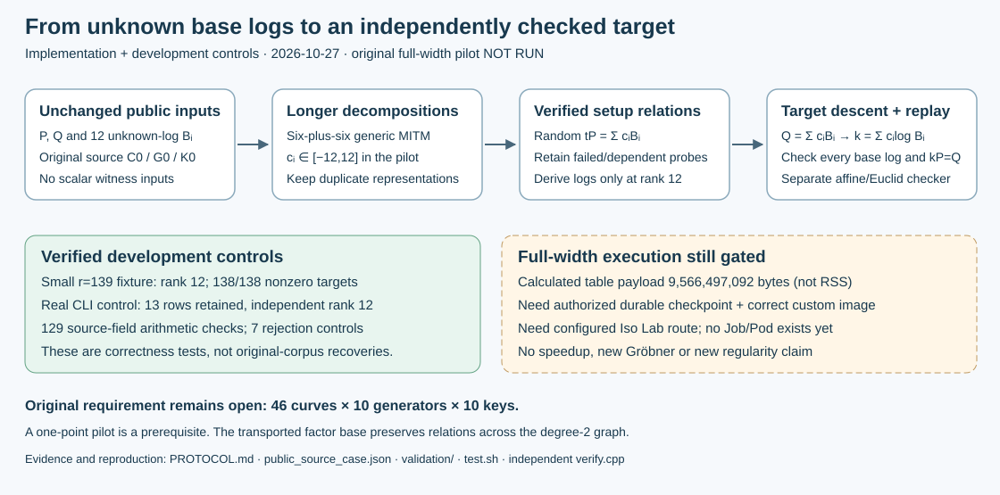

# Volcano IC recovery: implement the missing relation pipeline

2026-10-27. This change implements a longer-decomposition recovery baseline and
its independent checker. **The original 54-bit subgroup pilot has not run.** The
original 46-curve workload still has zero genuine random IC recoveries.



The previous 12-point strict two-sum base had only 288 nonidentity support points.
This extension keeps the exact public P, Q and unknown-log base from source
instance C0/G0/K0 and searches bounded integer combinations of those base points.
It does not import historical DLP answers or base-sampling coefficients.

The decomposition engine is a **generic meet-in-the-middle fallback** within a
relation/linear-algebra pipeline. It is not a new algebraic solver or a claimed
speed improvement. Once verified relations reach rank 12, the pipeline derives
all 12 base logs, independently checks their equations, decomposes Q, derives k,
and checks kP=Q. The [protocol](PROTOCOL.md) defines exact acceptance and limits.

| Requirement | Status / evidence |
| --- | --- |
| Preserve original 46 curves × 10 generators × 10 keys | Open unchanged; this pilot is one prerequisite |
| Unknown-log collector, rank, log recovery and descent | Implemented in native C++; full-width execution pending |
| Separate equation and rank replay | Implemented; passed development control |
| Small known-answer correctness control | Rank 12; all 138 nonzero control targets recovered |
| Actual runner, randomness and private journal path | Passed small control; 13 verified rows retained to rank 12 |
| Native arithmetic on actual public field/points | 129 differential scalar/batch checks passed |
| Corruption and input rejection | Seven negative controls passed |
| Large-table resources | Static payload calculation: 9,566,497,092 bytes; not an allocation/RSS measurement |
| Original source-case recovery | Not attempted; source checkpoint verified, AWS launch permission denied; custom image/recovery still required |
| New performance or regularity result | None; existing polynomial certificates remain unchanged |

Receipts are in [validation/](validation/). They are development-test receipts,
not a new full-width result or an ecbench admission. All 2,363 group-pair checks
and 2,187 wrapped walker states passed. The deterministic control and real
command-line control have separate replay receipts. The latter uses Linux
`getrandom` with rejection sampling; all its raw draws remain in the private
development history. Native logs default to *independent replay not run*; only
the separate checker supplies the replay verdict.

## Reproduce development checks

From a checkout of this branch:

```sh
bash research/volcano_ic_recovery_20261027/test.sh /absolute/new-receipt-directory
```

The script builds `runner`, `verify`, and `tests` with C++20, `-O2`, all selected
warnings as errors, then executes known-answer development controls. It records
source/binary hashes, compiler, failures and private synthetic-control journals.
The independent verifier uses separate affine group arithmetic, Euclidean
inversion and fresh batch Gaussian elimination; it does not include `bounded.hpp`.
It assumes the supplied prime parameters have been independently certified; it
does not claim to prove their primality or validate time/counter measurements.

The public original input rejects witness fields. A production invocation would
use `run.sh VERIFIED_RECEIPT_DIRECTORY NEW_PRIVATE_OUTPUT_DIRECTORY`; it checks
the source/binary bindings and the mandatory S3 checkpoint gate first. Do not
run it as a substitute for the required configured Iso Lab execution route.
The planned radius-12 table has 244,140,625 left entries, with all duplicate
representations retained. `25^12` counts coefficient vectors, not unique group
points or a proved chance of success.

## Execution gates and next action

The source-only checkpoint gate passed on October 28 using the authorized AWS
credentials. Its AES256-encrypted S3 archive was read back and its hash/content
verified. It contains the source handoff and metadata, not private scalar/RNG
journals, credential values or a live-process checkpoint. This resolves the
earlier missing-upload-access blocker; see [current launch status](LAUNCH_STATUS.md)
and [access evidence](validation/access_20261028.json).

The same identity was definitively denied `codebuild:StartBuild` on the lab
launcher and `eks:DescribeCluster`. A bounded read-only bridge preflight created
no build or experiment. The existing commit-building GitHub workflow executes
ecbench specs, not this standalone collector. A real launch still needs an
authorized custom-command route, tested-commit immutable image, qualified
CRIU/EBS recovery, a current source checkpoint and retained Job/Pod receipts.
The blocked [backlog card](../../backlog/XP-20261027-volcano-unknown-log-pilot/README.md)
keeps those prerequisites explicit. Its status is not ready or running.

After access/build gates pass, run the one unchanged pilot and independently
replay all rows. Success permits a separately frozen ten-generator extension;
failure informs coverage/rank diagnosis and is retained. It does not authorize
silently substituting a smaller curve, changing the original target or ignoring
the full graph workload.

## Sources, visuals and limits

The [protocol's literature section](PROTOCOL.md#prior-work-checked-before-implementation)
records the lead-atlas review and primary paper checked before implementation.
Generic decomposition is established prior work; no novelty claim is made.
Curve identity: original `icv1-fp57-t354478198-afcea726`, exact parameters and
public point/base encodings in [public_source_case.json](public_source_case.json).

[report.html](report.html), [report.pdf](report.pdf) and the editable SVG describe
the implementation/control-stage snapshot; the later launch status is linked
above. No new graph-wide observation, speed or
regularity result exists, so the original volcano heatmaps, full-graph completion
gauges, `docs/index-calculus-scoreboard.html`, `docs/ic/progress-timeline.json`,
and leaderboard/benchmark rows remain unchanged. Unit-test counts are not a new
research performance KPI. No hardware timing is promoted.

Conductor was attempted and unavailable. `cargo test --release --lib` could not
run because Cargo is absent. The relevant native checks passed; no whole-library
test pass, cloud job, restore support or full-width recovery is claimed. Source
checkpoint and approved heatmap storage now have verified S3 readbacks; these
are preservation results, not ECDLP recoveries. The original IC gap remains open.
