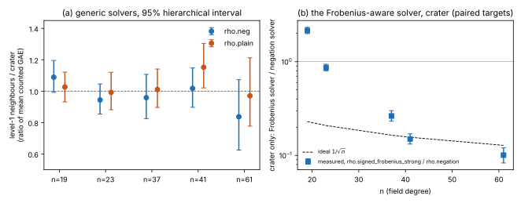

# Run report run-20261018T1625Z: crater against level-1 neighbours, Koblitz curves over F_(2^n)

Descriptive. Interpretation is in [`../../RESULT.md`](../../RESULT.md).

**What ran.** `crypto volcano ecbench-spec` wrote the specs in `specs/n*/`; `./run_sessions.sh n19 n23 n37 n41` and
`./run_sessions.sh n61` ran each with `ecbench run --wait --allow-busy --cpus none` and audited it with
`ecbench verify --replay 8`. Protocol: [`PROTOCOL.md`](../../PROTOCOL.md) (with its dated addendum). Base commit
`a8194d616`, working tree dirty (the native tools were uncommitted when the sessions ran).

**Host and isolation.** A busy host (a concurrent long computation held three cores), so every run is at level L0:
counted operations only, no wall-time figure is reported. `--cpus none`.

**Sessions.**

| session dir | session id | spec id | planned | records | status | start | end | audit receipt |
|---|---|---|---|---|---|---|---|---|
| n19-crater | ECBS1h8db0b7e2cb82 | ECS1h4f5b9797a7e7 | 512 | 512 | complete | 16:25Z | 16:25Z | audit OK: 512 records, 512 verified, 8 replays reproduced, 0 problems |
| n19-neighbors | ECBS1h80d0ce5ec1a5 | ECS1h9e04c9536701 | 1152 | 1152 | complete | 16:25Z | 16:26Z | audit OK: 1152 records, 1152 verified, 8 replays reproduced, 0 problems |
| n23-crater | ECBS1h9d8b14780c2e | ECS1h8e75ada25f8a | 512 | 512 | complete | 16:26Z | 16:26Z | audit OK: 512 records, 512 verified, 8 replays reproduced, 0 problems |
| n23-neighbors | ECBS1h30f89794578b | ECS1h53345f218169 | 1152 | 1152 | complete | 16:26Z | 16:27Z | audit OK: 1152 records, 1152 verified, 8 replays reproduced, 0 problems |
| n37-crater | ECBS1hfb8a14c394b1 | ECS1h90412d87bdcf | 512 | 512 | complete | 16:27Z | 16:28Z | audit OK: 512 records, 512 verified, 8 replays reproduced, 0 problems |
| n37-neighbors | ECBS1hf05295b5d295 | ECS1h48de1cd820c8 | 1152 | 1152 | complete | 16:28Z | 16:29Z | audit OK: 1152 records, 1152 verified, 8 replays reproduced, 0 problems |
| n41-crater | ECBS1h59d2c1fd72cd | ECS1hd68753ebe7ff | 512 | 512 | complete | 16:29Z | 16:31Z | audit OK: 512 records, 512 verified, 8 replays reproduced, 0 problems |
| n41-neighbors | ECBS1hc222f2c38f5d | ECS1h7f865ea1387e | 1152 | 1152 | complete | 16:31Z | 16:37Z | audit OK: 1152 records, 1152 verified, 8 replays reproduced, 0 problems |
| n61-crater | ECBS1ha6afec2c007a | ECS1h22c1e916b340 | 192 | 192 | complete | 16:45Z | 16:57Z | audit OK: 192 records, 192 verified, 8 replays reproduced, 0 problems |
| n61-neighbors | ECBS1h31b40584192c | ECS1h9a7ee3396481 | 216 | 216 | complete | 16:58Z | 17:14Z | audit OK: 216 records, 216 verified, 8 replays reproduced, 0 problems |

Every session finished with every planned execution recorded and every record verified; there were no failed or
timed-out executions.

**Arms.** `rho.negation` (reference on the level-1 curves), `rho.plain` (baseline), `rho.negation` repeated as control
(`rho-neg-aa`, bit-identical to `rho-neg` because ecbench's counts are deterministic), and on the crater only
`rho.signed_frobenius_strong` (reference there). Seeds: `target_seed` 20261018, measurement seed 18 (n = 61: 18).
Workloads: crater 32 targets (16 at n = 61); each level-1 neighbour 8 targets (4 at n = 61); 12 neighbours (6 at n = 61).

**Measured values** (unit `ecbench.gae`; replication unit a workload; computed by `examples/volcano_layers_analyze.rs`,
`TABLES.md`, `tables.json`):

| n | layer / arm | curves | targets | mean GAE | sd of per-target GAE | mean S |
|---|---|---|---|---|---|---|
| 19 | crater/rho-frob-strong | 1 | 32 | 1,116.3 | 44.2 | 3.086 |
| 19 | crater/rho-neg | 1 | 32 | 518.5 | 113.7 | 1.433 |
| 19 | crater/rho-plain | 1 | 32 | 649.1 | 142.8 | 1.794 |
| 19 | level 1/rho-neg | 12 | 96 | 564.8 | 114.1 | 1.561 |
| 19 | level 1/rho-plain | 12 | 96 | 666.3 | 137.7 | 1.842 |
| 23 | crater/rho-frob-strong | 1 | 32 | 1,641.5 | 125.7 | 1.134 |
| 23 | crater/rho-neg | 1 | 32 | 1,899.1 | 421.4 | 1.312 |
| 23 | crater/rho-plain | 1 | 32 | 2,184.0 | 583.2 | 1.509 |
| 23 | level 1/rho-neg | 12 | 96 | 1,793.1 | 496.2 | 1.239 |
| 23 | level 1/rho-plain | 12 | 96 | 2,168.1 | 591.9 | 1.498 |
| 37 | crater/rho-frob-strong | 1 | 32 | 4,085.7 | 679.2 | 0.269 |
| 37 | crater/rho-neg | 1 | 32 | 15,500.3 | 5,335.0 | 1.021 |
| 37 | crater/rho-plain | 1 | 32 | 20,523.0 | 5,737.7 | 1.351 |
| 37 | level 1/rho-neg | 12 | 96 | 14,863.3 | 4,288.3 | 0.979 |
| 37 | level 1/rho-plain | 12 | 96 | 20,744.1 | 6,311.2 | 1.366 |
| 41 | crater/rho-frob-strong | 1 | 32 | 105,836.7 | 28,556.5 | 0.143 |
| 41 | crater/rho-neg | 1 | 32 | 707,359.6 | 231,949.9 | 0.954 |
| 41 | crater/rho-plain | 1 | 32 | 876,965.1 | 251,940.3 | 1.183 |
| 41 | level 1/rho-neg | 12 | 96 | 719,924.2 | 171,309.3 | 0.971 |
| 41 | level 1/rho-plain | 12 | 96 | 1,010,449.3 | 276,566.0 | 1.363 |
| 61 | crater/rho-frob-strong | 1 | 16 | 1,474,699.4 | 476,663.5 | 0.116 |
| 61 | crater/rho-neg | 1 | 16 | 14,648,521.0 | 4,422,631.5 | 1.148 |
| 61 | crater/rho-plain | 1 | 16 | 17,813,253.7 | 5,616,442.4 | 1.396 |
| 61 | level 1/rho-neg | 6 | 24 | 12,265,990.7 | 4,350,554.3 | 0.961 |
| 61 | level 1/rho-plain | 6 | 24 | 17,287,569.9 | 6,289,023.1 | 1.355 |

**Ratios** (95% hierarchical bootstrap, curves then targets; 4000 resamples):

| n | comparison | ratio of means | 95% interval | ideal 1/sqrt(n) |
|---|---|---|---|---|
| 19 | level1/crater rho-neg | 1.089 | [0.993, 1.195] |  |
| 19 | level1/crater rho-plain | 1.027 | [0.932, 1.121] |  |
| 19 | crater frob-strong/neg | 2.153 | [1.992, 2.329] | 0.229 |
| 23 | level1/crater rho-neg | 0.944 | [0.854, 1.046] |  |
| 23 | level1/crater rho-plain | 0.993 | [0.882, 1.121] |  |
| 23 | crater frob-strong/neg | 0.864 | [0.799, 0.939] | 0.209 |
| 37 | level1/crater rho-neg | 0.959 | [0.825, 1.107] |  |
| 37 | level1/crater rho-plain | 1.011 | [0.896, 1.141] |  |
| 37 | crater frob-strong/neg | 0.264 | [0.232, 0.300] | 0.164 |
| 41 | level1/crater rho-neg | 1.018 | [0.897, 1.148] |  |
| 41 | level1/crater rho-plain | 1.152 | [1.021, 1.304] |  |
| 41 | crater frob-strong/neg | 0.150 | [0.132, 0.170] | 0.156 |
| 61 | level1/crater rho-neg | 0.837 | [0.625, 1.073] |  |
| 61 | level1/crater rho-plain | 0.970 | [0.777, 1.213] |  |
| 61 | crater frob-strong/neg | 0.101 | [0.083, 0.120] | 0.128 |

*Figure. (a) Ratio of mean counted GAE, level-1 neighbours over the crater, for the two generic solvers, with 95%
hierarchical-bootstrap intervals. (b) On the crater only: `rho.signed_frobenius_strong` over `rho.negation` on the same
targets, against `1/sqrt(n)`. Sessions in the table above; sample sizes in the measured-values table.*

**Missing or limited.** The neighbour curves are not in `docs/curves/registry.json` (`registered=false` in the plans).
The `rho-neg-aa` control carries no sampling information. At n = 61 only 6 neighbours and 4 targets each were run, so
its intervals are wide. No wall time. No isogeny map between a neighbour and the crater was computed.

**Raw records.** `sessions/n*-{crater,neighbors}/records.jsonl`; logs `sessions/*.run.log`, `sessions/*.verify.log`.
