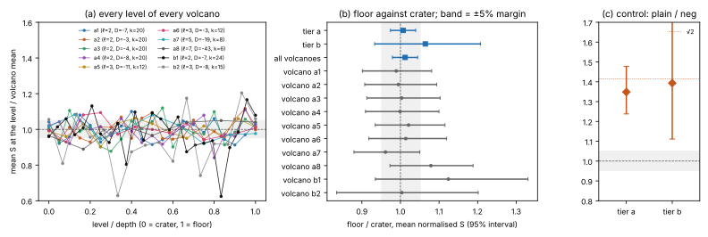

# RESULT: generic ECDLP cost is the same on every level of a tall volcano, within ±5%

This is the pre-registered study of `PROTOCOL.md`. Every number below comes from `TABLES.md` / `tables.json`, written by `examples/volcano_tall_analyze.rs`. The figure is `fig_levels.svg`; the descriptive run report is `reports/run-20261019/report.pdf`.

## Answer

**Equivalent within ±5%.** In tier a pooled, and in all ten volcanoes pooled, every pre-registered comparison lies inside the ±5% margin:
- floor/crater, middle/crater and floor/middle ratios;
- the crater→floor slope.

The distribution test (H2) finds no difference. The positive control resolves the known plain/negation gap. On these volcanoes, which way rho walks the level structure does not change its cost.

| scope | solves (crater / middle / floor) | comparison | estimate | 95% interval | reading |
|---|---|---|--:|---|---|
| tier a (8 volcanoes) | 2400 / 8804 / 2432 | floor / crater | 1.0070 | [0.9741, 1.0394] | equivalent within the margin |
| tier a | | middle / crater | 0.9898 | [0.9654, 1.0139] | equivalent within the margin |
| tier a | | floor / middle | 1.0174 | [0.9881, 1.0467] | equivalent within the margin |
| tier a | | crater→floor slope | +0.87% | [−2.03%, +3.75%] | equivalent within the margin |
| tier a | | KS crater vs floor | D = 0.0199 | p = 0.715 | H2 not rejected |
| all 10 volcanoes | 2625 / 9434 / 2672 | floor / crater | 1.0122 | [0.9792, 1.0445] | equivalent within the margin |
| all 10 | | middle / crater | 0.9884 | [0.9647, 1.0128] | equivalent within the margin |
| all 10 | | floor / middle | 1.0241 | [0.9936, 1.0522] | equivalent within the margin |
| all 10 | | crater→floor slope | +1.16% | [−1.71%, +3.92%] | equivalent within the margin |
| all 10 | | KS crater vs floor | D = 0.0217 | p = 0.542 | H2 not rejected |
| tier b (2 volcanoes, r ≈ 2^50–2^51) | 225 / 630 / 240 | floor / crater | 1.0644 | [0.9331, 1.2073] | no difference detected; wider than the margin (scale check, as planned) |

**Positive control (gate passed).** `Σ S(rho.plain) / Σ S(rho.negation)` on the same workloads and seeds:
- tier a: 1.3485 [1.2380, 1.4780] (512 pairs);
- tier b: 1.3934 [1.1111, 1.7670] (80 pairs).

Both lie above the margin. The theoretical factor is √2 ≈ 1.414, less the measured overhead of negation rho.

So the design resolves a 35% difference with room to spare, and bounds any level effect below about 4%.

**Per volcano.** None of the 40 per-volcano intervals (10 volcanoes × 4 rows) excludes the null value. At 95% about two would be expected to by chance. The widest swings are:
- a8 (ℓ=7, depth 6): floor/crater 1.079 [0.973, 1.188], slope +9.2% [−0.6, +18.4];
- a7 (ℓ=5, prime #E): floor/crater 0.961 [0.879, 1.050], slope −5.2%.

They have opposite signs, and pooling removes them.

**Size.** Mean raw S of `rho.negation`, against the floor √(π/4) = 0.8862:
- tier a: 0.947 [0.936, 0.958];
- tier b: 0.936 [0.902, 0.974].

The same constant holds from r ≈ 2^42 to 2^51, about 7% above the floor: negation rho's overhead, not a level effect.

## What was covered

- **Volcanoes:** ten, with ℓ ∈ {2, 3, 5, 7} and depths 6 to 24. The tallest floors hold 8.4 and 9.6 million curves.
- **Crater types:** split, inert and ramified, including the `j = 0` and `j = 1728` craters.
- **Group structure:** in one volcano (a4, m = 6) `E(F_p)` changes from `ℤ/64 × …` at the crater to cyclic at the floor.
- **Sampled curves:** 608, each checked to sit at its level (class numbers within the BFS range, degree rule, blind descent) and to have the predicted group structure.
- **Solves:** 14,731 `rho.negation` solves at the levels, plus 592 control pairs, in 53 sessions.

## Deviations, stated plainly

- **Three tier-b sessions were cut short.** A worker restart killed `b1__spec_t3` (401 of 504 records), `b2__spec_t3` (169 of 312) and `b2__spec_t60` (105 of 120; this is b2's crater).
  - They were not re-run, as the protocol requires. Their measured records are all used.
  - Their audits report exactly two problems each: the session never reached `complete`, and records are fewer than planned. Every record verified and 8 of 8 replays reproduced.
  - The other 50 sessions audit OK.
  - Tier b's planned scale check is weaker than designed. Tier a and the decision rules are unaffected.
- **Analysis code edits after the first session started.** The analysis program was dry-run on the first partial records to test the code.
  - Its results were not used.
  - Three crash fixes followed: skip non-directory entries in `specs/`, tolerate a missing group while data was partial, and sort with NaN present.
  - No method, unit, normalisation, margin or test changed.
- **Session scheduling.** Sessions started in alphabetical rather than longest-first order (PROTOCOL.md freeze record). This affects scheduling only.

## What this does and does not say

- It says the **generic** solver's cost is level-blind to within a few percent. That is what the generic-group model predicts, since all curves in the volcano share the group order `r`. It is now measured, at high resolution, on real tall volcanoes.
  - The earlier ±30% intervals (`research/volcano_prime_layers_20261018`) were too wide to say this.
  - So was the "±8%" this work once quoted, which was retracted.
- It says nothing about attacks that **use** the volcano: walking explicit isogenies to a weaker curve, endomorphism-ring–dependent index calculus, or pairings.
  - Within one volcano every curve has the same `#E`, so a transfer gains nothing for generic attacks: this result confirms the cost is identical at the destination.
  - Whether a non-generic attack depends on the level is a different experiment.
- The extra automorphisms of the `j = 0` / `j = 1728` craters are not used by ecbench's prime solvers. An automorphism-folded solver would gain √3 or √2 on those craters only. That is known theory and is not measured here.
- No claim about deployed curves. Curves are unregistered (`registered=false`) and are named by volcano id and level.
- Counts only (isolation L0); no wall time.
