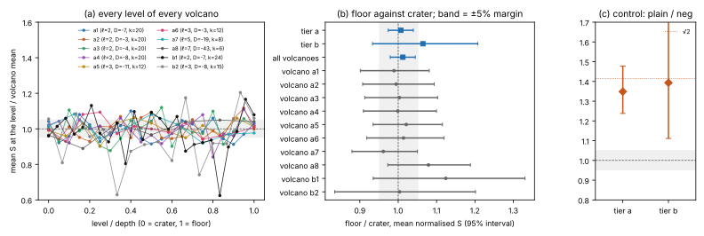

# Run report run-20261019

Descriptive; the interpretation is in RESULT.md. Every number comes from `tables.json` (`examples/volcano_tall_analyze.rs`).

## Sessions

| session | session id | spec id | records | status | audit |
|---|---|---|---|---|---|
| a1__control | ECBS1h9a255d0ffa27 | ECS1hc19de2cad0be | 128 | complete | audit OK: 128 records, 128 verified, 8 replays reproduced, 0 problems |
| a1__spec_t10 | ECBS1h1e29333f6646 | ECS1h61e0162b2752 | 1360 | complete | audit OK: 1360 records, 1360 verified, 8 replays reproduced, 0 problems |
| a1__spec_t150 | ECBS1hc4ac7ba545f7 | ECS1h16b82ad80357 | 300 | complete | audit OK: 300 records, 300 verified, 8 replays reproduced, 0 problems |
| a1__spec_t20 | ECBS1h062552713b8f | ECS1h7ef8b221d3c7 | 80 | complete | audit OK: 80 records, 80 verified, 8 replays reproduced, 0 problems |
| a1__spec_t38 | ECBS1h424621da48c2 | ECS1hf52533f57d6a | 304 | complete | audit OK: 304 records, 304 verified, 8 replays reproduced, 0 problems |
| a1__spec_t40 | ECBS1h5c695aadceab | ECS1h94936d9c32a8 | 80 | complete | audit OK: 80 records, 80 verified, 8 replays reproduced, 0 problems |
| a2__control | ECBS1h40737d08523f | ECS1h14a518fabc9a | 128 | complete | audit OK: 128 records, 128 verified, 8 replays reproduced, 0 problems |
| a2__spec_t10 | ECBS1h1f3e55187301 | ECS1h3e7c89fa3292 | 1360 | complete | audit OK: 1360 records, 1360 verified, 8 replays reproduced, 0 problems |
| a2__spec_t150 | ECBS1hfcfc78834f68 | ECS1h2ab9ad4966dd | 300 | complete | audit OK: 300 records, 300 verified, 8 replays reproduced, 0 problems |
| a2__spec_t20 | ECBS1h36a5acc78525 | ECS1h6f5abe1e3f43 | 80 | complete | audit OK: 80 records, 80 verified, 8 replays reproduced, 0 problems |
| a2__spec_t38 | ECBS1h89cb0d883c97 | ECS1h40450da9a76b | 304 | complete | audit OK: 304 records, 304 verified, 8 replays reproduced, 0 problems |
| a2__spec_t40 | ECBS1hf3695031c9b9 | ECS1h113957733cb5 | 80 | complete | audit OK: 80 records, 80 verified, 8 replays reproduced, 0 problems |
| a3__control | ECBS1he28f11c135be | ECS1h7732b0639c95 | 128 | complete | audit OK: 128 records, 128 verified, 8 replays reproduced, 0 problems |
| a3__spec_t10 | ECBS1h1d97bd3eb794 | ECS1hc875b2f8ba06 | 1360 | complete | audit OK: 1360 records, 1360 verified, 8 replays reproduced, 0 problems |
| a3__spec_t150 | ECBS1h6f09e531e3f0 | ECS1he1144476f5c2 | 300 | complete | audit OK: 300 records, 300 verified, 8 replays reproduced, 0 problems |
| a3__spec_t20 | ECBS1hd1f7e080b249 | ECS1hc55d1bbd6bcd | 80 | complete | audit OK: 80 records, 80 verified, 8 replays reproduced, 0 problems |
| a3__spec_t38 | ECBS1hdf4c83a8dd40 | ECS1h144872497940 | 304 | complete | audit OK: 304 records, 304 verified, 8 replays reproduced, 0 problems |
| a3__spec_t40 | ECBS1hcc11a46b9f21 | ECS1h7859c640fb2f | 80 | complete | audit OK: 80 records, 80 verified, 8 replays reproduced, 0 problems |
| a4__control | ECBS1ha587de30bc40 | ECS1h6194a78ed439 | 128 | complete | audit OK: 128 records, 128 verified, 8 replays reproduced, 0 problems |
| a4__spec_t10 | ECBS1h718c7bfde5c6 | ECS1h104951e4abab | 1440 | complete | audit OK: 1440 records, 1440 verified, 8 replays reproduced, 0 problems |
| a4__spec_t150 | ECBS1h63f826d3f19e | ECS1hd69508907f5c | 300 | complete | audit OK: 300 records, 300 verified, 8 replays reproduced, 0 problems |
| a4__spec_t20 | ECBS1h7132af76e7e3 | ECS1hcd47dd95bdd2 | 80 | complete | audit OK: 80 records, 80 verified, 8 replays reproduced, 0 problems |
| a4__spec_t38 | ECBS1h39e10d9b2e41 | ECS1h2f7adc1b9a69 | 304 | complete | audit OK: 304 records, 304 verified, 8 replays reproduced, 0 problems |
| a5__control | ECBS1ha36faa46460a | ECS1h9b00e208bb7c | 128 | complete | audit OK: 128 records, 128 verified, 8 replays reproduced, 0 problems |
| a5__spec_t10 | ECBS1hb169d9050170 | ECS1h331ead1b2118 | 800 | complete | audit OK: 800 records, 800 verified, 8 replays reproduced, 0 problems |
| a5__spec_t150 | ECBS1h283f2a496e62 | ECS1h00287ec6c9ce | 300 | complete | audit OK: 300 records, 300 verified, 8 replays reproduced, 0 problems |
| a5__spec_t20 | ECBS1ha54ea854ffb8 | ECS1hab112efdc7d7 | 80 | complete | audit OK: 80 records, 80 verified, 8 replays reproduced, 0 problems |
| a5__spec_t38 | ECBS1h1bcf5138b1e6 | ECS1hde783562ebce | 304 | complete | audit OK: 304 records, 304 verified, 8 replays reproduced, 0 problems |
| a6__control | ECBS1ha0c3c55d1a10 | ECS1h87722a9db90f | 128 | complete | audit OK: 128 records, 128 verified, 8 replays reproduced, 0 problems |
| a6__spec_t10 | ECBS1h6177ff4d54bc | ECS1hfb4ed6e3f4ed | 720 | complete | audit OK: 720 records, 720 verified, 8 replays reproduced, 0 problems |
| a6__spec_t14 | ECBS1hf86b519ce0a3 | ECS1hcf65cd6492d3 | 84 | complete | audit OK: 84 records, 84 verified, 8 replays reproduced, 0 problems |
| a6__spec_t150 | ECBS1h7931ff75c55d | ECS1hcc859ca2e041 | 300 | complete | audit OK: 300 records, 300 verified, 8 replays reproduced, 0 problems |
| a6__spec_t38 | ECBS1hbdbb4bb23f6b | ECS1h07985eb3f73a | 304 | complete | audit OK: 304 records, 304 verified, 8 replays reproduced, 0 problems |
| a6__spec_t40 | ECBS1h963ce46d77f7 | ECS1ha3ee82f74610 | 80 | complete | audit OK: 80 records, 80 verified, 8 replays reproduced, 0 problems |
| a7__control | ECBS1h3fcabf8a02b6 | ECS1h5660f6923d25 | 128 | complete | audit OK: 128 records, 128 verified, 8 replays reproduced, 0 problems |
| a7__spec_t10 | ECBS1h49623778c21f | ECS1hb617a919d6b3 | 560 | complete | audit OK: 560 records, 560 verified, 8 replays reproduced, 0 problems |
| a7__spec_t150 | ECBS1h03fdbd14724a | ECS1h5cc641ea0b38 | 300 | complete | audit OK: 300 records, 300 verified, 8 replays reproduced, 0 problems |
| a7__spec_t38 | ECBS1h7b7a62f2b154 | ECS1h378b3cf3dae2 | 304 | complete | audit OK: 304 records, 304 verified, 8 replays reproduced, 0 problems |
| a8__control | ECBS1h72adb45644af | ECS1h4c13c24e2666 | 128 | complete | audit OK: 128 records, 128 verified, 8 replays reproduced, 0 problems |
| a8__spec_t10 | ECBS1h23341feaeb05 | ECS1h71a3058cb91a | 400 | complete | audit OK: 400 records, 400 verified, 8 replays reproduced, 0 problems |
| a8__spec_t150 | ECBS1h1e68775d38ae | ECS1h4749b8e63adc | 300 | complete | audit OK: 300 records, 300 verified, 8 replays reproduced, 0 problems |
| a8__spec_t38 | ECBS1h1631cb76b491 | ECS1h8f50cdc73c11 | 304 | complete | audit OK: 304 records, 304 verified, 8 replays reproduced, 0 problems |
| b1__control | ECBS1he62bac363a4c | ECS1h94aeb8025dd4 | 80 | complete | audit OK: 80 records, 80 verified, 8 replays reproduced, 0 problems |
| b1__spec_t10 | ECBS1h28c5fc997545 | ECS1he2b9469fffdc | 20 | complete | audit OK: 20 records, 20 verified, 8 replays reproduced, 0 problems |
| b1__spec_t15 | ECBS1h33d4bef464da | ECS1hbe7936169e73 | 120 | complete | audit OK: 120 records, 120 verified, 8 replays reproduced, 0 problems |
| b1__spec_t3 | ECBS1h5a13eb2d0443 | ECS1h9be62071a236 | 401 | running | audit FAILED: 401 records, 401 verified, 8 replays reproduced, 2 problems |
| b1__spec_t5 | ECBS1h2e67e35a6534 | ECS1h8360469d43b8 | 20 | complete | audit OK: 20 records, 20 verified, 8 replays reproduced, 0 problems |
| b1__spec_t60 | ECBS1h5d8416ba2c94 | ECS1hd9779d3fa6e6 | 120 | complete | audit OK: 120 records, 120 verified, 8 replays reproduced, 0 problems |
| b2__control | ECBS1h1ba6df900180 | ECS1h585b85344515 | 80 | complete | audit OK: 80 records, 80 verified, 8 replays reproduced, 0 problems |
| b2__spec_t15 | ECBS1h8b822ce5c9f1 | ECS1hb7309fcbfed9 | 120 | complete | audit OK: 120 records, 120 verified, 8 replays reproduced, 0 problems |
| b2__spec_t3 | ECBS1hfe4e8ab8769b | ECS1hfc3fe4fa727e | 169 | running | audit FAILED: 169 records, 169 verified, 8 replays reproduced, 2 problems |
| b2__spec_t5 | ECBS1h10856eb64318 | ECS1he998e23aa93d | 20 | complete | audit OK: 20 records, 20 verified, 8 replays reproduced, 0 problems |
| b2__spec_t60 | ECBS1hd80f45a73d83 | ECS1h619ee22f49e8 | 105 | running | audit FAILED: 105 records, 105 verified, 8 replays reproduced, 2 problems |

## Volcanoes

| id | ℓ | D | depth | m | p | r | solves | mean S |
|---|---|---|---|---|---|---|---|---|
| a1 | 2 | -7 | 20 | 0 | 79739179114697 | 19934790368033 | 2124 | 0.9442 |
| a2 | 2 | -3 | 20 | 0 | 104602353229057 | 26150583213697 | 2124 | 0.9326 |
| a3 | 2 | -4 | 20 | 0 | 132738671602697 | 33184662163969 | 2124 | 0.9512 |
| a4 | 2 | -8 | 20 | 6 | 88368960461169281 | 7191484364147 | 2124 | 0.9478 |
| a5 | 3 | -11 | 12 | 0 | 75665619317083 | 15133120401881 | 1484 | 0.9538 |
| a6 | 3 | -3 | 12 | 0 | 74457264432181 | 5727480553771 | 1488 | 0.9520 |
| a7 | 5 | -19 | 8 | 0 | 113047896909809 | 113047875713291 | 1164 | 0.9693 |
| a8 | 7 | -43 | 6 | 0 | 133869096336161 | 10297621016051 | 1004 | 0.9344 |
| b1 | 2 | -7 | 24 | 0 | 5263679187971873 | 1315919762456401 | 681 | 0.9115 |
| b2 | 3 | -8 | 15 | 0 | 4561544860849099 | 2280772366005899 | 414 | 0.9762 |

## Pooled

| scope | comparison | estimate | 95% interval / p | reading |
|---|---|---|---|---|
| tier a | floor / crater | 1.0070 | [0.9741, 1.0394] | equivalent within the margin |
| tier a | middle / crater | 0.9898 | [0.9654, 1.0139] | equivalent within the margin |
| tier a | floor / middle | 1.0174 | [0.9881, 1.0467] | equivalent within the margin |
| tier a | slope_percent | 0.8731 | [-2.0262, 3.7461] | equivalent within the margin |
| tier a | KS crater vs floor | D = 0.0199 | p = 0.715 | H2 not rejected |
| tier a | mean raw S (floor 0.8862) | 0.9474 | [0.9364, 0.9584] | descriptive |
| tier b | floor / crater | 1.0644 | [0.9331, 1.2073] | no difference detected; interval wider than the margin |
| tier b | middle / crater | 0.9675 | [0.8897, 1.0543] | no difference detected; interval wider than the margin |
| tier b | floor / middle | 1.1001 | [0.9686, 1.2356] | no difference detected; interval wider than the margin |
| tier b | slope_percent | 4.4919 | [-6.8575, 15.8945] | no difference detected; interval wider than the margin |
| tier b | KS crater vs floor | D = 0.1108 | p = 0.104 | H2 not rejected |
| tier b | mean raw S (floor 0.8862) | 0.9360 | [0.9017, 0.9741] | descriptive |
| all volcanoes | floor / crater | 1.0122 | [0.9792, 1.0445] | equivalent within the margin |
| all volcanoes | middle / crater | 0.9884 | [0.9647, 1.0128] | equivalent within the margin |
| all volcanoes | floor / middle | 1.0241 | [0.9936, 1.0522] | equivalent within the margin |
| all volcanoes | slope_percent | 1.1636 | [-1.7074, 3.9230] | equivalent within the margin |
| all volcanoes | KS crater vs floor | D = 0.0217 | p = 0.542 | H2 not rejected |
| all volcanoes | mean raw S (floor 0.8862) | 0.9465 | [0.9365, 0.9565] | descriptive |

## Positive control

| tier | curves | pairs | Σ plain / Σ neg | 95% interval | reading |
|---|---|---|---|---|---|
| tier a | 32 | 512 | 1.3485 | [1.2380, 1.4780] | difference detected, larger than the margin |
| tier b | 8 | 80 | 1.3934 | [1.1111, 1.7670] | difference detected, larger than the margin |

## Per volcano

| scope | comparison | estimate | 95% interval / p | reading |
|---|---|---|---|---|
| volcano a1 | floor / crater | 0.9890 | [0.9012, 1.0809] | no difference detected; interval wider than the margin |
| volcano a1 | middle / crater | 0.9463 | [0.8889, 1.0101] | no difference detected; interval wider than the margin |
| volcano a1 | floor / middle | 1.0451 | [0.9646, 1.1282] | no difference detected; interval wider than the margin |
| volcano a1 | slope_percent | -1.1783 | [-8.6996, 6.3520] | no difference detected; interval wider than the margin |
| volcano a2 | floor / crater | 0.9947 | [0.9074, 1.0938] | no difference detected; interval wider than the margin |
| volcano a2 | middle / crater | 0.9974 | [0.9305, 1.0692] | no difference detected; interval wider than the margin |
| volcano a2 | floor / middle | 0.9973 | [0.9192, 1.0781] | no difference detected; interval wider than the margin |
| volcano a2 | slope_percent | 2.2573 | [-5.4872, 9.9121] | no difference detected; interval wider than the margin |
| volcano a3 | floor / crater | 1.0030 | [0.9129, 1.1027] | no difference detected; interval wider than the margin |
| volcano a3 | middle / crater | 0.9828 | [0.9141, 1.0583] | no difference detected; interval wider than the margin |
| volcano a3 | floor / middle | 1.0206 | [0.9421, 1.1026] | no difference detected; interval wider than the margin |
| volcano a3 | slope_percent | 1.6401 | [-6.1348, 9.2853] | no difference detected; interval wider than the margin |
| volcano a4 | floor / crater | 0.9990 | [0.9092, 1.0998] | no difference detected; interval wider than the margin |
| volcano a4 | middle / crater | 0.9710 | [0.9066, 1.0417] | no difference detected; interval wider than the margin |
| volcano a4 | floor / middle | 1.0288 | [0.9425, 1.1217] | no difference detected; interval wider than the margin |
| volcano a4 | slope_percent | -0.2602 | [-8.0472, 7.7148] | no difference detected; interval wider than the margin |
| volcano a5 | floor / crater | 1.0210 | [0.9346, 1.1154] | no difference detected; interval wider than the margin |
| volcano a5 | middle / crater | 1.0094 | [0.9364, 1.0878] | no difference detected; interval wider than the margin |
| volcano a5 | floor / middle | 1.0115 | [0.9354, 1.0920] | no difference detected; interval wider than the margin |
| volcano a5 | slope_percent | 2.5298 | [-5.1575, 10.3359] | no difference detected; interval wider than the margin |
| volcano a6 | floor / crater | 1.0138 | [0.9180, 1.1196] | no difference detected; interval wider than the margin |
| volcano a6 | middle / crater | 1.0053 | [0.9341, 1.0819] | no difference detected; interval wider than the margin |
| volcano a6 | floor / middle | 1.0085 | [0.9211, 1.1044] | no difference detected; interval wider than the margin |
| volcano a6 | slope_percent | -0.9308 | [-8.9541, 7.4288] | no difference detected; interval wider than the margin |
| volcano a7 | floor / crater | 0.9612 | [0.8794, 1.0501] | no difference detected; interval wider than the margin |
| volcano a7 | middle / crater | 0.9885 | [0.9100, 1.0723] | no difference detected; interval wider than the margin |
| volcano a7 | floor / middle | 0.9724 | [0.8916, 1.0649] | no difference detected; interval wider than the margin |
| volcano a7 | slope_percent | -5.2047 | [-13.9669, 3.1394] | no difference detected; interval wider than the margin |
| volcano a8 | floor / crater | 1.0788 | [0.9728, 1.1882] | no difference detected; interval wider than the margin |
| volcano a8 | middle / crater | 1.0315 | [0.9323, 1.1388] | no difference detected; interval wider than the margin |
| volcano a8 | floor / middle | 1.0458 | [0.9382, 1.1639] | no difference detected; interval wider than the margin |
| volcano a8 | slope_percent | 9.1657 | [-0.5834, 18.3721] | no difference detected; interval wider than the margin |
| volcano b1 | floor / crater | 1.1241 | [0.9348, 1.3304] | no difference detected; interval wider than the margin |
| volcano b1 | middle / crater | 1.0307 | [0.9240, 1.1478] | no difference detected; interval wider than the margin |
| volcano b1 | floor / middle | 1.0906 | [0.9110, 1.2772] | no difference detected; interval wider than the margin |
| volcano b1 | slope_percent | 5.3769 | [-11.0246, 20.6958] | no difference detected; interval wider than the margin |
| volcano b2 | floor / crater | 1.0036 | [0.8347, 1.2015] | no difference detected; interval wider than the margin |
| volcano b2 | middle / crater | 0.8821 | [0.7703, 1.0125] | no difference detected; interval wider than the margin |
| volcano b2 | floor / middle | 1.1377 | [0.9486, 1.3588] | no difference detected; interval wider than the margin |
| volcano b2 | slope_percent | 3.4135 | [-13.4034, 20.0367] | no difference detected; interval wider than the margin |

Unverified measured records: 0.
