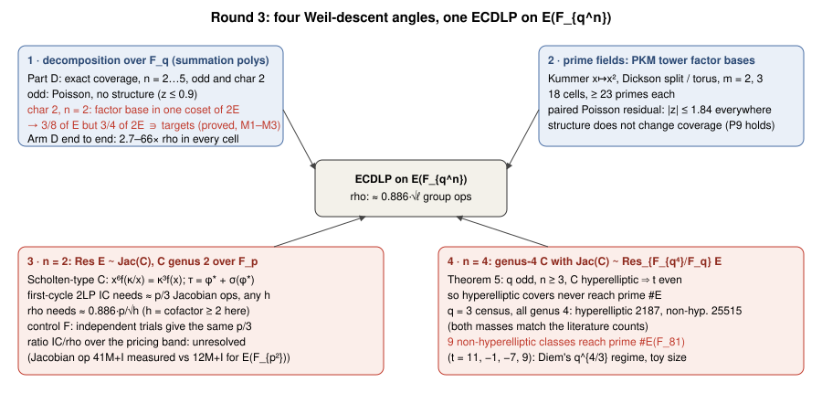
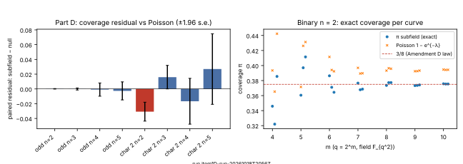
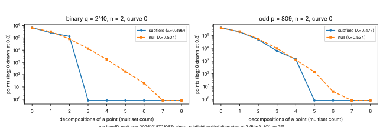
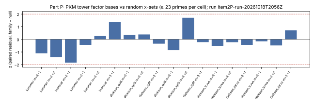
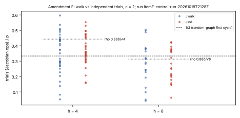
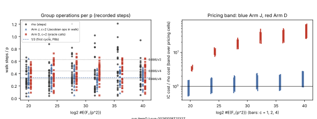
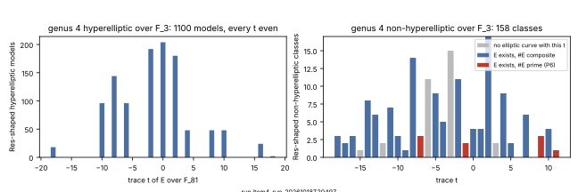

# Weil descent beyond covers: four angles, measured (round 3)

**Status.** A research search under a protocol frozen before every run
(`PROTOCOL.md`: Addendum A and Amendments B–G, each committed before the
runs it governs). Each item has a recorded run, a run report with a graph,
and checks. Nothing here is a speed record on a curve anyone deploys. Every
cost is a counted operation, never wall-clock. Conductor is not installable
on this host (installer HTTP 403 through the session proxy).

Tags: **[E]** exact enumeration or counted measurement in this round;
**[T]** proved here; **[L]** recalled from the literature and not re-read
this round (novelty audit owed).

## Answer

The four angles are (a) decomposition over `F_{q^n}` with summation
polynomials and Weil descent; (b) prime fields through Petit–Kosters–Messeng
(PKM) descent onto a subspace; (c) the constant factor at `n = 2`, from
genus-2 index calculus over `F_p`; (d) genus-4 Jacobians isogenous to
`Res_{F_{q^4}/F_q} E`. They are answered in order below.

1. **Decomposition coverage is Poisson, with one structural exception
   [E, T].** For generic `E/F_{q^n}` and the factor base `x ∈ F_q`, the
   coverage (the share of points that are a sum of `n` factor-base points)
   was computed exactly over the whole group. In odd characteristic at
   `n = 2…5` it matches a random `x`-set of the same size: the paired
   residual from Poisson has `|z| ≤ 0.94` (§1.1).

   The exception is **binary `n = 2`**, where `π → 3/8` rather than the
   Poisson value `1 − e^{−1/2} = 0.3935` (z = −4.72). The cause is proved
   (§1.2):
   - every `x ∈ F_q` has `Tr_{F_{q²}/F_2}(x) = 0`, so the whole factor base
     lies in one coset of `2E`;
   - the descended relation map is F_2-affine, and its image lies in the
     hyperplane `Tr(w/x_3²) = 0`;
   - so a point decomposes only if `Tr(x_3) = Tr(a)`, which holds for half
     the group.

   Inside that half the multiplicities are exactly `Bin(2, 1/2)`. The
   identity and the exact reconstruction of coverage from F_2 cosets agree
   on all 21 curves.

   Attack reading, corrected after the first push: the earlier text called
   the effect neutral to slightly negative, measured over the whole group.
   In an attack every target `aP + bQ` lies in the odd `ℓ`-subgroup, which
   sits inside `2E`, so the relevant figure is coverage of `2E`. That is
   exactly 3/4, against 0.3935 for the Poisson model at the same factor-base
   size: about 1.9× more relations per target. This is a correction of the
   cost model (accounting), not a new algorithm. Coverage of the
   `ℓ`-subgroup itself was not measured separately.

   End to end at `n = 2`, the decomposition route (Arm D) costs **2.7–66×
   rho in every pricing cell**. Its oracle needs a quartic root-finding,
   about 1,000 M per call (§3).

2. **Prime fields via PKM: no coverage effect [E].** The Kummer (`x ↦ x²`)
   and Dickson (split and torus) tower factor bases were tested on 18 cells
   with at least 23 primes each. Their exact coverage is indistinguishable
   from random `x`-sets: every paired-residual `|z| ≤ 1.84`. The algebraic
   structure of the tower does not create extra relations (P9 holds), so
   any PKM advantage would have to come from solving, not from coverage
   (§2).

3. **`n = 2`, genus-2 index calculus against rho: a constant-factor race,
   unresolved [E].** The route uses a Scholten-type `C/F_p` with
   `Jac(C) ~ Res_{F_{p²}/F_p} E` and the verified transfer `τ`.
   - **Operation counts.** First-cycle double-large-prime index calculus
     needs about `p/3` Jacobian operations (0.37 at cofactor `h = 4`, 0.27
     at `h = 8`). Rho needs `0.886·p/√h` (0.44 and 0.31). A control with
     independent trials gives the same counts, so this is not rho hiding
     inside the walk.
   - **Cost per operation.** This tool's genus-2 addition costs 41 M + I,
     against 12 M + I for an `E(F_{p²})` addition.
   - **Ranking.** On 1,260 verified runs up to `log2 #E = 40`, Arm J's
     cost ratio to rho spans the pricing band (0.51–2.83), so the rule
     ranks it **unresolved** at every size. At 40 bits rho is cheaper in
     10 of 12 cells.
   - **Distance to rho.** About 2.8× under measured costs at
     `I = 3M`. Every curve in this family has `h ≥ 2`, and prime-order
     `E` (`h = 1`) is where rho loses most; that is the next experiment
     (§7).

4. **`n = 4`: only non-hyperelliptic genus-4 curves reach prime-order
   `E` [T, E].** Theorem 5 (round 3, proved): for `q` odd and `n ≥ 3`, a
   hyperelliptic genus-`n` curve `C` with `Jac(C) ~ Res_{F_{q^n}/F_q} E`
   forces the trace `t` even. That makes `#E` even, so hyperelliptic covers
   never reach prime-order `E`.

   The exhaustive census of every genus-4 curve over `F_3` confirms this
   and finds the way around it:
   - **Masses.** The hyperelliptic mass is 2,187 (`= 3^7`). The
     non-hyperelliptic mass is 25,515 (`= q^9 + q^8 − q^6`), both matching
     the literature counts.
   - **Hyperelliptic.** All 1,100 Res-shaped hyperelliptic models have
     even `t`.
   - **Non-hyperelliptic.** Of the 158 Res-shaped non-hyperelliptic
     classes, **9 reach a prime-order `E/F_81`**: `t ∈ {11, −1, −7, 9}`,
     `#E ∈ {71, 83, 89, 73}`.

   Those are the curves where Diem's plane-curve index calculus,
   `q^{4/3}`, would apply instead of rho's `q²`. The result is
   toy-sized: the census shows existence; it does not construct the map
   (§4).

## 1. Item 1: decomposition over `F_{q^n}` (Parts D and Arm D)

### 1.1 Exact coverage (Part D, run `item1D-run-20261018T2056Z`) [E]

**Setup.** `E : y² = x³ + ax + b` (odd) or `y² + xy = x³ + ax² + b`
(binary) over `F_{q^n}`, with coefficients outside every proper subfield,
3 curves per field.

**Arms.**

- **subfield:** `F = {P : x(P) ∈ F_q}`;
- **null:** a random `x`-set of equal size;
- **positive:** an interval `{±jG}`.

**Statistic.** For each arm, the exact number of distinct `n`-fold
multiset sums over the whole group. The primary statistic (Amendment B) is
each arm's residual `π − (1 − e^{−λ})`, with `λ` its multiset count over
`#E`. It is paired per curve, subfield against null.

| field | n | curves | λ | π subfield | π null | resid subfield | resid null | diff | z |
|---|---|---|---|---|---|---|---|---|---|
| odd | 2 | 672 | 0.503 | 0.3949 | 0.3931 | +0.00017 | +0.00001 | +0.00016 | 0.94 |
| odd | 3 | 63 | 0.186 | 0.1576 | 0.1787 | −0.00985 | −0.00977 | −0.00007 | −0.10 |
| odd | 4 | 21 | 0.083 | 0.0605 | 0.0625 | −0.01779 | −0.01691 | −0.00088 | −0.19 |
| odd | 5 | 9 | 0.037 | 0.0210 | 0.0187 | −0.01439 | −0.01174 | −0.00265 | −0.43 |
| 2 | 2 | 21 | 0.507 | 0.3730 | 0.4054 | −0.02465 | +0.00615 | **−0.03080** | **−4.72** |
| 2 | 3 | 15 | 0.168 | 0.1385 | 0.2039 | −0.01150 | −0.02743 | +0.01592 | 1.96 |
| 2 | 4 | 9 | 0.147 | 0.0818 | 0.0711 | −0.03826 | −0.02154 | −0.01672 | −1.06 |
| 2 | 5 | 9 | 0.049 | 0.0265 | 0.0529 | −0.02066 | −0.04763 | +0.02696 | 1.11 |

The positive control falls far below Poisson in every cell, with π between
0.003 and 0.03 against 0.04–0.4. So the statistic sees structure when
structure is there. The Gaudry heuristic `1/n!` is not the coverage: π
follows Poisson at the measured `λ`, as P7 predicted.

### 1.2 The binary `n = 2` deficit (Amendment D, run `item1D-mult-run-20261018T2106Z`) [T, E]

Take `y² + xy = x³ + ax² + b` over `F_{q²}` with `q = 2^m`, and write
`e_1 = x_1 + x_2`, `e_2 = x_1x_2`. The descended relation equation is

`S_3 = x_3² e_1² + e_2² + x_3 e_2 + b = 0`.

Squaring is additive in characteristic 2, so
`L_{x_3}(e_1, e_2) = x_3² e_1² + e_2² + x_3 e_2` is F_2-linear from
`F_q²` (dimension `2m`) to `F_{q²}` (dimension `2m`).

**Lemma.** `Tr(L(e)/x_3²) = 0` for every `e ∈ F_q²`.

*Proof.* Write `T = Tr_{F_{q²}/F_2}`. Then
`T(L/x_3²) = T(e_1²) + T((e_2/x_3)² + e_2/x_3) = T(e_1) = 0`. The middle
term vanishes because `T(z² + z) = 0`. The last step holds because
`e_1 ∈ F_q`, so `T(e_1) = Tr_{F_q}(2e_1) = 0`. ∎

Hence `rank L ≤ 2m − 1`. A target is solvable only if `T(b/x_3²) = 0`. A
point `(x_3, y_3)` of `E` satisfies `T(x_3 + a + b/x_3²) = 0`, so a
decomposable point has `T(x_3) = T(a)`. That condition is the classical
halving criterion for `2E`. Every factor-base point has `T(x) = 0` and
lies in one coset of `2E`, so the 2-sums lie in `2E`, which is half the
group.

Measured on 21 curves, `m = 4…10`:

- **M1.** `x(P+Q) + x(P−Q) = x_1x_2/(x_1+x_2)²`, independent of `a` and
  `b`, holds on every pair (0 violations).
- **M2.** `dim ker L = 1` for every `x_3 ∉ F_q`. Exactly half of these
  are solvable (523,776 of 1,048,576 at `m = 10`). Every solution coset
  has size 2 (0 sizes that are not a power of 2).
- **M3.** Rebuilding coverage from the cosets, after the split and
  point-existence conditions, gives the measured distinct count exactly on
  all 21 curves (0 mismatches).

The point multiplicity histogram at `m = 10` is
`(0, 1, 2, ≥3) = (0.626, 0.250, 0.125, 0)`. Inside `2E` that is exactly
`Bin(2, 1/2)`, so `π = (1/2)(3/4) = 3/8`. The measured `π` at
`m = 8…10` is `0.3737–0.3772`.

**Prediction P7b fails as worded.** It said the index of dispersion would
exceed 1. The measured dispersion is `1.0007 ± 0.030`, against
`0.9725 ± 0.032` for the odd subfield. The deficit is a support effect
(half the group is unreachable, and inside it the multiplicities are
under-dispersed), not clustering.

The odd `n = 2` subfield multiplicities also stop at 4 (Bézout on the
descended quartic). At `λ ≈ 0.5` that truncation has no visible effect.

**Attack reading (corrected after the first push).** Over the whole
group the yield is 3/8 against the Poisson value 0.3935, which the first
version of this report read as "4.7% fewer relations per target". That
used the wrong denominator. Every attack target `aP + bQ` lies in the odd
`ℓ`-subgroup, which is contained in `2E`. Inside `2E` the multiplicities
are exactly `Bin(2, 1/2)`, so coverage of `2E` is **3/4**. A random
factor base of the same size reaches 0.39 there, so the subfield factor
base yields about **1.9× more relations per target**, or 1.5× against
Gaudry's `1/n! = 1/2` estimate.

The gain is bounded by the index of the coset subgroup, which is at most
the 2-part of the cofactor. It is a correction to the cost model of binary
`n = 2` decomposition (accounting), not a new algorithm. Coverage of the
`ℓ`-subgroup itself was not measured separately; that is the first
follow-up experiment. Classification: an exact structural fact plus a cost
model correction, not an improvement. We have not checked whether it
is in the literature (novelty audit owed); the `2E` coset observation may
be folklore.

## 2. Item 2: prime fields through PKM factor bases (Part P, run `item2P-run-20261018T2056Z`) [E]

**Setup.** Prime-order `E/F_p`, with `V` the `2^t` roots of a Kummer tower
(`x ↦ x²`) or a Dickson tower (`x ↦ x² − 2`), split or torus, and `t` at
the sizing `|V|^m ≈ m!·r` and one step either side. The coverage of
`m`-fold sums is exact over the whole group. There are 18 cells with 23–24
primes each; Amendment B's paired residual is the statistic.

| family | m | offsets −1 / 0 / +1: paired residual difference (z) |
|---|---|---|
| Kummer | 2 | −0.00024 (−1.10) / −0.00041 (−1.40) / −0.00024 (−1.84) |
| Kummer | 3 | −0.00046 (−0.43) / +0.00043 (0.26) / +0.00043 (1.36) |
| Dickson split | 2 | +0.00008 (0.34) / +0.00015 (0.39) / −0.00004 (−0.34) |
| Dickson split | 3 | −0.00053 (−0.85) / +0.00236 (1.71) / −0.00008 (−0.22) |
| Dickson torus | 2 | −0.00013 (−0.53) / −0.00005 (−0.23) / −0.00005 (−0.45) |
| Dickson torus | 3 | −0.00014 (−0.16) / −0.00100 (−0.48) / +0.00018 (0.71) |

There is no cell with `|z| > 2`. The three Kummer `m = 2` cells lean
negative (z −1.1, −1.4, −1.8). That is within spread, and it is recorded
as a lean, not an effect. P9 holds. Coverage at the sizing point is
0.58–0.65 (`m = 2`) and 0.59–0.61 (`m = 3`), the Poisson values.

## 3. Item 3: the `n = 2` routes end to end (Parts O/J; Amendments C, E, F, G)

### 3.1 Construction and checks [E]

**The curve.** `C : y² = f(x)` over `F_p`, with `f = (x − r)(x − κ/r)·g`,
`g` symmetric of degree 4, `x⁶f(κ/x) = κ³f(x)`, and `κ` a non-square.

**The map.** With `s² = κ`, the map `φ(x, y) = (x + κ/x, y(x + s)/x²)`
sends `C` to `E : v² = h(u)(u + 2s)` over `F_{p²}`. Its Weierstrass form
is `Y² = X³ + h_1X² + h_0h_2X + h_0²f_6`, with `h_i` the Taylor
coefficients of `h` at `u_0 = −2s`.

**The transfer.** `τ(P) = φ^*P + (φ^*P)^σ` lands in the quintic model of
`C`, obtained by sending the rational Weierstrass point `x = r` to
infinity.

**Checks (run `itemOJ-run-20261018T2124Z/checks.txt`).** On 6 instances
(p = 263 … 4507):

- `#C(F_p) = p + 1`, which is the Res-shape;
- `ℓ·P = O`;
- `τ` is a valid divisor and a homomorphism (`τ(P + P') = τP + τP'`);
- `τ(P) ≠ 0` and `ℓ·τ(P) = 0`;
- `N·D = 0` for random `D ∈ Jac(C)(F_p)`.

Every one holds.

**The decomposition oracle** (two descended equations, then a quartic in
`e_1`) equals brute force on all 6,068 points of 4 instances with
`p ≤ 101`.

**Per-operation costs, measured (K5).**

| operation | cost |
|---|---|
| affine `E(F_{p²})` addition | 12 M + 1 I |
| genus-2 addition, this tool's reduced formulas | 41 M + 1 I |
| genus-2 doubling, reduced formulas | 48 M + 1 I |
| generic Cantor addition | 113 M + 4 I |

The reduced formulas agree with Cantor on every tested pair.

### 3.2 What wins the race: the large-prime graph, not the factor base [E]

Every IC answer arrived as a direct relation `a + bk = 0`: a cycle among
large primes with no factor-base column. It came long before `|B| + 10`
B-relations existed. So the factor-base size does not matter: `c = 1, 2, 4`
give the same costs within spread.

In a random multigraph on `n ≈ p/2` vertices (the degree-1 points up to
sign), the expected number of edges before the first cycle is
`∫_0^{1/2} √(1 − 2c) dc · n = n/3`. Half the trials split, so this
predicts `p/3` Jacobian operations (P8b). Rho with the negation map needs
`0.886·√ℓ ≈ 0.886·p/√h`.

**Control F (run `itemF-control-run-20261018T2128Z`).** Independent
random trials (Jind, no walk) need the same number of operations as Arm
J's walk:

| arm | h | runs | trials/p | s.e. |
|---|---|---|---|---|
| Jind (independent trials) | 4 | 33 | 0.369 | 0.017 |
| Jind | 8 | 21 | 0.272 | 0.023 |
| Jwalk (Arm J's walk) | 4 | 33 | 0.344 | 0.023 |
| Jwalk | 8 | 21 | 0.292 | 0.030 |

So the count is not rho hiding inside the walk (P8c holds). The count
does depend on the cofactor: `h = 8` needs fewer trials than `h = 4`.
Relations land in the `ℓ`-subgroup, so for a given point only `1/h` of
partners are possible, which raises the rate of repeated edges. The simple
`p/3` law describes `h ≈ 4–8` only roughly.

### 3.3 End-to-end costs (run `itemOJ-run-20261018T2132Z`, recorded result) [E]

**Scale of the run.**

- 6 sizes, `log2 #E = 20 … 40` (`p ≈ 2^10 … 2^20`), 3 instances each;
  cofactors `h ∈ {4, 8}`.
- 10 targets per instance, so 30 runs per arm and size.
- Arms: R (rho); J and D at `c = 1, 2, 4`.
- **All 1,260 answers verified (`k·P = Q`).**

**Reference arm (K6).** Mean rho `steps/p` against `0.886·√ℓ/p`:

| log2 #E | rho, measured | theory |
|---|---|---|
| 20 | 0.327 ± 0.029 | 0.357 |
| 24 | 0.346 ± 0.038 | 0.400 |
| 28 | 0.429 ± 0.044 | 0.400 |
| 32 | 0.361 ± 0.048 | 0.357 |
| 36 | 0.499 ± 0.054 | 0.443 |
| 40 | 0.388 ± 0.034 | 0.400 |

**Pricing band** (Amendment C). Each cell fixes one value of each:

- `I ∈ {3M, 2·log2(p)·M}`;
- the Jacobian price: measured, or one `E(F_{p²})` addition;
- the native weight: `0`, `0.1` or `1`.

That gives 12 cells for Arm J and 6 for Arm D. An arm is ranked against
rho only where the order holds in every cell. The table gives the IC/rho
cost ratio over the band at `c = 2`:

| log2 #E | Arm J: min–max | cells IC cheaper | Arm D: min–max | verdict J / D |
|---|---|---|---|---|
| 20 | 0.51–1.53 | 6/12 | 2.73–3.83 | unresolved / rho cheaper |
| 24 | 0.64–1.84 | 6/12 | 7.36–12.2 | unresolved / rho cheaper |
| 28 | 0.73–2.12 | 6/12 | 13.9–27.0 | unresolved / rho cheaper |
| 32 | 0.84–2.47 | 5/12 | 22.6–49.5 | unresolved / rho cheaper |
| 36 | 0.75–2.22 | 5/12 | 21.0–51.3 | unresolved / rho cheaper |
| 40 | 0.95–2.83 | 2/12 | 24.8–66.3 | unresolved / rho cheaper |

`c = 1` and `c = 4` are within a few percent of `c = 2`. The best `c` per
size is a post-hoc minimum, which favours IC, and changes no verdict
(`ranking.csv`).

**Reading.**

- **Arm D, the decomposition route.** Rho is cheaper in every cell at
  every size, and the ratio grows with `log p`. Each oracle call
  computes `x^p` modulo the descended quartic, about 1,000 M at
  `p ≈ 2^20`, against rho's 15 M per step. P8 said Arm D's per-trial cost
  would be below Arm J's; that is **falsified**. The oracle costs about 20
  Jacobian operations.
- **Arm J, the genus-2 route.** It is unresolved at every size, and drifts
  toward rho as the fixed setup (`r` scalar multiplications per arm)
  amortises. At 40 bits rho is cheaper in 10 of 12 cells. Under the
  measured Jacobian cost with `I = 3M`, the ratio is 2.80–2.83. Under the
  IC-favourable price (one `E(F_{p²})` addition per Jacobian operation) it
  is 1.10–1.32, or 0.95–1.02 with Fermat-priced inversion.
- **Where the costs come from.** Asymptotically,
  `J/rho ≈ (c_J/c_E) · (trials_J/steps_rho)`. The count ratio is
  `≈ 0.84` at `h = 4` and `≈ 0.9` at `h = 8` (control F). The cost ratio
  `c_J/c_E` is `(41 + I)/(12 + I) ≈ 2.9` at `I = 3M`.
- **Distance remaining to rho on these curves.** About 2.8× under
  measured costs. Closing it needs `c_J/c_E ≲ 1.2` at `h = 4`. That is
  out of reach for genus-2 arithmetic over `F_p` against elliptic
  arithmetic over `F_{p²}`.
- **Exponent.** Both arms are linear in `p` (P8). The fitted slopes of
  `log cost` on `log p` (R 0.70, J 0.78) are below 1 because the setup
  amortises; `steps/p` is flat for both.

**Classification.** The first measurement of this route: it sets the
baseline, so it is not an improvement over an earlier one. The rho
repairs (Amendments E and G) are engineering applied to the reference
arm, and they make rho stronger. The leaderboard is unchanged: these
instances (Scholten-type `E/F_{p²}`, `log2 #E ≤ 40`) are not on it.

## 4. Item 4: genus-4 curves and `Res_{F_{q^4}/F_q} E` (run `item4-run-20261018T2049Z`) [T, E]

**Theorem 5 [T].** Let `q` be odd, `n ≥ 3`, and `C/F_q` hyperelliptic of
genus `n` with `Jac(C) ~ Res_{F_{q^n}/F_q} E`. Then `t = tr(E/F_{q^n})` is
even.

*Proof sketch.* The full proof is in the Part T tool comments and the
round-3 protocol.

- The Frobenius on `Jac(C)[2]` permutes the `2n + 2` Weierstrass points.
  With cycle lengths `c_i`, its characteristic polynomial is
  `∏(T^{c_i} + 1)/(T + 1)²` over F_2.
- The characteristic polynomial of `Res E` reduced mod 2 is
  `χ̄_E(T^n) = T^{2n} + tT^n + 1`.
- If `t` is odd, this is `Φ_3(T^n) = Φ_3(T^m)^{2^a}` with `n = 2^a·m`,
  `m` odd. That has a root of order `3m`.
- The only factors `T^c + 1` that contain such a root have `3m | c`.
  Covering every root then forces `Σ c_i ≥ 3n`. But `Σ c_i = 2n + 2`,
  which is less than `3n` once `n ≥ 3`. ∎

Part T enumerates cycle types for `n ≤ 12` and finds no odd-`t` solution
at `n ≥ 3`. At `n = 2` the odd-`t` cycle types are `[6]` and `[3, 3]`.
That is why round 2 found prime-order `E` at `n = 2` and none at `n = 3`.

**Census over `F_3`, genus 4, every curve [E].**

- **Hyperelliptic (Part H4).** There are 104,976 squarefree degree-10
  binary forms; divided by 48 that gives mass 2,187 = `3^7` (K1).
  1,100 models are Res-shaped. Every one has even `t`, and every cycle type
  is a product of powers of 2 (K2: 0 violations).
- **Non-hyperelliptic (Part K).** Canonical models lie on a quadric in
  `P³`, of one of three kinds:

  | quadric | forms | smooth | mass | Res-shaped forms | classes |
  |---|---|---|---|---|---|
  | split `P¹×P¹`, (3,3) forms, `|G| = 1152` | 43,046,720 | 21,830,400 | 9,475 | 81,216 | 36 |
  | non-split, `|G| = 1440` | 43,046,720 | 27,299,520 | 9,479 | 110,880 | 39 |
  | cone `P(1,1,2)`, `|G| = 1296` | 14,348,906 | 8,503,056 | 6,561 | 101,520 | 83 |
  | **total** | | | **25,515** | | **158** |

  The total mass equals `q^9 + q^8 − q^6 = 25,515`, the literature count of
  non-hyperelliptic genus-4 curves over `F_3` (K3, [L]). Orbit integrity
  holds: K4 and K5 have 0 violations.
- **Prediction P6 holds.** Nine Res-shaped non-hyperelliptic classes have
  an elliptic trace that exists and `#E(F_81)` prime:

  | quadric | t | #E |
  |---|---|---|
  | split | 11 | 71 |
  | non-split | −1 | 83 |
  | cone | −7 | 89 (×3) |
  | cone | 9 | 73 (×3, one with automorphism group of order 3) |
  | cone | −1 | 83 |

  Odd traces are common among non-hyperelliptic classes (see the
  histogram). A further 32 classes have a trace with no elliptic curve,
  because `3 | t` and `t ∉ {0, ±9, ±18}`.

**Reading.**

- **Costs at `n = 4` (exponents, [L]).** Rho on `E(F_{q^4})` costs `q²`;
  Gaudry decomposition and hyperelliptic genus-4 index calculus cost
  `q^{3/2}`; Diem's non-hyperelliptic plane-quintic route costs `q^{4/3}`.
- **What the theorem and census establish.** The lower-exponent covers that
  would reach prime-order `E` must be non-hyperelliptic, and such classes
  exist (9 of 158 at `q = 3`).
- **What they do not establish.** That such a `C` can be found for a given
  `E` at cryptographic size, or that the map `C → E` can be computed. By
  Tate's isogeny theorem, a non-constant map `C → E` over `F_{q^4}` exists
  once the isogeny does, but its degree is unknown. This is an existence
  result at toy size, not an attack.

## 5. Checks and controls

| check | where | result |
|---|---|---|
| K1 hyperelliptic genus-4 mass `= q^7` | item 4 | 2187 = 2187 |
| K2 hyperelliptic Res-shaped: `t` even, cycle types powers of 2 | item 4 | 0 violations / 1100 |
| K3 non-hyperelliptic mass `= q^9 + q^8 − q^6` | item 4 | 25515 = 25515 |
| K4, K5 orbit and stabiliser integrity | item 4 | 0, 0 |
| Part D positive control below Poisson | item 1 | every cell, π 0.003–0.03 |
| M1–M3 (Amendment D) | item 1 | 0 / 0 / 0 violations, 21 curves |
| Part P positive control below Poisson | item 2 | every cell |
| K1 decomposition oracle = brute force (`p ≤ 101`) | item 3 | 6,068 points, 0 mismatches |
| K2–K4: `#C(F_p) = p + 1`, `τ` a homomorphism, `τ(P) ≠ 0`, `ℓ·τ(P) = 0`, `N·D = 0` | item 3 | all true on 6 instances |
| K5 fast genus-2 formulas = Cantor | item 3 | agree on 400 pairs per size |
| K6 rho mean steps/p vs `0.886·√ℓ/p` | item 3 | see §3 |
| every answer `k·P = Q` verified | item 3 | all runs |
| unit tests | tools | genus4 4, pkm 3, decomposition 5, n2_routes 5: all pass |

## 6. What is not established

- **Item 1.** Arm D's oracle cost uses gcd with `x^p − x` on a quartic. A
  cheaper root-finding method would lower Arm D's constant but not its
  exponent. The `2E` coset fact is proved only for binary `n = 2`. Its
  analogue for even `n ≥ 4` (sums of `n` points from one coset) is
  predicted but was not separated from noise here: binary `n = 4` gives
  z −1.06 on 9 curves.
- **Item 2.** Only coverage was measured. The PKM solving cost (the
  algebraic systems over the tower) was not.
- **Item 3.** One family (Scholten-type, rational 2-torsion, so `h ≥ 2`).
  Sizes go only to `log2 #E = 40`. The Jacobian cost is this tool's
  formula (41 M + I), not an optimised one. See §3 for the scope of the
  ranking.
- **Item 4.** `q = 3` only. Existence, not construction. No timing.
- **Literature.** No source was re-read this round. Every [L] claim and
  every "not in the literature" needs the novelty audit.

## 7. Next improvements

In order of expected value:

1. **Prime-order `E` with a genus-2 Weil-restriction cover (`h = 1`).**
   The cofactor costs rho `√h`, and it costs Arm J much less (control
   F). With `h = 1` rho needs `0.886·p`, while Arm J's count is not yet
   measured at `h = 1`.
   - Every instance here has `h ≥ 2`, because the rational Weierstrass
     point `x = r` (needed for the quintic model) puts 2-torsion on `E`.
   - Next step: build `E` without rational 2-torsion. That needs
     real-model (sextic) genus-2 arithmetic or a different Scholten
     family, then measure Arm J's trials per `p` at `h = 1`.
   - If they stay near `0.4·p`, the operation-count advantage is about
     2.2×. That would beat a cost ratio `c_J/c_E` of about 2.
2. **Cheaper genus-2 arithmetic, measured.** Implement and measure an
   explicit-formula addition with fewer than 41 M; the literature
   reports about 25 M + I, but that figure is not admissible until it is
   measured here. Batch the inversions across parallel walks, for both
   arms.
3. **Item 1, even `n ≥ 4` binary.** Test the `2E`-coset confinement at
   `n = 4` with enough curves, and decide whether the free trace filter
   changes the decomposition cost at `n = 4`, where the oracle is no
   longer cheap.
4. **Item 4 at `q = 5`.** Rerun the non-hyperelliptic census, where Part K
   costs about `q^9`. Then try to construct the map `C → E` for one of
   the 9 prime-order classes at `q = 3` (the degree of the cover), and
   time Diem's algorithm on it as a toy.
5. **Item 2.** Measure PKM solving cost, not coverage, on the same
   prime-field cells.

## 8. Canonical graphs checked

This round adds new graphs only: `figures/item1_coverage`,
`item1_multiplicity`, `item2_pkm`, `item4_traces`, `itemOJ_routes`,
`itemF_control` and `routes_diagram.svg`. The study-level graphs of rounds
1 and 2 (`research/teske_variants_field_types_20261018/figures/*`,
`research/weil_restriction_isogeny_census_20261018/figures/*`) were checked
and left unchanged, because no number they plot changed. The
index-calculus leaderboard is unchanged because this round touches none of
its instances (see §3).

## Erratum (2026-10-24): native work priced in GAE

This erratum was found during validation for the benchmark gate (PROTOCOL.md,
Erratum V). The bands in §3.3 price native operations (hashing,
distinguished points, linear algebra mod `ℓ`) at 0, 0.1 and 1 `F_p`
multiplications. AGENTS.md §5a prices them at 0, 0.1 and 1 GAE.

Repriced with the same runs, the same cells and the same cost model
(`validation/gae-band/itemOJ-run-20261018T2132Z.txt`):

| arm | frozen band (native in M) | band with native in GAE | verdict |
|:--|:--|:--|:--|
| J, 20–40 bits | 0.51–2.83 | 0.51–2.98 | unresolved at every size (unchanged) |
| J, 40 bits | 0.93–2.83 | 0.93–2.98 | unresolved |
| D, 20–40 bits | 2.73–70.1 | 2.73–70.1 (40 bits: 11.2–70.1) | rho cheaper in every cell (unchanged) |

**Arm J.** The lower ends (native weight 0) are unchanged and the upper
ends rise.

**Arm D.** The lower ends fall at the larger sizes. Rho's native hashing
grows faster than D's, but D stays far above rho. No verdict in §3.3 changes.

## Run reports

- `reports/item4-run-20261018T2049Z/run-report.pdf`
- `reports/item1D-run-20261018T2056Z/run-report.pdf`
- `reports/item1D-mult-run-20261018T2106Z/run-report.pdf`
- `reports/item2P-run-20261018T2056Z/run-report.pdf`
- `reports/itemOJ-run-20261018T2124Z/run-report.pdf` (superseded for rho by Amendment G; kept)
- `reports/itemF-control-run-20261018T2128Z/run-report.pdf`
- `reports/itemOJ-run-20261018T2132Z/run-report.pdf` (the recorded Part O/J result)

## References [L, not re-read this round]

- Bos, Kleinjung, Lenstra, *On the use of the negation map in the Pollard rho method*, ANTS 2010.
- Diem, *An index calculus algorithm for plane curves of small degree*, ANTS 2006.
- Diem, *On the discrete logarithm problem in elliptic curves*, Compositio 2011.
- Gaudry, *Index calculus for abelian varieties of small dimension and the elliptic curve discrete logarithm problem*, JSC 2009.
- Gaudry, Thomé, Thériault, Diem, *A double large prime variation for small genus hyperelliptic index calculus*, Math. Comp. 2007.
- Petit, Kosters, Messeng, *Algebraic approaches for the elliptic curve discrete logarithm problem over prime fields*, PKC 2016.
- Scholten, *Weil restriction of an elliptic curve over a quadratic extension*, preprint 2003.
- Semaev, *Summation polynomials and the discrete logarithm problem on elliptic curves*, 2004.
- van Oorschot, Wiener, *Parallel collision search with cryptanalytic applications*, J. Cryptology 1999.
