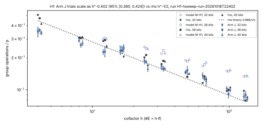
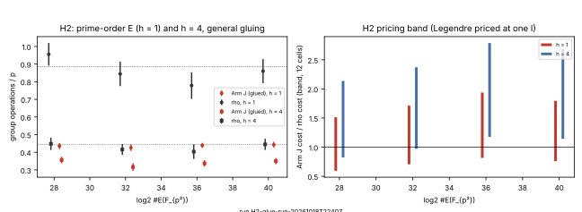
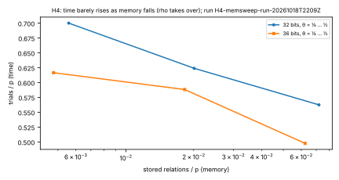
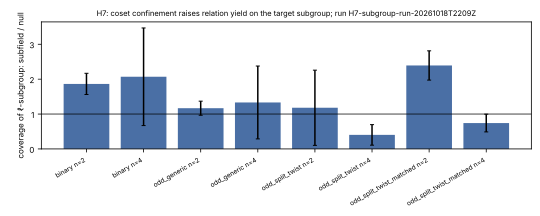

# Round 4: follow-up experiments on items 1–3 (Addendum H)

**Status.** Nine follow-up experiments (H1–H9) were frozen in `PROTOCOL.md`
(Addendum H, `f3bcf9a63`) before any of them ran. Amendments H-a and H-b
were committed before the runs they govern. Seven experiments ran and are
recorded:

- H1, H2 (with H3 folded in) and H6 on RunPod CPU pods;
- H4, H5 and H7 in this session's container.

H8 was not run, and H9 is answered by existing studies. Every cost is a
counted operation. Every discrete log was verified (`k·P = Q`): 3,860 in
total.

**Where it ran.** The repo's `ephemeral` runner could not authenticate
(the container has an AWS access-key ID but no secret). Jobs went
instead through `runpod/podrun.py`. A pod fetches the tool at a pinned,
pushed commit from the public repository, checks each file's SHA-256,
runs the command fixed at launch, and serves only read-only results.
Nothing is uploaded into the pod. Every pod was terminated after its
fetch, and each run directory keeps `pod.json`, `host.txt` and
`rusage.txt`.

## Answer

**Item 3: `n = 2` through genus-2 Jacobians.**

1. **The route reaches prime-order curves [E].** Any `E/F_{p²}` with
   `j ∉ F_p` is glued to `E^σ` along `ψ(a) = a^{p³}` on the 2-torsion
   roots. This gives a genus-2 `C/F_p` with `Jac(C) ~ Res E` and an
   explicit transfer.
   - It descends whenever the 2-torsion cubic is irreducible or split
     over `F_{p²}`.
   - With exactly one rational 2-torsion point, no Galois-equivariant
     gluing satisfies the descent cocycle. So `h ≡ 2 (mod 4)` is not
     reached, which matches `4 | #E` throughout the Scholten family.
   - Checks G1–G5 hold on every instance (see the checks table).
2. **On prime-order `E` (`h = 1`)** the first-cycle IC needs **0.43–0.44·p**
   Jacobian operations, against rho's 0.78–0.96·p: about half.
3. **Per-operation cost.** The reduced sextic-model formulas cost
   41 M + 1 I per addition and 51 M + 1 I per doubling, against 12 M + 1 I
   for an `E(F_{p²})` addition.
4. **Ranking at `h = 1`.** With the split test priced honestly (one
   Legendre symbol at one `I`), the pricing band is
   **0.59–1.94 (unresolved) at every size from 28 to 40 bits**, with the
   IC cheaper in up to 6 of 12 cells.
   - Distance to rho at measured cost (`I = 3M`): 1.43–1.81×.
   - Break-even: a genus-2 addition of about 22 M + I. That is the best
     published figure, not yet measured here.
5. **The cofactor law (H1) closes the large-`h` hope.**
   - Arm J's trials scale as `h^{−0.402}` (95% [0.380, 0.424]); rho's as
     `h^{−0.468}`, near the theoretical ½.
   - Arm J's count advantage is largest at small `h` and is gone by
     `h ≈ 16`.
   - The frozen decision rule applies: on large-cofactor curves
     (FourQ-like `h = 392`) this route never beats rho on count.
6. **Larger sizes (H6, 44–48 bits)** reproduce the constants.
   - Rho: `steps/p` 0.33 and 0.45, against theory 0.31 and 0.44.
   - Arm J: `steps/p` 0.30 and 0.31, band unresolved.
   - Arm D (decomposition): 28–87× rho.
7. **Memory (H4) is the real limit.** Time × memory does not stay near
   `p²/9`, as predicted: it falls from 0.040·p² to 0.004·p² as θ goes from
   ½ to ⅛. With few stored relations, the walk solves mostly through
   repeated relations, which is distinguished-point rho inside the IC
   walk. A memory-capped Arm J turns back into rho, so the IC's
   constant-factor count advantage exists only with Θ(p) memory.
8. **Automorphisms (H5) [E].** An exact census over `p = 5…13` finds 6, 6,
   14 and 14 classes that are simple over `F_p`, Res-shaped, and have
   automorphisms beyond `±1` (orders 4 to 120). The total mass equals
   `p³` exactly at every `p`. These are candidates for an IC gain of `k`
   against rho's `√k`. Measuring that needs such curves at cryptographic
   size and a rho that uses the same automorphism; not done.

**Item 1: decomposition over `F_{q^n}`.**

9. **Coset confinement measured on the target subgroup (H7) [E].** This is
   coverage of the `ℓ`-subgroup itself, not the whole group.
   - **Binary `n = 2`:** subfield over null gives a ratio of
     **1.86 ± 0.16** (21 curves). That confirms the corrected
     reading of round 3: the subfield factor base reaches 0.75 of `2E`
     and of each deeper `2^k E`, against a Poisson value of 0.39.
   - **Odd characteristic, size-matched split twists
     (`E ≅ Y² = Π(X − d e_i)`, `e_i ∈ F_q`, `d` a square), `n = 2`:**
     ratio **2.39 ± 0.21** (12 curves). The subfield factor base covers
     the whole `ℓ`-subgroup (1.0, against 0.27–0.71 for null).
   - **Generic odd curves:** 1.17 ± 0.10, near the no-effect value.
   - **`n = 4` cells:** too small to read (s.e. 0.13–0.71).
   - The gain is bounded by the cofactor's 2-part. It is a cost-model fact
     about these curve families, not a new algorithm, and prime-order
     curves gain nothing.

**Item 2: prime fields.**

10. **H9 needs no new run.** The PKM solving degree is the subject of
    `research/notes/index-calculus/RESEARCH_PKM_TOWER_ORACLE.md`, rounds
    1–7 and later studies (for example `D = 7` at `m = 3`, `N = 18`, and at
    `m = 4`, `N = 16`). Re-measuring would duplicate them; this round
    cites them. Round 3 settled coverage: no effect.

**Not run: H8** (decomposition crossover at `n = 3`). The repo's Semaev
tools are binary-field only. A descended-`S_4` solver over `F_{p³}`
(Gröbner or resultant) is a separate build. It is the next item-1
experiment.

## H1: the cofactor law (run `H1-hsweep-run-20261018T2240Z`, RunPod, 16 vCPU)

**Scale.** The Scholten family, with
`h ∈ {4, 8, 12, 16, 24, 32, 48, 64, 96, 128}` × `log2 #E ∈ {32, 36, 40}`.
Each cell has 4 instances × 10 targets, with arms R and J, plus Jind at
32 bits. All answers verified.

**Fits.** On cell means, with a 2,000-sample bootstrap over instances:

| arm | α (trials/p ∝ h^−α) | 95% interval |
|---|---|---|
| J (walk) | 0.402 | [0.380, 0.424] |
| Jind (independent trials, 32 bits) | 0.368 | [0.334, 0.400] |
| R (rho) | 0.468 | [0.446, 0.490] |

**Model M-H1.** This is the uniform admissible-pair graph on the
instance's real degree-1 points and their cofactor classes, with sign
parity. It matches the measured trials within about 10% at `h ≤ 16`. At
`h = 64–128` it overpredicts by 1.3–1.6×. Its uniform-pair assumption does
not hold there: relations are not uniform over admissible pairs once the
classes are small. The measured law is the result; the model is
diagnostic only.

## H2/H3: the general gluing (run `H2-glue-run-20261018T2240Z`, RunPod, 16 vCPU)

**Construction.**

- Solve `R ab + S a + T b = 1` over the étale algebra `F_{p²}[z]/(g)`,
  with `b = ψ(a) = z^{p³}`. This gives `s_2 = −T/R`, `t_2 = −S/R`,
  `k = s_2t_2 + 1/R` and `s_1 = k·g(s_2)`.
- That defines `C: y² = g(s_1x² + s_2)/s_1²` over `F_{p²}`.
- Descent datum: `x ↦ λ/x^σ`, `λ² = k/N(s_1)`.
- The `F_p` model comes from a Baer-subline cross-ratio map. A rational
  point is moved to infinity, so the model has two rational points at
  infinity. It is twisted when needed, so that `τ` is nonzero on the
  `ℓ`-part.
- The IC columns are `x_P = [2P − D∞]`, so a relation reads
  `(x_P + x_Q)/2`.

**Checks.** On 16 instances plus G5:

| check | result |
|---|---|
| `t_2 = σ(s_2)`, `λ² ∈ F_p` | 16/16 |
| G1: `#C(F_p) = p + 1`; `#C(F_{p²}) = p² + 1 − 2t` (`p < 400`) | 16/16; 8/8 |
| G2: associativity, inverse, `N·A = 0` | all true; `N·A` "degenerate" twice at `p ≤ 277`, never false |
| G3: homomorphism, `τ ≠ 0`, `ℓ·τ = 0` | all true; one "degenerate" at `p = 257` |
| G5: reduced formulas = generic law | 2,400/2,400 pairs |

**Measured** (`log2 #E` 28–40; 4 instances × 10 targets per cell; all
answers verified). Group operations per `p`, mean ± s.e.:

| bits | h | Arm J | rho | Arm J cost / rho, pricing band | verdict |
|---|---|---|---|---|---|
| 28 | 1 | 0.435 ± 0.017 | 0.956 ± 0.064 | 0.59–1.51 | unresolved |
| 32 | 1 | 0.426 ± 0.018 | 0.844 ± 0.069 | 0.71–1.71 | unresolved |
| 36 | 1 | 0.439 ± 0.014 | 0.778 ± 0.076 | 0.82–1.94 | unresolved |
| 40 | 1 | 0.443 ± 0.016 | 0.860 ± 0.068 | 0.76–1.80 | unresolved |
| 36 | 4 | 0.337 ± 0.018 | 0.403 ± 0.041 | 1.18–2.79 | rho cheaper |
| 40 | 4 | 0.350 ± 0.018 | 0.445 ± 0.031 | 1.14–2.69 | rho cheaper |

**Distance to rho (prime-order `E/F_{p²}`).** About 1.8× at 40 bits under
measured costs (1.78× with the H3 Legendre split test at one `I`, as the
band prices it; the 1.68× in `glue_summary.txt` leaves the split test out,
corrected 2026-10-24 on the validator's report). Under the IC-favourable price (one Jacobian operation =
one `E(F_{p²})` addition), the IC is cheaper: 0.76× at 40 bits. Closing the
gap needs a genus-2 sextic-model addition of about 22 M + I, measured.
This round's reduced formulas take 41 M + I.

## H4: memory against time (run `H4-memsweep-run-20261018T2209Z`)

| bits | θ | trials/p | stored/p | time·memory/p² |
|---|---|---|---|---|
| 32 | ½ | 0.563 | 0.0719 | 0.0405 |
| 32 | ¼ | 0.624 | 0.0201 | 0.0125 |
| 32 | ⅛ | 0.700 | 0.0056 | 0.0039 |
| 36 | ½ | 0.498 | 0.0624 | 0.0311 |
| 36 | ¼ | 0.588 | 0.0182 | 0.0107 |
| 36 | ⅛ | 0.617 | 0.0048 | 0.0030 |

At θ = 1 (`h = 4`) the trials are about 0.35·p, with about 0.18·p stored.

**The prediction (time ∝ 1/θ) is falsified.** As θ falls, the answers
come from relations the walk repeats, so the arm becomes rho with
distinguished points (H4 used the walk arm; a Jind-θ arm would isolate
the graph mechanism, and was not run). The IC's count advantage at θ = 1
depends on Θ(p) relation storage. At cryptographic sizes that is the
binding constraint, and the comparison should be read as area-time.

## H5: automorphisms (run `H5-aut-census-run-20261018T2227Z`) [E]

Classes simple over `F_p` with even L-polynomial (`a_1 = 0`), by `|Aut|`,
which includes the hyperelliptic involution:

| p | mass Σ1/\|Aut\| (= p³) | \|Aut\| = 2 | 4 | 6 | 8 | 12 | 24 | 120 | with \|Aut\| > 2 |
|---|---|---|---|---|---|---|---|---|---|
| 5 | 125 | 31 | 1 | 4 | – | – | – | 1 | 6 |
| 7 | 343 | 85 | 3 | 2 | – | – | 1 | – | 6 |
| 11 | 1331 | 306 | 3 | 9 | 1 | 1 | – | – | 14 |
| 13 | 2197 | 450 | 6 | 7 | – | – | 1 | – | 14 |

So Res-shaped, simple Jacobians with extra automorphisms over `F_p`
exist. Whether the IC's gain of `k` beats rho's `√k` on them needs the
same automorphism granted to rho in `Jac(C)`, and needs a family at large
`p`. Not measured.

## H6: larger sizes (run `H6-large-run-20261018T2210Z`, RunPod, 16 vCPU)

Arms R, J and D at `c = 2`; 3 instances × 10 targets per size; all 180
answers verified.

| bits | rho steps/p | theory | Arm J steps/p | Arm J band | Arm D band |
|---|---|---|---|---|---|
| 44 | 0.328 ± 0.026 | 0.313 | 0.295 | 0.99–2.96, unresolved | 28.4–80.9, rho cheaper |
| 48 | 0.448 ± 0.042 | 0.443 | 0.311 | 0.77–2.32, unresolved | 28.1–86.8, rho cheaper |

## H7: coverage of the target subgroup (run `H7-subgroup-run-20261018T2209Z`) [E]

Ratio of `ℓ`-subgroup coverage, subfield over null; mean ± s.e. over
curves:

| cell | n = 2 | n = 4 |
|---|---|---|
| binary (`m = 4…10` / `3…5`) | 1.86 ± 0.16 (21) | 2.07 ± 0.71 (9) |
| odd generic | 1.17 ± 0.10 (12) | 1.33 ± 0.53 (9) |
| odd split twist, frozen (`d` generic) | 1.18 ± 0.55 (12) | 0.40 ± 0.15 (9) |
| odd split twist, size-matched (`d` square) | **2.39 ± 0.21** (12) | 0.74 ± 0.13 (9) |

**Why the frozen split-twist cell is noisy.** With `d` a non-square, the
factor base is empty apart from the 2-torsion points (Amendment H-a).

**Why the `n = 4` cells are unreadable.** Their `ℓ`-subgroups are small
(tens to hundreds of points).

**Mechanism.**

- **Binary:** `Tr(x) = 0` for `x ∈ F_q`.
- **Odd split twists:** every `X − d e_i ∈ d·F_q` has the same quadratic
  character.

In both cases the factor base sits in one coset of `2E`, and its sums
land in `2E`, which contains every target.

## Checks

| check | result |
|---|---|
| every discrete log verified (`k·P = Q`) | H1 2,800; H2 640; H4 240; H6 180 (3,860 in this round, all verified) |
| rho positive control (K6) at 44/48 bits | matches `0.886·√ℓ/p` within 1 s.e. |
| G1–G5 (gluing) | see H2; no false check |
| H5 mass `Σ 1/|Aut| = p³` | exact at p = 5, 7, 11, 13 |
| unit tests | n2_routes 5, decomposition_coverage 5, genus2_aut_census 1: pass |

## What is not established

- **H2.** The 22 M + I break-even figure is an estimate. No formula at
  that cost was implemented here.
- **H4.** The memory result uses the walk arm.
- **H5.** No measurement beyond the census.
- **H7.** The `n = 4` cells are underpowered.
- **H8** was not run.
- **Novelty.** None of these results has a novelty audit. The general
  gluing is very likely Scholten's (2003) construction, written down
  here with the `a^{p³}` cocycle made explicit. The statement that
  `h ≡ 2 (mod 4)` is unreachable needs checking against that paper.

## Next improvements

1. **Measure a cheaper sextic-model addition.** This decides `h = 1`; the
   target is 22 M + I or less. Use the explicit real-model formulas, with
   Karatsuba-style products and a shared inversion, and verify them
   against the generic law.
2. **Make memory part of the comparison.** Report area-time for every
   Arm J row, and test a Jind-θ arm that isolates the graph from the walk.
3. **H5 follow-up.** Build a large-`p` family of Res-shaped curves with an
   order-4 automorphism. Measure Arm J on the automorphism-reduced graph
   against rho in `Jac(C)` with the same automorphism.
4. **H8.** Build a descended-`S_4` oracle over `F_{p³}` and measure the
   `n = 3` crossover.
5. **H7.** Enlarge the binary and odd `n = 4` cells to readable
   `ℓ`-subgroup sizes.

## Erratum (2026-10-24): native work priced in GAE

This erratum was found during validation for the benchmark gate (PROTOCOL.md,
Erratum V). The H2 and H6 bands price native operations at 0, 0.1 and 1
`F_p` multiplications. AGENTS.md §5a prices them at 0, 0.1 and 1 GAE.

Repriced with the same runs, the same cells and the same cost model
(`validation/gae-band/`):

| run | frozen band (native in M) | band with native in GAE | verdict |
|:--|:--|:--|:--|
| H2, h = 1, 28–40 bits | 0.59–1.94 | 0.59–2.04 | unresolved at every size (unchanged) |
| H2, h = 4, 36–40 bits | 1.14–2.79 | 1.14–2.88 | rho cheaper in every cell (unchanged) |
| H6, Arm J, 44 / 48 bits | 0.99–2.96 / 0.77–2.32 | 0.99–3.04 / 0.77–2.38 | unresolved (unchanged) |

At the gate's three points (`I = 3M`, measured Jacobian cost, native 0,
0.1 and 1 GAE), H2 at 40 bits with `h = 1` costs 1.78×, 1.80× and 1.88×
rho. That is the distance remaining to the matched rho at measured cost.

## Validation (2026-10-24)

Both benchmark studies of this directory pass the validation gate
(`docs/VALIDATION_GATE.md`): `VAL-20261024-wd3` (round 3) and
`VAL-20261024-wd4` (round 4), `validation/validation_report.yaml`.

- **Replay.** An independent validator drew a nonce from `os.urandom`
  and selected 14 jobs from it. It also replayed every remaining cell.
  - All 5,228 recorded rows replay exactly in every column except wall
    time: round 3 has 1,368 (itemOJ and itemF), round 4 has 3,860 (H1,
    H2, H4 and H6).
  - The replays use the tool at d01c574a2 with `N2_DUMP`.
- **Scalars.** Every dumped answer was checked by
  `validation/verify_dump.rs`, which shares no code with `n2_routes.rs`.
  - It checks that `ℓ` is prime, `ℓP = O`, `N` is in the Hasse interval
    and `N·R = O`.
  - It checks that `k_found·P = Q` and `k_found = k` for every arm.
- **Recompute.** 167 headline numbers recompute from the CSVs. All 15
  summary, ranking and gae-band files reproduce byte for byte.
- **Rho reference.** Negation is the strongest symmetry available:
  `j(E) ∉ F_p` on all 176 curves, and `j ≠ 0, 1728`. Rho and the IC run in
  the same process, with the same counters.
- **The gate's three points.** `I = 3M`, measured Jacobian cost, native
  work at 0, 0.1 and 1 GAE, 40 bits; rho is cheaper at every point.
  - Round 3, Arm J with `c = 1`: 2.79×, 2.84× and 2.98× rho.
  - H2 with `h = 1`: 1.78×, 1.80× and 1.88× rho.
- **Limitation.** The recompute independently implements the producer's
  definitions; it is not a blind derivation. The operation counts were
  shown to reproduce, not re-derived by a second implementation of the
  arms.

## Run reports

- `reports/H1-hsweep-run-20261018T2240Z/run-report.pdf`
- `reports/H2-glue-run-20261018T2240Z/run-report.pdf`
- `reports/H4-memsweep-run-20261018T2209Z/run-report.pdf`
- `reports/H5-aut-census-run-20261018T2227Z/run-report.pdf`
- `reports/H6-large-run-20261018T2210Z/run-report.pdf`
- `reports/H7-subgroup-run-20261018T2209Z/run-report.pdf`
