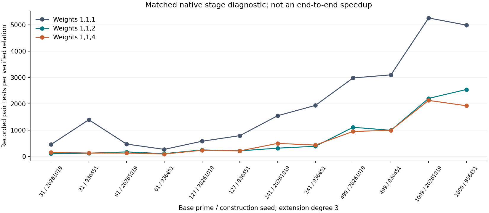

# Observed results

The native primary suite and larger-recovery follow-up completed 36 of
36 synthetic one-target DLP recoveries on 12 distinct prime-order curves
over cubic extension fields. Base primes range from 31 to 1009; the largest
group order is 1,027,286,801. No recovery budget was exhausted. The solver
constructs no covering curve: it enumerates one weighted signed slot and
uses native S3 resultant/root solving for the residual pair on the Weil
restriction. The coefficient arms 1, 2 and 4 share the same factor-base
logarithm unknowns.

On the two p=1009 curves the following stage yields and full-recovery
residual counts were observed. The residual count does not price setup,
polynomial arithmetic, group operations or linear algebra.

| Seed | Weight c | Stage relations / 128 | Full-recovery residuals |
|---:|---:|---:|---:|
| 20261019 | 1 | 21 | 3044 |
| 20261019 | 2 | 45 | 1247 |
| 20261019 | 4 | 47 | 1152 |
| 936451 | 1 | 22 | 3063 |
| 936451 | 2 | 42 | 1302 |
| 936451 | 4 | 52 | 1177 |

# Validation and evidence

The primary run recorded 11,370 PDP dictionary checks; the exploratory
follow-up recorded 18,344. These are validation calls and include A/A and
overlapping stage panels. Every returned decomposition was checked in
the group. Every recovered scalar passed both a group check and the
external known-answer check; the solver instance had its secret field
set to zero. The independent signed-pair dictionary is unavailable to
the algebraic solver. It is a quadratic correctness reference, not a
proposed scalable relation-collection algorithm.

The primary replay reproduced every per-case result and deterministic
counter byte for byte, including eight baseline DLP A/A controls. Its
24 duplicate recoveries are excluded from the 36 distinct cases; see
[control arrangement](PROTOCOL_NOTES.md). Native PARI 2.17.2 separately confirmed all 12
curve cardinalities, generator orders and planted targets, and repeated
those checks on the four follow-up fixtures. This is independent fixture
arithmetic, not independent-host implementation replay.

The [primary protocol](PROTOCOL.md) was committed before measurement
at 6095144c, with the primary runner at fc13c52e. The
[follow-up protocol](FOLLOWUP.md) and runtime source were frozen at
040b8e1a before execution. The follow-up was specified after seeing the
primary results and uses the same four larger curves and stage panels.
It is exploratory and adds 12 full recoveries. The primary/replay/follow-up
reports have their exact commands, source snapshots, host information,
budgets, raw-record links, graphs and PDFs:

- [Primary run report](reports/run-20261019T0526Z/REPORT.md).
- [Deterministic replay report](reports/run-20261019T0527Z/REPORT.md).
- [Larger full-recovery report](reports/run-20261019T0531Z/REPORT.md).
- [Validation logs and initial failures](validation/README.md).

# Scope and next experiment

Observed weighted-slot yield gains survive this larger native suite.
The number of unknown logarithms does not increase because the weight
is a known scalar multiplying an existing base log. Breaking permutation
collisions is a plausible explanation; this suite does not isolate that
mechanism or establish publication novelty or an asymptotic gain.

Complete S, IC/rho ratio and end-to-end speedup remain null. The legacy
pair API has incomplete native counters, its field-inverse accounting is
legacy, and no complete conversion band or matched ecbench strong-rho
reference was measured. Magma, msolve and FGb were not run. There is no
independent-host replay. These are L0 count diagnostics on a shared
AMD EPYC 9V74 KVM container with a four-CPU quota and 16 GiB memory;
wall time is not admitted. Earlier Python results are historical and
are not native runtime baselines. No cryptographic-size or binary-field
claim follows.

The [tracked gap](../../problems/weil-weighted-complete-cost.md) specifies
the next discriminating experiment: complete native instrumentation and
a matched cold, one-target ecbench IC/strong-rho comparison on these
frozen public fixtures, followed by independent-host replay.
