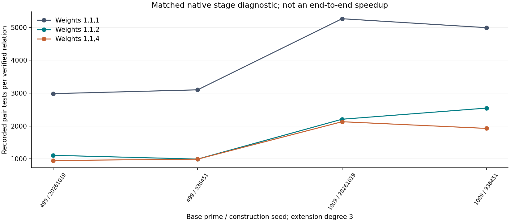

# Native larger-curve diagnostic

This run uses the repository's native cubic-field arithmetic and S3 resultant pair solver. It constructs no covering curve and no whole-field or whole-group operation table. Each decision is cross-checked with a separate signed-pair dictionary unavailable to the solver.

The local reference is the identical hybrid with c=1, not the best complete IC pipeline. Counts below are stage diagnostics, not end-to-end speedups. Complete S, ratios to rho and external fastest-tool comparisons are unestablished. Wall time is not admitted at L0.

| p | construction seed | group order | unknowns | weight | verified / targets | pair tests | pair tests / relation |
|---:|---:|---:|---:|---:|---:|---:|---:|
| 499 | 20261019 | 124249159 | 249 | 1 | 19 / 128 | 56670 | 2982.632 |
| 499 | 20261019 | 124249159 | 249 | 2 | 47 / 128 | 52049 | 1107.426 |
| 499 | 20261019 | 124249159 | 249 | 4 | 52 / 128 | 49357 | 949.173 |
| 499 | 936451 | 124261523 | 258 | 1 | 19 / 128 | 58878 | 3098.842 |
| 499 | 936451 | 124261523 | 258 | 2 | 51 / 128 | 50621 | 992.569 |
| 499 | 936451 | 124261523 | 258 | 4 | 52 / 128 | 51520 | 990.769 |
| 1009 | 20261019 | 1027186051 | 495 | 1 | 21 / 128 | 110487 | 5261.286 |
| 1009 | 20261019 | 1027186051 | 495 | 2 | 45 / 128 | 99211 | 2204.689 |
| 1009 | 20261019 | 1027186051 | 495 | 4 | 47 / 128 | 100052 | 2128.766 |
| 1009 | 936451 | 1027286801 | 495 | 1 | 22 / 128 | 109779 | 4989.955 |
| 1009 | 936451 | 1027286801 | 495 | 2 | 42 / 128 | 106812 | 2543.143 |
| 1009 | 936451 | 1027286801 | 495 | 4 | 52 / 128 | 100150 | 1925.962 |

# Synthetic one-target recoveries

| p | seed | weight | residuals | independent rank | status |
|---:|---:|---:|---:|---:|:---|
| 499 | 20261019 | 1 | 1579 | 228 | verified_recovery |
| 499 | 20261019 | 2 | 590 | 227 | verified_recovery |
| 499 | 20261019 | 4 | 565 | 229 | verified_recovery |
| 499 | 936451 | 1 | 1430 | 244 | verified_recovery |
| 499 | 936451 | 2 | 590 | 247 | verified_recovery |
| 499 | 936451 | 4 | 557 | 241 | verified_recovery |
| 1009 | 20261019 | 1 | 3044 | 453 | verified_recovery |
| 1009 | 20261019 | 2 | 1247 | 445 | verified_recovery |
| 1009 | 20261019 | 4 | 1152 | 443 | verified_recovery |
| 1009 | 936451 | 1 | 3063 | 448 | verified_recovery |
| 1009 | 936451 | 2 | 1302 | 470 | verified_recovery |
| 1009 | 936451 | 4 | 1177 | 457 | verified_recovery |

Completed 12 recoveries; 0 budget-exhausted recoveries. Total independently checked PDP decisions, including A/A controls and recovery attempts: 18344. The independent comparison is against a separate dictionary, not an independent host.

# Limits and next checks

The legacy pair API does not emit internal lookup, polynomial addition/division, allocation or RNG counts. Its F_p multiplication counter also uses legacy inverse accounting. These missing counts prevent a complete pricing band, S, or ranking against rho. No strongest-external-solver comparison was run: Magma, msolve and FGb were not run here. Base and weighted-slot setup, verification group operations, residual-generation group operations and modular elimination multiplications have separate ledgers. Dictionary construction, reference arithmetic and fixture generation are excluded validation/setup work without complete operation ledgers. No binary-field or ECC2K transfer was tested.

The next discriminating step is complete native counters plus matched ecbench one-target rho measurements, with independent-host replay and the fastest available external algebraic reference. These obligations remain open; verified recoveries alone do not discharge them.

# Reproduction and provenance

See config.json, host.txt, SHA256SUMS, records.jsonl, the committed PROTOCOL.md and examples/weil_weighted_decomposition.rs. Seed 936451 is the holdout. Inputs and outputs are public synthetic fixtures. Histories from the earlier Python experiment remain historical and are not runtime baselines. All A/A decisions and deterministic counters were asserted equal.
