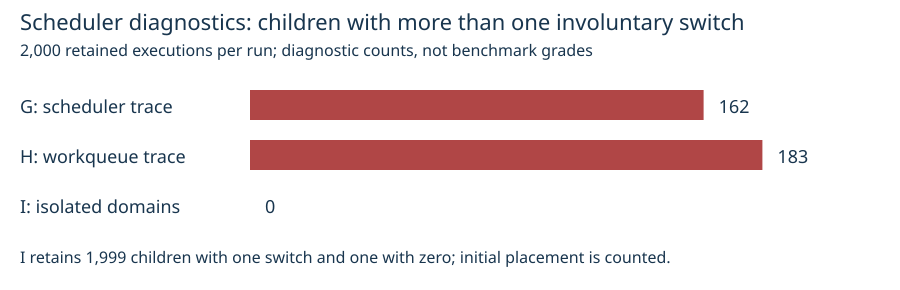

# Dedicated benchmark workers: qualified L2 bootstrap

[Inspected PDF](report.pdf) · [native verification](verification.json) · [deployment](deployment.json) · [raw evidence](runs.tar.xz)

Qualification J passed the unchanged native gates: **3,606 verified L2 executions,
3,600 matching measured replays, 1,200 admitted A/A pairs and all 19 S3 payload
hashes verified**. The qualified bootstrap is deployed as profile v6 on the
dedicated `cpu-l2-spot` pool. Ordinary `cpu-spot` retains its previous v4 bootstrap.
The post-merge main-only GitHub Action is still pending final review and CI.

## Diagnosis and retained attempts

| Attempt | What actually ran | Outcome |
| --- | --- | --- |
| F | No Job or trace: the completed E worker had auto-consolidated | SSM InvalidInstanceId; protocol and failure retained |
| G | 2,000 native probe children, CPU4 scheduler trace | 162 children had more than one involuntary switch; no excess busy ticks above two |
| H | 2,000 children, scheduler/workqueue/timer trace | 183 children had more than one switch; no excess busy ticks above two |
| I | 2,000 children on a fresh candidate bootstrap, scheduler/workqueue trace | 0 children above one switch; 0 traced native-probe preemptions on CPU4; diagnostic only |
| J | Full untraced crypto qualification on I's worker | All native L2, replay, A/A and S3 gates passed |

Every G/H/I run retained all 2,000 samples and verified all six S3 payload hashes.
G's 30,663-byte complete trace attributed native child preemptions to kworker/4:1
(150), migration/4 (11) and ksoftirqd/4 (1). H's 199,693-byte trace retained all
1,293 entries with no buffer loss. Its workqueue events included psi_avgs_work
(183) and vmstat_update (61), plus less frequent filesystem/memory cleanup.
These event counts are not one-to-one causal attribution for every switch.
The initial RCU-only hypothesis did not explain the dominant observed work.

I's raw wait4 involuntary-switch histogram is zero: 1, one: 1,999. The probe pins
after exec, so its counters include the initial affinity transition; ecbench
pins in pre_exec. No zero-total-switch claim is made. I's complete five-entry
trace contains no native-probe preemptions; CNI switches and a check_lifetime
callback occur after the probe. Tracing overhead makes G/H/I diagnostic only.
J began after explicit readback confirmed all diagnostic tracing disabled.

## Qualified bootstrap and deployed contract

The candidate keeps periodic scheduler ticks, isolates worker scheduler domains
and managed IRQs, offloads RCU callbacks, and binds RCU threads and watchdogs to
housekeeping CPUs. `cgroup_disable=pressure` removes per-cgroup PSI work while
mandatory host `/proc/pressure/cpu` and `/proc/pressure/memory` remain enabled.
Every J record retains real before/after host pressure values. Existing strict
whole-core static CPU management, NUMA, IRQ/workqueue and service placement remain.
No native grader, threshold, correctness check or sample-admission rule changed.

Kernel sources explain why isolated domains avoid periodic vmstat shepherd work
and why per-cgroup PSI can schedule delayed work. Sources: [CPU isolation](https://docs.kernel.org/admin-guide/cpu-isolation.html),
[kernel threads](https://docs.kernel.org/admin-guide/kernel-per-CPU-kthreads.html),
[kernel parameters](https://www.kernel.org/doc/html/v6.13/admin-guide/kernel-parameters.html).
The inspected Linux v6.18 source files are retained in the evidence archive.

Domain isolation changes ordinary unaffined multithreaded scheduling, so L2 uses
its own tainted pool. `submit-job --isolation-profile l2` selects `cpu-l2-spot`,
profile v6 and its measurement toleration; standard jobs select only `cpu-spot`.
Both pools allow broad x86 C/M/R Spot families, generation six or newer, subject
to existing requirements and capacity. Each is capped at 32 vCPUs / 128 GiB:
combined limits remain 64 vCPUs / 256 GiB under the regional 96-vCPU quota.
Each node must fit its individual pool limit. Capacity is not guaranteed.

Deployment source: `cc858fd93ab203f877c34b14205a0f22e554bf73`. The production cpu-l2 class
spec equals the qualified I/J spec; the ordinary cpu class equals the prior v4
spec. Both classes/pools were read back Ready with current generations as the
`isolab:submitters` group. Both remote launchers were updated through CloudFormation
and verified against immutable S3 versions and full archive hashes. Runtime
checkpoint/archive pins did not change. The temporary diagnostic resources and
this task's unchanged temporary cluster-admin association were removed; other
tasks' jobs and workers were not paused, cancelled or resized.

| Launcher | Immutable S3 package version |
| --- | --- |
| Ordinary remote launcher | `GAbpTmZE8VYoN72rYIOwYqaior1Pj6ep` |
| Recovery controller | `FhkDu4kbpsBNUbxuDW16EYHRfTX3OQZe` |

## Full native qualification J

Public 32-bit prime_search seed 59297; two targets with target seed 20261002;
rho.negation reference, rho.plain baseline and rho.negation A/A control. Exactly
600 rounds, one warmup, alternating order, seed 1 and 120-second child timeout.
Four exclusive CPUs, 4 GiB, 1,800 seconds including provisioning, fixed 60-second
setup and zero retries. Boot readback completed during setup; no diagnostic
exec ran during measurement. The worker was c8a.2xlarge, eight cores, one thread
per core, AL2023 AMI ami-082b570a48503ea93, kernel 6.18.54, us-east-2c.

| Gate | Native outcome |
| --- | --- |
| Correctness and isolation | 3,606 / 3,606 verified and L2 |
| Measured replay | 3,600 / 3,600 matched |
| A/A | 1,200 pairs admitted, zero below L2, outside_noise=false |
| A/A median ratio | 1.0000835088461724 |
| Native A/A 95% interval | [0.9998485970859599, 1.0002419602383978] |
| S3 | 19 / 19 full payload hashes matched |

- Job: `ecbench-domain-periodic-20261023-j` / `c97aa0ac-d3f6-431d-915d-189d21cd3c36`.
- Pod UID: `76931218-b9ab-446c-a4b9-05dc068aa557`.
- Worker: `i-08df3df7752a77c99`; node `ip-10-84-74-123.us-east-2.compute.internal`.
- Crypto source: `cb2ec6873f30b683f7885b53c410d69965f02c20`.
- Actual image: `104186811093.dkr.ecr.us-east-2.amazonaws.com/isolab/tasks@sha256:67eea58f5d4a7a8882b55f089c6063bb49fad58d40260ee9b0ceb349fc0e4581`.
- Binary SHA-256: `583e62f0836eae43330c4b36bbe3d145dacb01de3132436c71f6924445c6a5a9`.
- Results: `s3://isolab-results-104186811093-us-east-2/runs/ecbench-domain-periodic-20261023-j/76931218-b9ab-446c-a4b9-05dc068aa557/`.

## Corrections, limits and reproduction

The frozen workload always used two targets and 600 rounds, producing 1,200 A/A
pairs. The protocol prose and operational verifier initially expected 600 pairs;
the original, exact-count correction and verifier are retained. No workload,
threshold or sample changed. The first verifier invocation also retained an old
D directory path and failed before reading evidence; that observer mistake is
explicitly recorded. Native results were neither retried nor regraded.

G/H's initial SSM stdout hit its 24,000-byte limit. Complete traces were then
retrieved as compressed data (H in two chunks) and checked against recorded
compressed/plain hashes. Partial originals remain labeled and retained. The
local MCP deployment initially hit ETXTBSY when replacing a running executable;
atomic rename installed the verified binary without killing a running client.

This qualifies one fresh crypto workload/bootstrap combination. It does not prove
all instance families, arbitrary CRIU portability, a new CRIU restore under v6,
an algorithm speedup or completion of the main GitHub Action. Prior [D provisioning](../20261023-l2-qualification-d/REPORT.md)
and [E preemption](../20261023-l2-qualification-e/REPORT.md) failures remain frozen.
Earlier recovery evidence remains separate; interrupted timing is never admitted.

Run `sha256sum -c runs.tar.xz.sha256 && tar -xJf runs.tar.xz`. The archive retains
all F/G/H/I/J protocols, raw native artifacts, full traces, manifests, instance and
Job/Pod receipts, corrections, bootstrap, source observations and deployment
receipts. Run `sha256sum -c SHA256SUMS` inside each run's artifacts directory to
verify its complete payload set. Package binaries remain in immutable S3 objects
identified by receipt; private checkpoint memory and credentials are not included.
The graph derives counts from retained native rusage records and uses a common
linear count scale; it computes no new timing statistic. Algorithm leaderboards
and curve graphics were checked for scope and left unchanged. This evidence
directory is frozen; later validation gets its own report.
