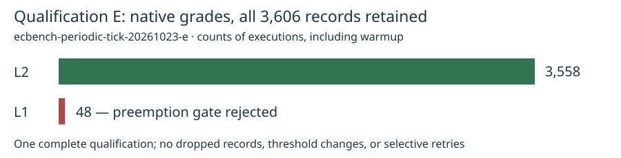

# Periodic-tick L2 qualification E — failed

[Inspected PDF](report.pdf) · [verification](verification.json) · [raw evidence](runs.tar.xz)

The full unchanged crypto workload ran after capacity freed. The periodic-tick candidate
removed the excess-tick failures in this attempt, but **48 observations failed the
unchanged involuntary-preemption gate**. Profile v5 is not qualified or promoted.

| Requirement | Recorded outcome |
| --- | --- |
| Every execution verified and L2 or L3 | 3,606 verified; 3,558 L2 / 48 L1 — **failed** |
| Native measured replay | 3,600 / 3,600 matched |
| A/A admission | Not evaluated: L2 gate exited 42 first |
| Complete S3 integrity | All 18 emitted payload hashes matched; 19 objects including SHA256SUMS |
| Worker and image identity | c8a.2xlarge, 8 cores, one thread/core; actual image/source/binary matched protocol |
| Selected boot change | nohz_full inactive; managed IRQ, RCU offload, workqueue and user-service placement retained |

## Frozen workload and identities

Public 32-bit prime_search seed 59297, two targets with target seed 20261002;
rho.negation reference, rho.plain baseline, rho.negation control. Exactly 600 rounds,
one warmup, alternate order, measurement seed 1, per-child timeout 120 seconds.
The Pod requested four exclusive CPUs and 4 GiB. Its 1,800-second deadline included
provisioning; retry count zero. A fixed 60-second setup preceded native measurement.
Boot readback completed before that setup ended; no diagnostic exec ran during measurement.

- Job: `ecbench-periodic-tick-20261023-e` / `19510979-be9c-431b-b99f-88fb200485f1`.
- Pod UID: `b30bd223-b6f7-427a-baf7-857503feef6d`.
- Instance: `i-0dd644e0372e4a9dc`; node `ip-10-84-90-159.us-east-2.compute.internal`.
- Source: `cb2ec6873f30b683f7885b53c410d69965f02c20`.
- Image: `104186811093.dkr.ecr.us-east-2.amazonaws.com/isolab/tasks@sha256:67eea58f5d4a7a8882b55f089c6063bb49fad58d40260ee9b0ceb349fc0e4581`.
- Binary SHA-256: `583e62f0836eae43330c4b36bbe3d145dacb01de3132436c71f6924445c6a5a9`.
- S3: `s3://isolab-results-104186811093-us-east-2/runs/ecbench-periodic-tick-20261023-e/b30bd223-b6f7-427a-baf7-857503feef6d/`.

All rejected records named involuntary preemptions as their only L2 blocker.
None failed for excess busy ticks or steal. The native threshold remains 50
involuntary preemptions per second. This proves neither general CPU-accounting
correctness nor a complete isolation fix. Post-run host inspection showed RCU
threads executing on worker CPUs; their exact causal role needs a separate trace.
The [kernel's RCU guidance](https://docs.kernel.org/admin-guide/kernel-per-CPU-kthreads.html)
requires affinity for offloaded RCU threads; rcu_nocbs alone does not establish it.

## Retention and limitations

[The earlier D provisioning failure](../20261023-l2-qualification-d/REPORT.md)
remains unchanged. E used a newly frozen protocol and did not retry a measured D result;
D never started. E remains failed, and no identical measurement rerun is scheduled.
No new CRIU restore, algorithm-speed result, or post-merge GitHub Action is claimed.
The current deployment remains v4 pending a complete qualified repair.

The observer initially misread a paginated AWS CLI listing that omitted KeyCount,
recording zero objects despite a populated Contents list. `observation-correction.json`
retains that error and the complete download/hash verification; no result was lost.
The subsequent bounded post-failure SSM host listing hit its 24,000-byte output limit
and is explicitly partial. Every native benchmark artifact is complete.

`sha256sum -c runs.tar.xz.sha256 && tar -xJf runs.tar.xz` restores the inputs,
protocol/upload, Job/Pod and worker receipts, boot readback, original observer and
correction, native records/replay/gate, full S3 payloads, and hash checks under
`runs/qualification-e/`. The graph copies the native grade counts and uses a common
linear count scale; it computes no new benchmark statistic. This evidence directory
is frozen. Follow-on diagnosis gets separate runs and reports.

Algorithm leaderboards and curve graphics were checked for scope and left unchanged:
this is an infrastructure validity result, with no admitted performance comparison.
