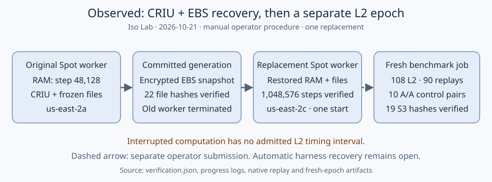

# CRIU + EBS recovery and a fresh L2 epoch

**Observed:** the manual recovery test passed. A native SHA-256 process resumed
from its CRIU checkpoint and EBS volume snapshot on a replacement EKS Spot
worker, after the original worker terminated. A separately submitted fresh
benchmark epoch then passed the existing harness's L2, replay, A/A and S3 gates.
Automatic recovery of ordinary harness jobs remains unimplemented.

The frozen [process protocol](protocol.json) and [epoch protocol](fresh-epoch-protocol.json)
describe two different validation steps. The SHA-256 process is a public
correctness fixture, not an elliptic-curve performance benchmark. The later
ecbench job is the registered 20-bit validation fixture with two targets, nine
arms, five measured rounds and a warmup. No timing crosses the restore boundary.

| Check | Observed result |
| --- | --- |
| Process checkpoint | iteration 48,128; CRIU 4.2.1; payload UID/GID 1000 |
| Old worker fence | EC2 `i-0fabdc1b9d167d430` observed terminated at 05:17:19.212 UTC |
| Replacement | pod created 05:17:20 UTC; instance `i-0ff791a8db99aac86` |
| Worker/zone change | c8a.2xlarge, us-east-2a → us-east-2c |
| State consistency | 22/22 file hashes matched before restore; encrypted EBS snapshot ready |
| Recovery replay | 1,048,576 final steps; 1,024 recorded chain values; one process start |
| Final SHA-256 | `fdde49b4c5a6b75e9974a8993090b4abb7bca85454a0466eece1357b792dae98` |
| Private memory archive | 3,012,193 bytes; AES256; downloaded copy matched SHA-256 |
| Fresh epoch L2 | 108/108 executions; no below-L2 or invalid outcomes |
| Native measurement replay | 90/90 reproduced |
| A/A admission | 10 pairs admitted; recorded 95% ratio interval [0.9892440499496646, 1.012733566458267] |
| Fresh epoch S3 payloads | 19/19 hashes verified, manifest complete |
| Fresh worker topology | c8a.2xlarge: eight logical CPUs, eight physical cores; no SMT |

The A/A interval is the harness's recorded control result, not an algorithm
speedup. There is one process replacement test and one fresh epoch; no
cross-family, repeated-interruption or automatic-failover result is claimed.

This is a sequence diagram because the test makes no comparative speed claim.
The [PDF](report.pdf) contains the same results and the diagram. Canonical
algorithm leaderboards and performance graphs are unchanged: this is
infrastructure/correctness qualification, not a measured algorithm improvement.

## Identity and replay

[verification.json](verification.json) binds the old and restored pod UIDs,
EC2 instances, snapshot ID, file hashes, kernel/runtime class, executable/source
hashes and fresh epoch receipt. [fixture-source-executed.rs](fixture-source-executed.rs)
is the exact source used for the running process; its SHA-256 is
`42b3b70c1f281e1ffe507e653022bd170e9197b95c4e2cb75abd7a7df7193d75`.
The executed binary SHA-256 is
`b3cd5b6832a85967fddc5489984963939bd26e76798280a64f0e03b45b4352b8`.
The current native verifier adds exact-target and checkpoint-prefix checks;
it does not change the executed fixture or its frozen records.

The process never reads progress from disk. CRIU restored its memory at the
saved instruction state, and [progress-after.log](progress-after.log) preserves
and advances [progress-before.log](progress-before.log). The verifier starts
from the public all-zero state and recomputes every recorded hash, checks the
exact final target and rejects a restarted or altered prefix. Its first step
also matches the independent OpenSSL known answer.

The fresh epoch uses source
`cb2ec6873f30b683f7885b53c410d69965f02c20`, binary
`583e62f0836eae43330c4b36bbe3d145dacb01de3132436c71f6924445c6a5a9`, and image
`isolab/tasks@sha256:67eea58f5d4a7a8882b55f089c6063bb49fad58d40260ee9b0ceb349fc0e4581`.
It is **not** the pending PR #2342 full main-branch GitHub Action experiment.
The requested source/spec, request hash, actual pod image, native build-info and
binary hash were checked with the maintained `remote/verify-build` contract.

- Job: `criu-resume-20261021-epoch-1`;
  UID `4c90515a-1a82-482f-a28d-54d798dde3a1`.
- Pod UID: `d5afd859-72e2-4288-a0ca-a85b493f58bf`.
- Launcher: `isolab-experiment-launcher:d865902e-9493-4fd8-be7f-3d2eb3989d14`.
- Benchmark results:
  `s3://isolab-results-104186811093-us-east-2/runs/criu-resume-20261021-epoch-1/d5afd859-72e2-4288-a0ca-a85b493f58bf/`.
- Recovery evidence: `s3://isolab-results-104186811093-us-east-2/recovery/probes/20261021/evidence/`.
- Private memory archive: the exact S3 key/version and SHA-256 are in
  [generation-1.json](generation-1.json); raw CRIU memory is not in Git or the PDF.

## Failures and limits retained

1. The first payload start failed because the base image lacks `setpriv`, so
   its dump failed with no such process. The tool was copied from the disposable
   worker and the real fixture was started once. The failed dump log is retained.
2. The first archive command failed because the image lacks `tar`. An empty
   object was uploaded by the initial shell sequence and was rejected; its
   version/size receipt remains in [rejected-empty-upload.json](rejected-empty-upload.json).
   It was never a committed generation. A corrected command with `pipefail`,
   archive validation and downloaded-byte comparison used a distinct key.
3. The first replacement launch received a transient Spot quota/capacity error
   while the account released the terminated instance's allocation. Karpenter
   later launched the same requested instance class within the existing quota.
   No quota or node-pool cap was raised.
4. The restored computation was an operator-controlled child process, not a
   CRI restore-via-create image. That vulnerable runtime feature stayed disabled.
5. No benchmark timing from the restored computation was admitted. The fresh
   ecbench epoch was a separate operator submission, not an automatic epoch
   transition. [The integration gap](../../../../../../problems/eks-resumable-l2-experiments.md)
   remains open.

The two recovery pods, their disposable worker nodes and their source/restored
PVCs were removed after collecting evidence. The encrypted snapshot and private
S3 generation are retained. The snapshot controller/class remain installed.
The temporary operator admin grant created for this probe was removed after use.
