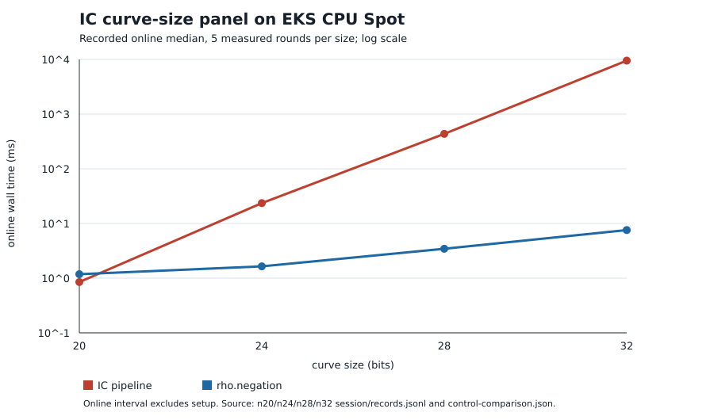

# EKS Spot IC curve-size plumbing validation, 2026-10-26

## Requested scope and outcome

| Requirement | Evidence | Status |
|:--|:--|:--|
| 20, 24, 28 and 32-bit public synthetic curves, one target each | `n*/input-spec.json`, `n*/session/records.jsonl` | Verified complete |
| CPU Spot with L2 isolation | `n*/l2-gate.json`, `n*/runner-identity.json`; `cpu-l2-spot` NodePool has `karpenter.sh/capacity-type: spot` | Verified complete for the four jobs |
| Correctness and independent audit | `n*/audit.json`, `n*/SHA256SUMS`; all four audits passed, 18/18 records L2 per job, 15 exact replays per job | Verified complete |
| Repeatable Actions dispatch | frozen `../../specs/ic-size-sweep/`, `../../run-ic-sweep`, `../../test-ic-sweep.sh`, `isolab-experiment.yml` | Implemented; Actions dispatch awaits merge to `main` |
| CRIU checkpoint and restore | `resume/` controller and live `ic-criu-n32-20261026-v1` request | Live request pending Spot provisioning at report time; no new restore claim |

## Frozen execution

Each job used `ecbench.spec/v1`, five measured rounds plus one warmup, L2,
`prime_search` seed 59297, target seed 20261002, and one target. The arms were
`rho.negation` reference, `ic.pipeline` candidate (`prime-abscissa:size=32`,
`mitm:negation_folded=1`), and `rho.negation` A/A control. Instance type was
`c8a.2xlarge`, memory 4 GiB, job deadline 1800 seconds, with no measurement
retry. All recovered scalars matched the target. Four separate Spot nodes ran
the four jobs after an initial transient C8a Spot capacity delay.

The frozen executable SHA-256 was
`583e62f0836eae43330c4b36bbe3d145dacb01de3132436c71f6924445c6a5a9`,
source revision `cb2ec6873f30b683f7885b53c410d69965f02c20`, and immutable
image `104186811093.dkr.ecr.us-east-2.amazonaws.com/isolab/tasks@sha256:67eea58f5d4a7a8882b55f089c6063bb49fad58d40260ee9b0ceb349fc0e4581`.
These identify the deployed build used for the live diagnostic, not the pending
Actions workflow revision. `build-info.json` and `binary.sha256` in each size
directory pin the same executable. Each directory contains its complete S3
receipt with `SHA256SUMS`, the original spec, native session, audit, control
comparison, and L2 gate. SHA-256 verification of every downloaded file passed.

| Bits | Job name | Curve | Pod UID | S3 receipt prefix |
|--:|:--|:--|:--|:--|
| 20 | `ic-sweep-n20-20261026-v1` | `icv1-fp20-t727-cd198a38` | `47596bf0-fe30-46d9-8a89-b771a2ae46e5` | `runs/ic-sweep-n20-20261026-v1/47596bf0-fe30-46d9-8a89-b771a2ae46e5/` |
| 24 | `ic-sweep-n24-20261026-v1` | `icv1-fp24-t1059-6df599df` | `57985f09-711d-46af-9c60-4c1cfca69237` | `runs/ic-sweep-n24-20261026-v1/57985f09-711d-46af-9c60-4c1cfca69237/` |
| 28 | `ic-sweep-n28-20261026-v1` | `icv1-fp28-tm3161-380f655a` | `1b759d67-1778-407b-bf32-71c4dcc6bb0b` | `runs/ic-sweep-n28-20261026-v1/1b759d67-1778-407b-bf32-71c4dcc6bb0b/` |
| 32 | `ic-sweep-n32-20261026-v1` | `icv1-fp32-t74357-b7396dac` | `ba46ec33-e2b2-4536-a909-76f89f1d79b1` | `runs/ic-sweep-n32-20261026-v1/ba46ec33-e2b2-4536-a909-76f89f1d79b1/` |

The bucket for all four prefixes is
`s3://isolab-results-104186811093-us-east-2/`. The local copy is the
reviewable source of truth; S3 provides durable originals.

## Recorded online diagnostics

Values below are medians of five measured rounds in each native session.
They describe the target-dependent online interval only. They do not include
factor-base setup or total process cost. The A/A confidence interval comes
from each `control-comparison.json`. The 28 and 32-bit control intervals are
wide, so wall-time comparisons are descriptive only.

| Bits | IC online ms | Rho online ms | IC total GAE | Rho total GAE | Rho/IC online | A/A median [95% CI] |
|--:|--:|--:|--:|--:|--:|:--|
| 20 | 0.849690 | 1.183083 | 8,529 | 1,016 | 1.39237 | 1.001003 [0.995447, 1.013117] |
| 24 | 23.555580 | 1.646459 | 165,732 | 4,510 | 0.069897 | 0.988823 [0.961345, 1.080637] |
| 28 | 435.896655 | 3.453848 | 2,516,038 | 19,263 | 0.007924 | 0.939888 [0.882773, 1.214492] |
| 32 | 9,520.577446 | 7.591005 | 31,077,180 | 49,663 | 0.000797 | 0.827563 [0.688707, 1.159466] |

The online ratio is the recorded rho median divided by the recorded IC
median. It is not an end-to-end `S` ratio. No external implementation was run,
no precomputation cost band was established, and no leaderboard or admitted
benchmark claim follows from this infrastructure validation.

The visual source is `plot-online.py`; `REPORT.pdf` embeds this graph. The
four run records and the comparison JSON files remain the authority for every
number. Relevant prior project methods are the native ecbench measurement
standard (`.github/workflows/ic-measurement.yml`), the EKS/CRIU harness
contract (`taskq/deploy/eks-karpenter/HARNESS.md`), and the validation gate
(`docs/VALIDATION_GATE.md`). This run tests that known workflow on four sizes;
it proposes no new ECDLP method or novelty claim.
